# Architecture

The server connects several mail protocols to a shared mail store. It writes
directly into RADOS via librados and encapsulates that backend behind Go
interfaces. Durable data is shared between replicas; active connections and
their state each belong to one process.

Source base: [main.go](cmd/shardpost/main.go), [model.User](internal/model/model.go),
[cephstore](internal/cephstore/store.go). Details on write ordering and
repair are in the [storage chapter](docs/architecture/storage.md).

## System Boundaries

| Component | Task | Boundary |
|---|---|---|
| This project's mail server | IMAP, POP3, LMTP, ManageSieve, Sieve, mail store, learning worker | No public SMTP MTA and no user management |
| nauthilus-director | Public protocol access and backend routing; client IP via PROXY | Its own configuration, certificates and health checks |
| Nauthilus | Login and resolution of an address to the canonical account | No mail content, no mailbox index |
| Ceph/Rook | RADOS persistence, replication/EC; provisioning of the Ceph credentials | No global transaction across mail objects |
| SMTP relay | Sending of redirect, vacation and notify | External side effect, not atomic together with Ceph |
| Learning program/Rspamd | Processing of a committed learning job | Repeated runs must be harmless |
| Monitoring | Logs, metrics and traces | Does not replace a real protocol test |

In the production profile, Nauthilus is addressed over gRPC and an
OIDC-authenticated backchannel. The generic auth interface additionally allows
HTTP and a static test backend. A login name is not automatically the storage
namespace: what counts is the canonical `auth.Result.Account`. A short-lived
auth cache in front of Nauthilus answers repeated logins and lookups and joins
identical concurrent ones (see [configuration](docs/configuration.md#auth-cache-auth)).

## Components Within the Process

`cmd/shardpost` is the wiring point. It loads and validates the configuration,
initializes logging and telemetry, obtains Ceph access, opens the store and
connects protocol servers, authentication, the Sieve engine, the program
launcher and the learning worker. It also starts the health, readiness and
metrics endpoints and coordinates shutdown.

The protocol servers own their connections and translate commands into
operations on `model.User`. `imapproto` implements its own parser, dispatcher,
session states and output; go-imap supplies types and helper building blocks.
LMTP uses go-smtp and is currently coupled directly to the Ceph store.
This means that not all protocol packages are cgo-free.

`internal/sieve` evaluates scripts with the bundled go-sieve fork.
`internal/imapsieve` maps mailbox events to those scripts and to learning rules.
The external program launcher accepts configured programs only. It starts no
shell and limits input, output, runtime and concurrency. The classifier is a
configured program, not special Rspamd handling inside the Go mail store.

## Deployment and Connections

The existing Kubernetes profile contains two replicas, one Service,
a PodDisruptionBudget, network rules and a scrub CronJob. All replicas
use the same pools. Topology spreading improves placement, but is no
guarantee against correlated failures.

| Service port | Listener in the container | Use |
|---|---|---|
| 143 | 1143 | IMAP, optional STARTTLS |
| 993 | 1993 | IMAP with implicit TLS |
| 110 | 1110 | POP3, optional STLS |
| 995 | 1995 | POP3 with implicit TLS |
| 4190 | 14190 | ManageSieve, optional STARTTLS |
| 24 | 2424 | LMTP, optional STARTTLS |
| no mail service port | 8080 | `/healthz`, `/readyz`, `/metrics` on the pod |

Whether a listener is actually enabled depends on the configuration and the TLS
files. The existence of a service port proves neither listener health nor
public reachability. The current public evidence covers IMAP and ManageSieve,
not every conceivable POP3 route.

The listeners are wrapped first with the trust-bound PROXY parser and then,
where applicable, with implicit TLS. `RemoteAddr()` therefore returns the
effective client address. The receiver trust list and the Director's PROXY
output are a shared contract; the NetworkPolicy additionally restricts which
senders can be reached.

## State, Concurrency and Scaling

Connection, selected mailbox, parser buffers, watch and response writer live in
the pod. In the IMAP path, `cmdMu` serializes commands and asynchronous
notifications. Memory budgets limit the literals read in and the per-message
work; `GOMEMLIMIT` does not replace this application-level budget.

Durable mail data, change journals, scripts and learning jobs live in RADOS.
Changes to individual objects use compare-and-swap; across several objects,
intents, pending markers and repair paths do the work. POP3 maildrop and
learning operations additionally use renewable leases. There is no general
promise of a transactional database spanning all objects.

Watch/notify wakes IMAP sessions after changes made by other pods. Notifications
are hints; header, MODSEQ and the change journal remain the basis for
synchronization. Lost hints must not be confused with lost
mail state.

More replicas spread connections and work. Hot accounts, CAS conflicts,
Ceph latency, memory budgets and downstream services can still impose limits.
A guaranteed capacity in the millions cannot be derived from the tests so far.

## Failures and Their Visible Consequences

| Failure | Effect | Response/evidence |
|---|---|---|
| Nauthilus/backchannel | New logins or recipient resolution fail temporarily | Handle auth errors separately from wrong credentials |
| Ceph unreachable | Store operations fail; readiness checks `Store.Ping` | Check Ceph and real mail operations; liveness alone is not enough |
| Pod is terminated | Sessions are ended; clients reconnect | Readiness turns red, drain, limited shutdown window |
| Watch fails | Delayed updates | Polling/re-registration of the watch; the persistent change data remains authoritative |
| Script fails | LMTP uses the intended INBOX fallback; IMAP keeps the original according to the action path | Mind the protocol context; there is no uniform behavior for all actions |
| Learning target unreachable | The persistent job waits or moves into retry/dead | Check queue and program metrics and the job state |
| Collector unreachable | Telemetry can fail while mail operation continues | Assess export errors and telemetry separately |

## Design Decisions

The [decision overview](docs/decisions/architecture.md) explains RADOS,
pool separation, interfaces, intents and the program allowlist together with
their consequences. [UML and sequence diagrams](docs/architecture/runtime.md)
lead from the interfaces to concrete login and delivery paths.
