# ShardPost — Mailserver mit direktem RADOS-Speicher

Dieses Projekt implementiert einen verteilbar betriebenen Mailserver in Go:
IMAP und POP3 für den Zugriff, LMTP für die Zustellung, ManageSieve für die
Skriptverwaltung sowie Sieve und IMAPSieve für die Verarbeitung. Metadaten,
Nachrichten und dauerhafte Lernaufträge liegen direkt in Ceph RADOS.
Nauthilus übernimmt im Betriebsprofil Authentifizierung und Identitätsauflösung.

**ShardPost** ist der Projekt- und Produktname seit Version 0.12.0; seit
0.13.0 heißen auch Namespace, Deployment, RADOS-Pools, Director-Shard und
externe Identitäten `shardpost`. Go-Modul und Serverbinary heißen `shardpost`,
der Lastgenerator `shardpost-load`. Die [Namensmigration](docs/decisions/project-name.md)
beschreibt den Ablauf und die bewusst stabilen Metrikfamilien.

## Einstieg

| Du möchtest … | Dokument |
|---|---|
| das Gesamtsystem verstehen | [Architektur mit System- und Komponentenskizzen](ARCHITECTURE.md) |
| den Code ändern und testen | [Entwicklerhandbuch](docs/development/README.md) |
| Schnittstellen und Abläufe verfolgen | [UML, Zustände und Sequenzen](docs/architecture/runtime.md) |
| Speichern, Parallelität und Fehlerbehandlung verstehen | [RADOS-Datenmodell und Konsistenz](docs/architecture/storage.md) |
| konfigurieren | [Konfiguration](docs/configuration.md) |
| Sieve oder Lernprogramme erweitern | [Sieve, IMAPSieve und externe Programme](docs/imapsieve.md) |
| Quota-Regeln, Warnungen, Over-Flag | [Quota](docs/quota.md) |
| Admin-API, shardpostctl, lokale Zustellung | [Admin-API und LDA](docs/admin-api.md) |
| ausrollen oder eine Störung untersuchen | [Betrieb und Releases](docs/operations/README.md) |
| Logs, Metriken und Traces verstehen | [Observability](docs/observability.md) |
| Grenzen und Testabdeckung beurteilen | [Qualitätsstand](docs/development/quality.md) |

Der [Dokumentationsindex](docs/README.md) enthält die vollständige Lesereihenfolge,
Entscheidungen, historische Reviews und Release-Nachweise.

## System im Überblick



Der Server ist die Mailbox- und Verarbeitungsschicht. Ein vorgeschalteter MTA
übernimmt Internet-SMTP und Warteschlangen; ausgehende Sieve-Aktionen verwenden
einen konfigurierten SMTP-Relay. Director, Nauthilus, Ceph/Rook, cert-manager,
Rspamd und Monitoring sind eigene Komponenten mit eigenen Betriebsverträgen.

Mehrere Serverreplikas teilen die RADOS-Pools. Sitzungen, Parser und Caches sind
prozesslokal; dauerhafter Mailzustand liegt in RADOS. Ein Podwechsel erfordert
eine neue Clientverbindung. Die Architektur ermöglicht mehrere Replikas,
belegt aber allein noch keine bestimmte Maximalzahl von Benutzern.

## Lokal entwickeln

Voraussetzungen: Go gemäß [go.mod](go.mod) (aktuell 1.27.1), vorhandener
Vendor-Bestand und für den kompletten Server Linux mit passenden librados-
Entwicklungsbibliotheken. Der Docker-Build stellt diese Umgebung bereit.

Eine schnelle, Ceph-unabhängige Prüfung:

```bash
go test -race ./internal/config ./internal/logging ./internal/imapproto ./internal/pop3proto ./internal/sieve
```

Der vollständige Server einschließlich LMTP importiert den Ceph-Adapter.
`go test ./internal/...` ist deshalb **kein** Ceph-freier Einstieg.
Der [vollständige Linux-Testlauf](docs/development/README.md) bindet außerdem
die Sieve-Test-Fixtures aus `third_party` ein.

Ein lokales Image bauen und nur seine Konfiguration prüfen:

```bash
docker build --platform linux/amd64 -t shardpost:dev .
docker run --rm -e LOG_LEVEL=info shardpost:dev config check
```

`config check` validiert Konfiguration und Secret-Dateien, stellt aber keine
Verbindung zu Ceph oder Nauthilus her. Ein echter Serverstart benötigt diese
Abhängigkeiten bzw. ein ausdrücklich isoliertes Testprofil.

## Betriebsprofil und aktueller Nachweis

Das Betriebsprofil ist `deploy/overlays/croessner-nauthilus`. Das Basisprofil
und `croessner` enthalten statische Testzugänge; sie sind keine Vorlage für
einen öffentlich erreichbaren Produktivdienst. Das Makefile verwendet das Betriebsprofil ausdrücklich als Default;
für isolierte Testumgebungen das Overlay bewusst überschreiben.

Am 18.09.2026 wurde **ShardPost 0.13.0** in den Namespace `shardpost` mit den
Pools `shardpost-index`/`shardpost-data` umgezogen (objektweise verifizierte
Kopie). Direkte und Director-Abnahme (IMAP, LMTP, ManageSieve, Sieve,
IMAPSIEVE) bestanden für beide Testkonten; imaptest unverändert bis auf den
bekannten `fetch-envelope`-Fall. `make lint` meldet 0 Issues.
Dies ist ein datierter Abnahmenachweis, keine fortlaufende Zustandsanzeige.
Details: [ShardPost 0.13.0](docs/reports/2026-09-18-shardpost-0.13.0.md),
vorher [0.12.0](docs/reports/2026-09-16-shardpost.md).

Die [Qualitätsübersicht](docs/development/quality.md) unterscheidet aktuelle
Tests von älteren Konformitätsergebnissen und ausdrücklich ausgeschlossenen
Fällen. Der historische [Ausbauplan](ROADMAP.md) ersetzt diese Übersicht nicht.
