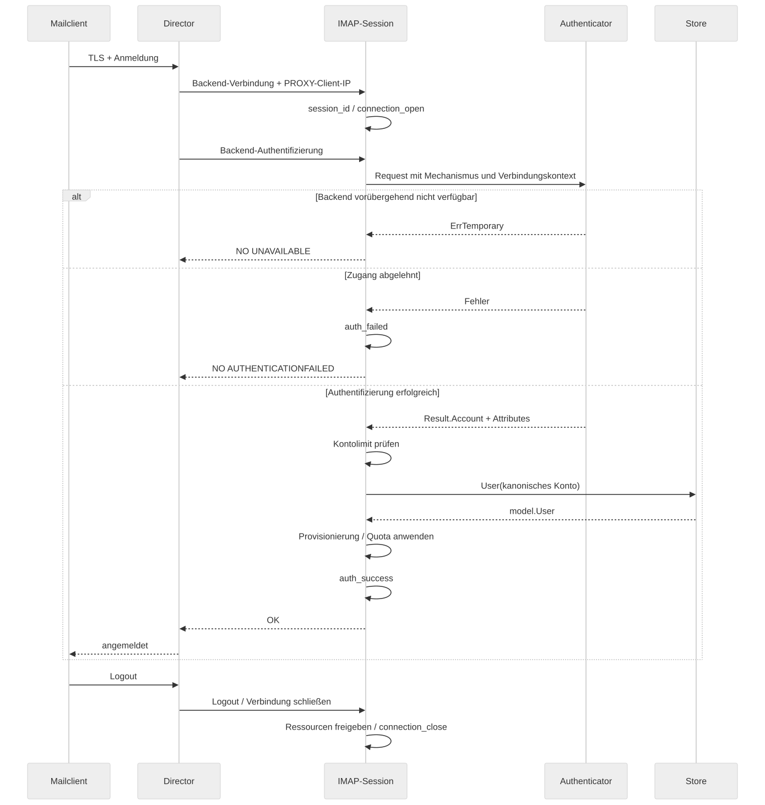
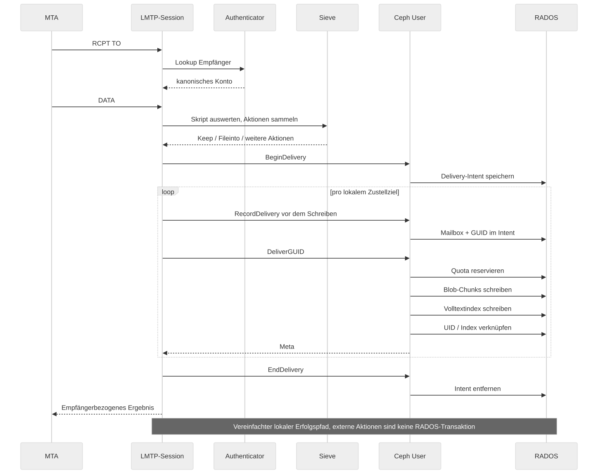

# Runtime, interfaces and protocol flows

[Documentation index](../README.md) · [Architecture](../../ARCHITECTURE.md)

## UML: the key contracts

The UML shows an excerpt of the Go contracts, not a complete API
reference. Method signatures are shortened for readability, error returns in
particular. In Go, implementation is implicit through method sets.
The authoritative, complete definition is [model.go](../../internal/model/model.go).

`auth.Authenticator` separates credential checking from protocol processing.
`Authenticate` returns the canonical account; `Lookup` resolves LMTP recipients
without a user password. `ErrInvalid` and `ErrTemporary` are different
results: a backend outage must not count as a definitely wrong password.
With Nauthilus the authenticator is layered
`MasterUser{Cache{Nauthilus}}`: the master-user check, then the auth
cache (`internal/auth/cache.go`: answers from memory, one shared backend
call for identical concurrent requests, flushed across the cluster
through the flush log `auth-flush` in the admin namespace), then the
Nauthilus client.

`model.User` is an account-bound view of mailboxes, messages,
scripts, metadata and quotas. The caller must call `Close()`.
Watches and leases have lifecycles of their own; a lost lease requires
protected changes to stop. The in-memory store is a test backend,
not proof of the error semantics of distributed RADOS operations.

The actual store types and adapters are in
[cephstore/store.go](../../internal/cephstore/store.go),
[memstore.go](../../internal/memstore/memstore.go) and
[main.go](../../cmd/shardpost/main.go).

## Processes

One image, three long-running commands: `shardpost serve` is the server
with every protocol listener, the admin API and — with `workers.run`
(the default) — the background workers; with `workers.run: false` it is
a front-end that keeps the APIs and the writers of the queues and runs
no worker. `shardpost runner` (0.52.0) is the background workers without
listeners: the job runner with the expiry and `fts_due` workers, the
upload expiry, the delayed submission worker and the learning worker,
registered with the role `runner`. `shardpost push` (0.52.0, partitioned)
is the JMAP push worker, a deployment of its own. The short-lived
commands (scrub, backfills, the system tools) register for their run.

## Startup and shutdown

1. `loadConfig` selects the file and the subcommand; `config.Load` merges
   defaults, YAML and explicitly set environment values and validates them
   (`config.LoadRunner` for the runner leaves the authentication secrets
   unread).
2. Once the configuration is valid, the JSON logger is set up with the chosen
   level. `config check` ends here without opening any services.
3. `run` sets up signal handling and telemetry. Ceph access comes from the
   configuration or from the Rook secret made readable through RBAC.
4. The store and the authenticator are opened; TLS keys, the Sieve and
   program configuration and the optional learning worker are connected.
5. The mail listeners and the HTTP endpoints are started. Without TLS
   configuration, no implicit TLS listeners are started.
6. On shutdown, readiness is disabled first. After a short
   propagation delay, services are stopped and IMAP/POP3 are drained within
   limits. Workers and tracing are stopped through the designated teardown
   functions.

`/healthz` reports that the HTTP process is responding. `/readyz` additionally
checks the drain state and Ceph reachability. Neither endpoint fully checks
Nauthilus, Sieve, the learning target or mailbox access.

## Login and session correlation

The diagram shows the backend path; the director and Nauthilus may perform
further checks in the frontend. The concrete backend login
depends on the director contract (for example master user or bearer replay).
The server only opens the account-bound store view after successful
authentication and the account limit check. Storage errors can still prevent a
login after the identity has been verified successfully.

Entry points: `newConn`, `serve`, `handleLine`, `authenticate`,
`finishLogin` in [imapproto/conn.go](../../internal/imapproto/conn.go).
SASL decoding lives in [auth/sasl.go](../../internal/auth/sasl.go),
backend selection in [cmd/shardpost/auth.go](../../cmd/shardpost/auth.go).

## IMAP states

The selected mailbox, the sequence numbers and the watches belong to the session.
`SELECT`/`EXAMINE` load a view; `EXAMINE` is read-only.
`CLOSE` may expunge marked messages, `UNSELECT` only ends the
selection. End of transport and shutdown can occur in any state.
The diagram condenses these abort paths into a transition to `Logout`.

`UNAUTHENTICATE` releases the account state and the watches but keeps the
transport and the logging session ID. A subsequent login must not inherit any
user attributes of the previous identity. `IDLE` is a waiting state here
within the selected mailbox, not an additional authentication status.

## LMTP delivery

Recipient resolution happens before DATA. LMTP can return different results for
individual recipients. Sieve produces an action plan;
several local targets are held together by one delivery intent.
`RecordDelivery` stores the mailbox and the pre-selected GUID **before** the
message is written. Only a successful `EndDelivery` permits the
positive completion intended for it.

The figure shows the local success path. Reject, discard, pipe,
redirect, vacation and notify have rules of their own. External effects
cannot be undone by a RADOS rollback. The complete
flow including the error paths is in
[lmtpd.go](../../internal/lmtpd/lmtpd.go) (`LMTPData`, per-recipient
status) and in the shared delivery service
[internal/delivery](../../internal/delivery/delivery.go) (Sieve, storing,
rollback, relay helpers), which the local delivery of the
[Admin API](../admin-api.md) uses as well.

## Events and learning jobs

For the prepared learning path, an independent copy of the message is persisted
before the target commit. Commit receipts connect the learning job and the
visible mailbox change. The worker checks them before the external call. An
EXPUNGE therefore cannot invalidate the already persisted learning copy.

`Delivered` separates external success from later cleanup. Even so,
a crash window remains between external success and recording it:
the call can be repeated. Exactly-once is not guaranteed.
Dead jobs are not successful jobs and require an operator decision.

The illustration focuses on `Prepare`/commit receipts. The code
also contains `Enqueue` for jobs queued directly without a prepared phase.
Details: [learning.go](../../internal/imapsieve/learning.go),
[RADOS queue](../../internal/cephstore/learning.go),
[Sieve behavior](../imapsieve.md).
