# Storage explained: ShardPost on Ceph, step by step

[Architecture](../../ARCHITECTURE.md) · [RADOS storage (reference)](storage.md) ·
[Operations](../operations/README.md) · [Observability](../observability.md)

This is a course, not a reference. It explains what ShardPost stores in
Ceph, how, and why — slowly, with pictures, in an order you can teach
to somebody else. Every chapter starts with what you will learn and ends
with a short recap. When you need the last detail, the chapter links to
the reference document that has it.

Written for ShardPost 0.52.0 on 2026-10-04. Object names, keys,
commands, configuration keys and defaults were checked against the code
of that version (`internal/cephstore`, `internal/config`,
`internal/jobs`, `internal/metrics`, `cmd/shardpost`,
`cmd/shardpostctl`). The examples use the made-up accounts
`alice@example.org` and `bob@example.org`.

**How to read it.** Chapters 1 to 3 build the picture: what Ceph is, how
ShardPost divides it, what one account looks like. Chapter 4 follows a
mail through the system. Chapters 5 and 6 explain how many servers work
together. Chapters 7 to 10 are for the operator: the programs, the daily
work, monitoring and sizing. Chapter 11 is a glossary; use it whenever
a word is new.

## Contents

1. [Ceph in five minutes](#1-ceph-in-five-minutes)
2. [The pools of ShardPost and why there are three](#2-the-pools-of-shardpost-and-why-there-are-three)
3. [What one account looks like in RADOS](#3-what-one-account-looks-like-in-rados)
4. [Walkthroughs: what happens, step by step](#4-walkthroughs-what-happens-step-by-step)
5. [Many servers, no central database](#5-many-servers-no-central-database)
6. [The store-wide state](#6-the-store-wide-state)
7. [Our programs and what they do to Ceph](#7-our-programs-and-what-they-do-to-ceph)
8. [The operator's job](#8-the-operators-job)
9. [Monitoring](#9-monitoring)
10. [Sizing rules of thumb](#10-sizing-rules-of-thumb)
11. [Glossary](#11-glossary)
12. [Where to read more](#12-where-to-read-more)

---

## 1. Ceph in five minutes

**What you will learn:** what a Ceph cluster is made of, how an object
finds its disk, the difference between replication and erasure coding,
what an object holds (data, xattrs, omap), and what RADOS, librados and
cephx are.

### 1.1 A warehouse with many shelves

Think of Ceph as a large warehouse.

- An **OSD** (object storage daemon) is one shelf with its own clerk:
  one process per disk that stores data and answers requests. A cluster
  has a few to hundreds of them.
- The **monitors** are the front office. They keep the floor plan of the
  warehouse (the *cluster map*: which OSDs exist, which are up) and check
  the ID cards of everybody who comes in (*cephx*, below). They do not
  carry boxes.
- A **pool** is a department with its own rules: how many copies of each
  box, which kind of shelf (fast NVMe or large HDD).
- An **object** is one labelled box. It has a name, like `mbox/7f3a…` or
  `msg/9c1e…/0`.
- A **namespace** is a label prefix inside a pool. Two boxes with the same
  name in different namespaces are different boxes. ShardPost gives every
  account its own namespace. A namespace organizes data; it is not a
  separate set of credentials (the server's Ceph user reaches all of
  them, see [storage.md](storage.md#physical-model)).
- A **placement group** (PG) is a numbered group of boxes. Ceph does not
  track every box individually; it hashes the box's name to a PG, and
  places whole PGs onto OSDs.

### 1.2 How an object finds its disk


1. The client logs in at a monitor and fetches the cluster map.
2. It hashes the object name and gets a PG number.
3. An algorithm called **CRUSH** computes, from the map, which OSDs hold
   that PG. Everybody computes the same answer; nobody has to ask.
4. The client talks to the first OSD of the set (the *primary*)
   directly. There is no gateway in the middle.
5. For a write, the primary forwards it to the other OSDs of the set
   and confirms only when they have it.

Two consequences matter for ShardPost:

- **There is no central lookup.** Ten servers can work on the same
  cluster without asking each other where things are.
- **Listing a namespace is expensive.** Because objects are placed by a
  hash, the objects of one namespace are spread over every PG of the
  pool. To list them, Ceph has to visit every PG. That is why ShardPost
  avoids listings in its everyday paths (chapter 5 and 6).

### 1.3 Replication and erasure coding


A pool keeps its data safe in one of two ways:

- **Replicated** (for example `size 3`): every object is stored three
  times on three OSDs. Simple and fast; costs three times the space.
  `min_size 2` means writes continue while one copy is missing.
- **Erasure coded** (EC, for example `k=2 m=1` or `4+2`): an object is
  cut into `k` data parts plus `m` parity parts, each on another OSD. Any
  `k` parts rebuild the object. Costs `(k+m)/k` the space — 1.5 for 2+1
  and 4+2 — but writes are more expensive, and an EC pool **cannot hold
  omap** (below).

### 1.4 What is inside an object

Every RADOS object can hold three things:

| Part | What it is | ShardPost example |
|---|---|---|
| Data | a byte stream, read and written by offset | the bytes of a message chunk `msg/<guid>/<n>` |
| xattrs | a few small named values | `refs` (reference count) and `len` (total size) on chunk 0 of a message |
| omap | a sorted key-value store attached to the object, kept in the OSD's RocksDB database | the entries `m:<uid>` of a mailbox object |

The omap is the important one for ShardPost: almost all of its
*index* — mailboxes, message entries, quota counters, the full-text
index — lives in omap keys. Omap can be read by key, by range (all keys
from `m:0000000100` on) and page by page.

**Large omap warning.** Ceph warns when one object has more than
200 000 omap keys (`osd_deep_scrub_large_omap_object_key_threshold`, a
Ceph default; ShardPost's docs and configuration use this value
throughout). The check runs during a deep scrub, so the warning
`LARGE_OMAP_OBJECTS` can appear days after the object grew. Much of
ShardPost's design is about keeping every object well below this line.

### 1.5 RADOS, librados, cephx

- **RADOS** is the object store at the bottom of Ceph: pools, objects,
  OSDs. ShardPost uses RADOS directly. It does **not** use the block
  device (RBD), the file system (CephFS) or the S3 gateway (RGW). The
  Rook manifests create the pools as `CephBlockPool` resources, but they
  are used as plain RADOS pools.
- **librados** is the client library. The `shardpost` binary links it
  (that is why it needs cgo and a matching `librados2`, see
  [Running without Kubernetes](../operations/README.md#running-without-kubernetes)).
- **cephx** is Ceph's authentication. ShardPost logs in as one Ceph user
  (`ceph.user`, default `shardpost`) with read, write and execute rights
  on its pools. "Execute" is needed for *object classes*: small programs
  that run inside the OSD, like `cls_lock` for locks.

Three more RADOS features ShardPost relies on, explained in chapter 5:

- every object has a **version** that changes with each write; a write
  can say "only if the version is still N" (*assert version*);
- **watch/notify**: a client can watch an object and is woken when
  somebody notifies it;
- **one object, one atomic step**: several changes to *one* object in one
  operation either all happen or none. There is no transaction across
  two objects.

**Recap.** Ceph is a warehouse of OSDs, organized in pools; objects are
hashed to PGs and PGs are placed on OSDs by CRUSH, so clients go straight
to the right disk. Replicated pools can hold omap, erasure coded pools
cannot. An object holds data, xattrs and omap; ShardPost keeps its index
in omap and its message bytes in data. Changes are atomic per object,
never across objects. Listings are expensive.

---

## 2. The pools of ShardPost and why there are three

**What you will learn:** which pools ShardPost uses, what goes where and
why, which namespaces exist, and how the cluster knows whether the
store-wide state lives in its own pool.

### 2.1 Three pools


| Pool (default name) | Configuration key | Holds | Type |
|---|---|---|---|
| `shardpost-index` | `ceph.index_pool` | the accounts' index objects (omap): mailboxes, entries, quota, full-text index, Sieve scripts | replicated |
| `shardpost-data` | `ceph.data_pool` | message blobs (`msg/<guid>/<n>`) and the learning copies | erasure coded or replicated |
| `shardpost-system` | `ceph.system_pool` (empty by default) | the store-wide state: admin store, account directory, queues, locks, server METADATA | replicated |

Why split it like this?

- **Index and data behave differently.** The index is many small keys,
  read and rewritten all the time; it needs omap, so it must be
  replicated, and it likes fast disks. Message bytes are large, written
  once and never changed; they can live on large disks in an erasure
  coded pool, which saves space. A blob is never overwritten, so the data
  pool does not even need `allow_ec_overwrites`
  ([Ceph side](../operations/README.md#ceph-side)).
- **The store-wide state is small and hot.** A few hundred objects that
  every server polls, watches or locks (job queues, worker locks, the
  auth flush log). With `ceph.system_pool` it gets a replicated pool of
  its own on fast OSDs, apart from the millions of account objects. The
  operations guide estimates well under 5 GB for it at a million accounts
  ([Pool sizes](../operations/README.md#pool-sizes-for-a-large-cluster)).

The default chunk size of message blobs is 4 MiB (`ceph.chunk_size`).
Do not change it casually while data exists: readers compute chunk
offsets from it ([storage.md](storage.md#physical-model)).

### 2.2 The namespaces

Inside the pools, the namespace says whose data it is:

| Namespace | Pool(s) | What |
|---|---|---|
| the canonical account name, e.g. `alice@example.org` | index and data | everything of one account |
| `~public` | index and data | the public folders (they belong to no account) |
| `~admin` | system (or index) | the admin store: jobs, plans, marks, registrations, push and submission state, the auth flush log |
| `~accounts` | system (or index) | the account directory and the store-wide queues |
| `~learning` | system (or index) for the queue indexes, data for the copies | the IMAPSieve learning queue |
| `~server` | system (or index) | the server METADATA entries |

Names starting with `~` are reserved. The store refuses to open an
account with an empty name or a reserved name other than these five
(`Store.User`, see [storage.md](storage.md#store-wide-sorted-indexes-and-the-account-directory)).

### 2.3 The old layout: no system pool

Before 0.47.0 — and today on every cluster whose `ceph.system_pool` is
empty — the four system namespaces live in the **index pool**. Nothing
else changes; the objects have the same names. The system pool is an
optimization for large clusters, not a requirement.

A cluster has exactly **one** placement, and the data says which, not
the configuration:

- the **fence** `system.moved` in `~admin` of the index pool says "the
  state has moved, and to which pool";
- the **mark** `system.pool` in `~admin` of the system pool says "this pool
  holds the state of that index pool and cluster".

Every `shardpost` process reads both when it opens the store (two reads,
no listing) and refuses to start when they contradict its configuration.
Servers and push workers repeat the check every minute; a contradiction
ends the process after draining (`event=system_placement_lost`), a read
that fails only logs a warning. `shardpost system init` creates fence and
mark for a new cluster, `shardpost system migrate` moves an existing
cluster in a maintenance window (chapter 8). Details:
[System pool and placement](storage.md#system-pool-and-placement).

**Recap.** Three pools: index (omap, replicated, fast), data (blobs,
usually erasure coded, large), system (store-wide state, replicated,
fast, optional). Each account is a namespace in index and data; the
store's own state uses four `~` namespaces. Without a system pool those
live in the index pool. A fence and a mark decide the placement, and
every process checks them.

---

## 3. What one account looks like in RADOS

**What you will learn:** every object of the account `alice@example.org`,
what its keys mean, how a message is found from a mailbox name, and how
big things can get.


### 3.1 The registry: `mailboxes`

Think of it as the account's table of contents. One omap object,
`mailboxes`, in the account's namespace of the index pool:

| Key | Meaning |
|---|---|
| `m:<name>` | a mailbox name, e.g. `m:INBOX`; the value is a record with the stable **mailbox id** |
| `q:bytes`, `q:msgs` | the quota **usage** of the account (bytes, messages) |
| `q:lbytes`, `q:lmsgs` | a quota **limit** set with `SETQUOTA` (the usual limit comes from the user database, see [quota](../quota.md)) |
| `uv:<name>` | the last UIDVALIDITY used for a name |
| `sub:<name>` | a subscription to a name without a mailbox |
| `d:…` | delivery intents of a delivery to several mailboxes |
| `bi:`, `qi:`, `bimp:`, `up:`, `sub:<guid>`, `ci:`, `dm:`, `ps:` | intents: notes "I am in the middle of something" (chapter 5) |

The mailbox name is only a key here. The mailbox's own objects are named
by its id, so a RENAME changes one registry key and moves no data.

### 3.2 The mailbox: `mbox/<id>` and its shards

Each mailbox has one object `mbox/<id>`, called **shard 0**. It holds
the mailbox header and the first messages:

| Key | Meaning |
|---|---|
| `h:uidnext`, `h:uidvalidity`, `h:modseq` | the IMAP counters: next UID, UIDVALIDITY, highest MODSEQ |
| `h:keywords`, `h:recent`, `h:shardsize`, `h:logstart` | keywords in use, the `\Recent` mark, the shard size, the start of the change log |
| `m:<uid>` | one **entry** per message, the UID with ten digits (`m:0000000042`); the value is the message's index record: GUID, size, chunk count, flags, dates, envelope, preview |
| `c:<modseq>`, `v:<modseq>` | the change log and the log of vanished (expunged) UIDs, for CONDSTORE/QRESYNC |
| `i:…`, `r:<uid>` | MOVE intents and removal intents (chapter 4.3) |

A mailbox with many messages gets more objects: `mbox/<id>/1`,
`mbox/<id>/2`, … The rule is

```
shard = (uid - 1) / shard size
```

with the shard size from `server.mbox_shard_size` (default 100 000),
written into the header when the mailbox is created and fixed after
that. So UIDs 1–100 000 are in `mbox/<id>`, 100 001–200 000 in
`mbox/<id>/1`, and so on. No object ever holds more than 100 000 entries.

### 3.3 The messages: `msg/<guid>/<n>` in the data pool

Every stored message gets a **GUID**, 16 random bytes written as 32 hex
digits. Its bytes go into the data pool, same namespace:

- `msg/<guid>/0` — the first 4 MiB, plus the xattrs `refs` (how many
  mailbox entries point at this blob) and `len` (the total size);
- `msg/<guid>/1`, `msg/<guid>/2`, … — further 4 MiB chunks.

A 10 MiB message is three objects; a 5 KiB message is one. Blobs are
written once and never changed. COPY within the account adds an entry
and raises `refs`; it does not copy the bytes.

### 3.4 The account change log: `account`

JMAP asks "what changed anywhere in this account since state N?". The
object `account` answers it:

| Key | Meaning |
|---|---|
| `h:seq` | the account counter (the newest sequence) |
| `h:logstart` | the oldest sequence still in the log |
| `p:<seq>` | a change announced but not yet recorded |
| `a:<seq>` | a recorded change: kind, operation, mailbox, messages |

The log keeps `server.account_log_retention` entries (default 10 000).
JMAP push workers and IMAP NOTIFY watch this object.

### 3.5 The full-text index

Search would be far too slow if every SEARCH read every message. So
every delivery also writes a full-text index. Since 0.46.0 new indexes
use **layout 3** (once the cluster mark `fts/layout3` is set):

| Object | What |
|---|---|
| `ftsmap` | the id map: GUID ↔ document id (`g:<guid>`, `i:<id>`, `n`), the **layout record** `L` naming the current *generation*, the version marker `V` |
| `ftx/<gen>/p<i>` | posting lists: for each term (`s:invoice` = word "invoice" in the subject) the documents that contain it |
| `ftx/<gen>/d<j>` | the trigram dictionary for substring search: `voi:s:invoice` says "invoice" contains "voi" |
| `ftx/<gen>/h<k>` | the decoded header text of each message, compressed |

`<gen>` is a random 16-hex-digit token. A new account starts with **one**
object of each kind (`fts.shards_min`, default 1). When the objects
outgrow their target (`fts.shard_target_keys` and
`fts.dict_target_keys`, 100 000 keys each), the account is
**resharded**: a new generation with more objects is built and the
layout record is switched to it (chapter 8).

Older accounts may still have **layout 2**: `fts/<nn>` (16 posting
shards, `server.fts_shards`), `ftst/<nnn>` (256 dictionary shards),
`ftsh/<nn>` (header texts). Same keys, many more objects: about 284
full-text objects per account against 4 in a small layout 3 account
([storage.md](storage.md#full-text-index-layout-3)).

The full-text index does **not** count against the quota.

### 3.6 The rest

| Object | What |
|---|---|
| `sieve` | the Sieve scripts (`s:<name>` keys) and the active one (xattr `active`) |
| `metadata` | IMAP METADATA annotations of the account |
| `scrub` | candidates and state of the scrubber |
| `ix/<space>/<nn>` | front-end indexes that can always be rebuilt, today the JMAP locator (GUID → mailbox and UID), 32 shards |
| `pubseen/<id>` | the account's private `\Seen` marks in public folder `<id>` |

### 3.7 Following a message from name to bytes

To read message UID 42 of alice's INBOX:

1. read `m:INBOX` in `mailboxes` → mailbox id `7f3a…`;
2. compute the shard: `(42 - 1) / 100000 = 0` → object `mbox/7f3a…`;
3. read key `m:0000000042` → GUID `9c1e…`, size, chunk count;
4. read `msg/9c1e…/0` (and further chunks) in the data pool.

Four small steps, no listing, no central lookup.

**Recap.** One account = one namespace in two pools. The registry
`mailboxes` maps names to stable ids and holds the quota. Each mailbox
is `mbox/<id>` plus higher shards of 100 000 entries. Each message is
one or more 4 MiB chunks `msg/<guid>/<n>` with a reference count. The
`account` object is the JMAP change log, `ftsmap` and `ftx/…` are the
full-text index.

---

## 4. Walkthroughs: what happens, step by step

**What you will learn:** which objects are read and written when a mail
arrives, when a client reads and searches, when messages are copied,
moved and expunged, when a mailbox is deleted, and when a user logs in.

A note on the abbreviation used below: **CAS** (compare-and-swap) means
"read the object with its version, compute, write only if the version is
unchanged, otherwise try again". Chapter 5 explains it.

### 4.1 A mail arrives

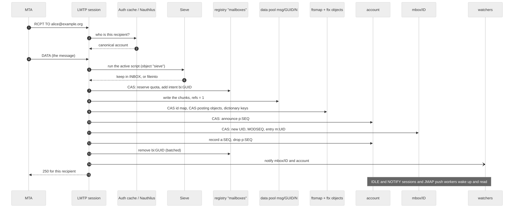

The MTA hands the message to ShardPost over **LMTP**.

1. **Who is the recipient?** The LMTP session asks the auth cache, which
   asks Nauthilus on a miss, for the canonical account (here
   `alice@example.org`). An unknown recipient is refused before the
   message is even sent.
2. **Sieve.** The session reads the account's `sieve` object and runs the
   active script (plus global scripts). The result is a list of actions:
   keep in INBOX, `fileinto` other mailboxes, redirect, vacation.
   If the message goes into several mailboxes, a **delivery intent**
   (`d:` in the registry) is written first, naming each target and GUID.
3. **Reserve.** One CAS on the registry: check the quota, add the size to
   `q:bytes` and 1 to `q:msgs`, and in the same write add the intent
   `bi:<guid>` ("a blob is about to be written"). Over quota: LMTP
   answers `552 5.2.2 Mailbox full`.
4. **Write the blob.** The chunks `msg/<guid>/0..n` go into the data pool,
   with `refs = 1` and `len` on chunk 0.
5. **Index the text.** One CAS on `ftsmap` allocates the document id,
   then one CAS per posting object the message's terms fall into, then
   the dictionary keys of new terms (plain writes: setting a key twice
   changes nothing).
6. **Announce** the change in the account log: `p:<seq>` on `account`.
7. **Link.** A CAS on the mailbox object: allocate the next UID and
   MODSEQ, write the entry `m:<uid>` (on shard 0 in the same CAS; on a
   higher shard in two phases, see [storage.md](storage.md#writing-a-message)).
8. **Record** the change: `a:<seq>` replaces `p:<seq>`.
9. **Clean up.** The intent `bi:<guid>` is removed, batched with the next
   registry write where possible.
10. **Wake the watchers.** A notify on `mbox/<id>` and on `account` wakes
    IDLE sessions, NOTIFY sessions and JMAP push workers on any server.
11. **Answer.** `250` for this recipient.

The order is the point: the blob is written **before** the entry that
points at it, so no client ever sees an entry without data. If anything
fails before the link, the session gives back the quota and deletes the
blob. If the process dies in the middle, the intents tell the scrubber
what to clean (chapter 5.5). Any storage error is answered
`451 4.3.0 Temporary storage failure`, so the MTA retries.

What it costs: in layout 3 with one object of each kind, about 21 RADOS
operations per delivery (10.3 reads, 10.4 writes, `TestHotPathOps` on the
test cluster, [storage.md](storage.md#full-text-index-layout-3)); the
bench measured 24.2 ([0.45.0 report](../reports/2026-10-02-shardpost-0.45.0.md)).
In layout 2 it was 245.6, of which the full-text index made 225
([R4 measurement](../reports/2026-10-02-r4-measurement.md)). The
full-text part of a layout 3 delivery is about `2·S + D + 1` operations
(S posting objects, D dictionary objects), so a large, resharded account
pays more per delivery than a small one.

### 4.2 A client reads and searches

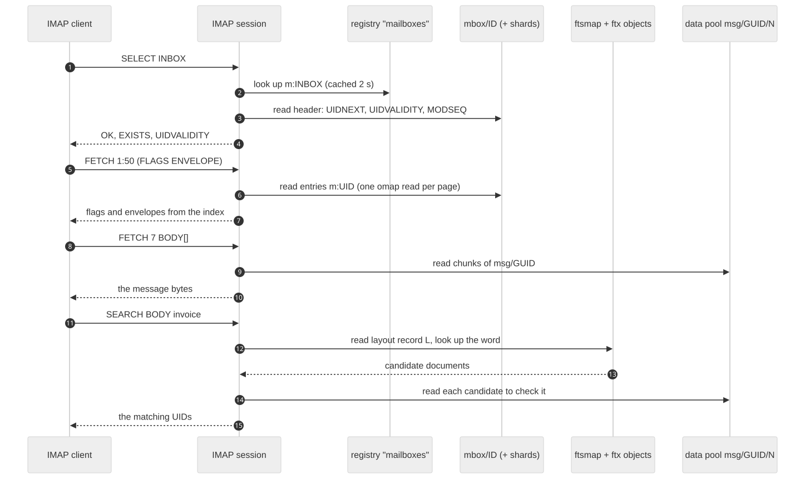

- **Opening the account** costs nothing in Ceph by itself (`Store.User()`
  sends no operation); the account, its mailbox list and the INBOX state
  cost 4 reads ([R4 measurement](../reports/2026-10-02-r4-measurement.md)).
- **SELECT** reads the registry key of the name (cached for two seconds)
  and the header keys of `mbox/<id>`.
- **FETCH** of flags or envelopes reads only entries `m:<uid>` from the
  index: the envelope and preview are stored in the entry. A FETCH of the
  body reads the chunks from the data pool.
- **SEARCH** of text asks the full-text index for *candidates*: the
  layout record `L` names the generation, the dictionary and posting
  objects give the documents that may contain the words. By default
  (`fts.imap_search: substring`) every candidate is then checked against
  the stored header text or the message itself, because IMAP requires
  exact substring matches. JMAP and the admin search use the index alone.
  Details: [Notifications and search](storage.md#notifications-and-search).
- **IDLE** watches `mbox/<id>`; **NOTIFY** watches `account`. All
  sessions of one server share one RADOS watch per object (the *watch
  hub*), so a thousand sessions on INBOX of one account cost one watch.

### 4.3 Copy, move and expunge

**COPY** inside the account: one new entry in the target mailbox and
`refs + 1` on the blob (a CAS on the xattr of `msg/<guid>/0`). No bytes
are copied. A copy into *another* account writes a new blob in that
account's namespace: blobs never cross namespaces.

**MOVE** is copy-then-remove with a safety net: a MOVE intent `i:` on the
source mailbox, `refs` raised for the moment, the target linked, the
source entry removed, the extra reference released. The net reference
count is unchanged. A crash leaves the intent for the scrub.

**EXPUNGE** removes entries and gives the blob back:

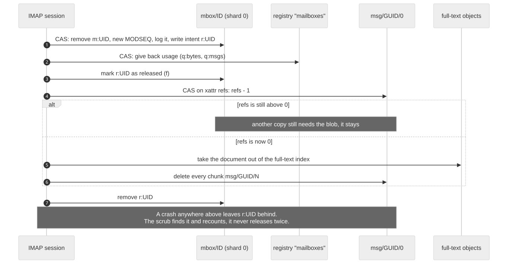

1. A CAS on shard 0 removes the entry, raises the MODSEQ, logs the
   change and writes the **removal intent** `r:<uid>` (with GUID, size
   and chunk count).
2. A CAS on the registry gives the usage back (`q:bytes`, `q:msgs`).
3. One write marks `r:<uid>` as released (field `f`).
4. A CAS on the `refs` xattr lowers it by one.
5. Only when `refs` reaches 0: the document leaves the full-text index
   and every chunk is deleted.
6. `r:<uid>` is removed.

A crash between these steps leaves `r:<uid>`. The scrubber never
"releases again" (that could take a blob away from a copy in another
mailbox); it **recounts** every reference instead
([storage.md](storage.md#intents-debris-that-a-scrub-finds-without-listing)).

`\Deleted`, a Trash mailbox and physical deletion are three different
things: only EXPUNGE (or the `expunge` job) removes data, and it is
gone. There is no recycle bin in the store.

### 4.4 A mailbox is deleted

IMAP DELETE (or the `mailbox_delete` job for big trees):

1. one CAS on the registry removes the name and writes the **tombstone**
   `dm:<id>` (with UIDNEXT and the shard size);
2. the header of shard 0 is **retired** (`h:uidnext` set to 0, the old
   value kept), so a delivery that looked the mailbox up a moment ago can
   no longer add a message;
3. every entry's blob reference is released, the usage given back;
4. the shards are deleted, highest first, shard 0 last; then the
   tombstone goes.

Because of the tombstone, a crash in the middle is finished by the
scrub. With the cluster mark `mailbox/lock` (0.52.0) the job locks only
the mailboxes it removes instead of the whole account
([Online quota recount and the mailbox lock](storage.md#online-quota-recount-and-the-mailbox-lock-0520)).

### 4.5 Login, briefly

A login is mostly **not** a Ceph event. The protocol asks the auth cache;
on a miss the cache asks Nauthilus. The cache keeps an answer for
`auth.cache.ttl` (30 s), lookups for LMTP for `auth.cache.lookup_ttl`
(30 s). The only shared state in Ceph is the flush log `auth-flush` in
`~admin`: `shardpostctl auth flush <account>` writes it, and every server
watches it and drops its cached entries. After a successful login the
session opens the account (chapter 4.2). See
[Auth cache](../operations/README.md#auth-cache).

**Recap.** Delivery: reserve with an intent, write the blob, index the
text, link the entry, record the change, notify. Reading: registry →
mailbox → entry → blob. Search: index candidates, then a check. COPY
raises a reference count, EXPUNGE lowers it, the last reference deletes
the bytes. Every multi-step change leaves an intent behind if it dies.

---

## 5. Many servers, no central database

**What you will learn:** how many ShardPost processes can change the
same account at the same time without a database server, why a crash
never leaves a broken account, and which mechanisms do it.


### 5.1 Compare-and-swap on one object

RADOS makes one object change atomic. ShardPost builds every shared
counter on that:

1. read the keys **and** the object version;
2. compute the new value (UIDNEXT + 1, `q:bytes` + size, …);
3. write it with *assert version*: "only if the object is still at that
   version";
4. if somebody else wrote in between, the write fails; read again and
   decide again.

Two deliveries to alice's INBOX on two servers can both read UIDNEXT 43;
one wins and writes 43, the other fails, re-reads 44 and writes 44. No
UID is ever given twice. A writer that loses waits a random 1 to 10 ms
times the rounds it lost and gives up after 16 rounds. Every lost round
is counted in `imapceph_rados_cas_retries_total{kind,class}`.

### 5.2 Two objects: announce, write, record

CAS works for one object. A change that spans two objects — a higher
mailbox shard and its header, or the mailbox and the `account` log — is
done in phases: first *announce* it in one object (`p:<seq>` in
`account`, a pending record in the header), then write, then *record*
and drop the announcement. Readers never move past an announcement that
has no record yet, so a JMAP state token or an IMAP MODSEQ never skips a
change that is still being written. An announcement whose writer died is
turned into a partial entry after 60 seconds
([The account change log](storage.md#the-account-change-log)).

### 5.3 Watch and notify: wake-ups, not messages

A watch is a doorbell, not a letter. The writer rings, the watcher looks
for itself. If a notify is lost, nothing is lost: the client sees the
change at its next command, and NOTIFY sessions also read the account
log every 60 seconds on their own. Watches in use:

| Object | Who watches | Who notifies |
|---|---|---|
| `mbox/<id>` | IMAP IDLE (selected mailbox) | every write to the mailbox |
| `account` | IMAP NOTIFY, JMAP push workers | every account log record |
| `auth-flush` (`~admin`) | every server | `shardpostctl auth flush` |
| shard 0 of `ix.jobs/claimable` | job runners | a new job, a release at shutdown |
| shard 0 of the learning and submission queues | their workers | a new entry |

`imapceph_imap_watches{object}` and `imapceph_imap_watch_rearms_total`
show the watches of a server.

### 5.4 Locks and leases

Some work must run on exactly one process at a time.

- **`cls_lock`** is a lock that lives in the OSD, on an object, with a
  time to live. The holder renews it; if the holder dies, the lock
  expires. Used by the store-wide workers (the job expiry worker on
  `ix.jobs/expiry/lock`, the learning worker on
  `mbox/learning-worker`, the delayed submission partitions, the 64
  JMAP push partitions `ix.jmap/push/p<nn>/lock`), the backfills, the
  sweep, and the POP3 maildrop lock (lock `maildrop` on the INBOX object).
- **Leases in records.** A job record carries its lease (`Lease.Gen`,
  `Lease.Until`); a runner claims it by CAS on the record and renews it
  with heartbeats. A runner that dies loses the lease, and another takes
  the job over from its last checkpoint.
- **The account lock** is a key in the account's registry. Imports and
  exclusive jobs (`purge`, offline `fts_rebuild`, …) take it. While it is
  held, IMAP and POP3 answer "Mailbox maintenance in progress", LMTP
  answers `451 4.2.1`, and open sessions are disconnected within five
  seconds ([shardpostctl-job(1)](../man/man1/shardpostctl-job.1)).

A lock is advisory: the CAS on the data is always the final fence. If a
lock is lost at the wrong moment, the CAS still refuses a stale write.

### 5.5 Intents: why a crash leaves nothing broken

Between two writes to two objects, a process can die. Without care,
that leaves a blob nobody points at, or a mailbox object without a name.
ShardPost therefore follows one rule: **before** a write that could leave
debris, it records an **intent** in an object the scrub reads anyway, and
removes it **after** the write.

| Intent | Where | Says |
|---|---|---|
| `bi:<guid>` | registry | a blob is being written for a delivery, APPEND, Sieve `fileinto`, COPY into another account |
| `ci:<id>` | registry | a mailbox object is being created |
| `dm:<id>` | registry | a mailbox is being deleted (tombstone) |
| `d:…` | registry | a delivery to several mailboxes is running |
| `i:…` | mailbox shard 0 | a MOVE is running |
| `r:<uid>` | mailbox shard 0 | an entry was removed, its blob reference not yet released |
| `up:`, `sub:`, `bimp:`, `qi:`, `ps:` | registry | a JMAP upload, a delayed submission copy, an import step, a quota-relevant COPY/MOVE/rename, private `\Seen` marks of a public folder |

An intent older than `scrub.intent_grace_seconds` (3600 s) belongs to a
write that will not finish. The scrub settles it against what the
account's index actually says: a referenced blob is fine, an
unreferenced old one is deleted, references are recounted rather than
released twice. The full table is in
[storage.md](storage.md#intents-debris-that-a-scrub-finds-without-listing).

Intents use the writer's clock. **All servers need NTP**: a clock that is
behind by more than the grace period could make the scrub take a running
write for a crash.

**Recap.** CAS on one object makes counters safe. Announce-write-record
spans two objects. Watch/notify wakes people up, nothing more. Locks
pick a single worker, leases move jobs between runners, the account lock
keeps protocols out during maintenance. Intents turn every crash into a
to-do list for the scrub.

---

## 6. The store-wide state

**What you will learn:** what lives outside the accounts, why it is
organized as indexes and queues, and which processes use it.


### 6.1 Why indexes and queues

A server must not list a namespace to find work: a listing visits every
PG of the pool (chapter 1.2). So everything that has to be found again
is in a **sorted index** or a **due queue**:

- a **sorted index** `ix.<name>/head` plus `ix.<name>/<nn>` shard objects:
  one omap key per entry, the shard chosen by a hash of the id;
- a **due queue**: keys `<due time>/<id>/<gen>`, so a worker finds what
  is due by reading the first page of a few shard objects.

`imapceph_rados_listings_total{site}` counts the listings that remain,
by call site: a routine path that lists shows up there at once.

### 6.2 `~admin`: the admin store

One object per record, `kv.<key>`:

| Record | What |
|---|---|
| `kv.job/<id>`, `kv.plan/<id>`, `kv.idem/<hash>` | maintenance jobs, their plans, idempotency keys |
| `kv.servers/<instance>` | **registrations**: every process registers with version and capabilities and renews every minute; deleted 24 hours after the last heartbeat |
| `kv.fts/layout3`, `kv.fts/dictfilter`, `kv.fts/online`, `kv.quota/online`, `kv.mailbox/lock` | **cluster marks**: switches set by `shardpostctl … enable -pods n` once every running process reports the capability |
| `kv.jmap/push/acct/<account>`, `kv.jmap/push/seen/<account>`, `kv.jmap/push/lease` | JMAP push subscriptions and the push workers' state |
| `kv.jmap/sendq/<account>/<id>` | delayed JMAP submissions |
| `kv.fts_due/<account>` | the reshard job the `fts_due` worker planned |

Beside them: hint indexes (`ix.job`, `ix.plan`, `ix.idem`,
`ix.jmap/push/acct`, `ix.servers`), the due queues `ix.jobs/claimable`
and `ix.jobs/expiry`, the submission queue `ix.submission`, the push
partition locks, members and control objects, and `auth-flush`. With
`admin.kv_index: read` (the default, once `shardpost index backfill kv`
completed or `shardpost system init` set its marker) no running path
lists `~admin`
([Admin store](storage.md#admin-store-hint-indexes-and-due-queues)).

### 6.3 `~accounts`: the account directory and queues

- **The account directory** `ix.accounts` (256 shards): one entry per
  account that has a registry, with `state` (`active` or `purging`) and
  the record of the last batch scrub. Batches over all accounts and the
  nightly scrub walk it instead of listing pools. It is written once per
  account lifetime, when the registry is created.
- `ix.uploads` (expiring JMAP uploads), `ix.purged` (purged accounts for
  the sweep), `ix.fts_layout` (accounts with a layout 3 index),
  `ix.fts_due` (accounts waiting for a reshard).
- `sweep/state`, `sweep/lock`, `sweep/<run>/…` — a sweep in progress;
  these always stay in the index pool.

### 6.4 `~learning` and `~server`

`~learning` holds the learning queue: the copies `learning/<id>` in the
data pool (message plus job as xattr), and in the system (or index) pool
the due queue `ix.learning`, the owner index `ix.learning/owner` and the
worker lock on `mbox/learning-worker`. `~server` holds one object,
`metadata`: the server METADATA entries.

**Recap.** Store-wide state lives in four namespaces: `~admin` (jobs,
marks, registrations, push and submission state), `~accounts` (the
directory and queues), `~learning`, `~server`. Everything that has to be
found again sits in sorted indexes and due queues, so no running path
needs a listing.

---

## 7. Our programs and what they do to Ceph

**What you will learn:** every program and command that touches Ceph,
what it reads and writes, how heavy it is, and when to use it.


### 7.1 Long-running processes

| Program | What it does | Touches in Ceph | Weight | When |
|---|---|---|---|---|
| `shardpost` (no command: it serves) | IMAP, POP3, LMTP, ManageSieve, JMAP, the admin API; also the background workers unless `workers.run: false` | accounts in index and data; registration, auth flush, job queue writes, account directory entries; with workers also everything of `shardpost runner` | the main load: per delivery about 21–25 operations in layout 3 | always |
| `shardpost runner` (0.52.0) | the background workers without listeners: job runner with the expiry and `fts_due` workers, upload expiry, delayed submission worker, learning worker | job records and queues in `~admin`, the directory and queues in `~accounts`, `~learning`; per job the accounts it works on | follows the jobs; batches and reshards can be heavy | optional, for large clusters ([Job runners](../operations/README.md#job-runners)) |
| `shardpost push` | JMAP Web Push: 64 partitions shared by the push pods | watches `account` objects of accounts with subscriptions, reads their logs; partition locks, members and `kv.jmap/push/*` | one watch per watched account, reads per change | when JMAP push is offered; two or more pods |

### 7.2 One-shot commands of the server binary

These run with the server's image, configuration and Ceph credentials,
usually as a Kubernetes Job or CronJob. They talk to Ceph directly, not
through a server.

| Command | Reads / writes | Weight | When |
|---|---|---|---|
| `shardpost scrub --batch` | submits one batch job (`scrub` with `skip_idle`) to the admin store and exits; the job runners do the work | the job: per account a few omap reads when idle, a full check otherwise; with `scrub.orphan_source` `listing` or `shadow` (the default) also a listing of the account's namespace in both pools | nightly (the CronJob) |
| `shardpost scrub` | scrubs `scrub.users`, else every account of the directory, in its own process | as above, but in one process | for chosen accounts |
| `shardpost scrub --sweep [--repair] [--restart]` | lists **both pools in every namespace**, spills names into `~accounts/sweep/…`, compares with each account's data model; `--repair` deletes remnants older than `scrub.grace_seconds` | heavy: a walk over every PG of both pools | once after upgrades that leave old debris, after purges with `purge.listing: false`; report first, then `--repair` |
| `shardpost index backfill accounts` | lists the index pool once, enters missing accounts into the directory, repairs entries | one listing plus one stat per account | once after the directory rollout, or to repair |
| `shardpost index backfill kv` | lists `~admin` once, writes hint index and queue entries | one listing of `~admin` | once after rollout; again when `imapceph_kv_index_errors_total` rises |
| `shardpost index backfill learning` | lists `~learning` once, writes queue and owner entries | one listing of `~learning` | once after rollout; again when its error counter rises |
| `shardpost index show kv` / `show learning` | reads the indexes and queues (read-only) | reads every queue entry | diagnosis |
| `shardpost system status / init / migrate / verify / abort / revert / cleanup` | the placement tools: fence, mark, copies of the four system namespaces, quarantine | init: small; migrate: copies every system object, in a window with every process stopped | once per cluster ([shardpost-system(1)](../man/man1/shardpost-system.1)) |
| `shardpost bench populate / measure` | fills and measures **bench pools of its own**; refuses the production pools | heavy on the bench pools only | capacity planning ([Bench](../operations/bench.md)) |
| `shardpost config check` | validates the configuration; no Ceph access | none | before every rollout |

### 7.3 `shardpostctl`

`shardpostctl` never talks to Ceph. It calls the admin API of a server
(Unix socket in the pod, or mutual TLS) and the server does the work.
The main command groups and their effect on storage:

| Group | Typical commands | Effect on Ceph |
|---|---|---|
| `server` | `server list` | reads registrations |
| `account` | `account show`, `account list`, `account directory`, `account repair` | reads the directory and registry; `repair` fixes a directory entry |
| `quota` | `quota online status\|enable\|disable` | reads registrations, sets the cluster mark `quota/online` |
| `mailbox`, `acl`, `message`, `sieve` | list, create, rename, flag, copy, move, scripts | the same reads and writes as IMAP would do |
| `plan`, `apply`, `check`, `job` | plan a job, run it, watch it | writes plan and job records; the job does the work (7.4) |
| `learning` | inspect and retry learning jobs | the learning queue |
| `export`, `archive verify`, `restore` | stream an account into an archive, check it, import it back | export: reads every message; restore: an import under the account lock |
| `migrate` | copy an account from another IMAP server, keeping UIDs | writes like a delivery, in batches, under the account lock; may reshard the full-text index between batches |
| `deliver` | deliver one message like an LDA | one delivery |
| `auth flush` | flush the auth cache | one write to `auth-flush` |
| `fts` | `fts layout3\|dictfilter\|online status\|enable\|disable`, `fts layout show\|clear`, `fts layout3 list`, `fts stats` | marks and reads; `fts stats` reads S + 1 objects, `-exact` reads every index object |
| `trace`, `submission` | protocol trace, delayed submissions | small records |

Each group has a manual page under [`docs/man/man1/`](../man/man1/).

### 7.4 The jobs

Jobs are records in `~admin`; job runners claim and run them; a plan
computed first is applied once ([shardpostctl-job(1)](../man/man1/shardpostctl-job.1)).
"Locks" means the account lock of chapter 5.4: deliveries get `451`
for the duration.

| Kind | What it does in Ceph | Locks | Weight | When |
|---|---|---|---|---|
| `index_check` | reads the account's index objects and reports findings; repairs nothing | no | reads per mailbox | diagnosis (`shardpostctl check`) |
| `scrub` | checks and repairs references, intents, quota, orphans | no (repairs under a scrub mark) | per account: omap reads, plus listings unless `scrub.orphan_source: intents` | nightly as a batch; per account after trouble (`plan scrub <account>`, `apply`) |
| `quota_recalc` | counts the usage from the index and writes `q:bytes`/`q:msgs` | offline yes; online no (mark `quota/online`) | reads every entry | after quota drift |
| `acl_reconcile` | writes or removes share pointers | no | small | after ACL trouble |
| `fts_rebuild` | drops the full-text index and indexes every message again | offline yes; online no (mark `fts/online`) | reads every message | to change the text preparation, after a damaged index |
| `fts_layout` | converts layout 2 ↔ 3 or reshards a layout 3 index (copies the postings) | offline yes; online no | reads and writes the whole index of the account | reshards (usually by the `fts_due` worker), conversion |
| `fts_dict_convert` | rewrites a pre-0.35.0 layout 2 dictionary (legacy) | no | index of the account | only for old layout 2 indexes |
| `attachment_backfill` | reads messages without an attachment flag and records it | no | reads those messages | once for old messages (JMAP) |
| `mailbox_name_convert` | renames mailboxes stored in modified UTF-7 | yes | small | once for old accounts |
| `mailbox_delete` | deletes a mailbox tree (chapter 4.4) | offline the account; with mark `mailbox/lock` only the mailboxes | releases every blob of the tree | large mailbox trees |
| `expunge` | removes chosen messages (at most 40 000 per plan) | no | per message as EXPUNGE | bulk clean-up |
| `purge` | deletes every object of an account, removes it from the directory | yes | deletes everything; with `purge.listing: true` (default) also lists the namespace in both pools | account deletion |
| `batch` | runs `index_check`, `scrub`, `fts_rebuild`, `attachment_backfill`, `fts_layout` or `quota_recalc` on every account of the directory | per kind | `jobs.batch_parallel` accounts at a time (`scrub.parallel` for scrub) | `shardpostctl plan -all` |

Export, restore and import (`migrate`) are **not** job kinds: they are
admin API operations that stream to or from the caller. Restore and
import hold the account lock while they run.

**Recap.** Three long-running programs (`shardpost`, `runner`, `push`)
carry the daily load. One-shot commands scrub, sweep, backfill and move
the placement. `shardpostctl` only talks to the admin API. Jobs are the
way to do long or dangerous work; the ones that lock an account make its
deliveries wait.

---

## 8. The operator's job

**What you will learn:** what to look at daily and weekly, and what to
do — and what it does to storage — when something specific happens.

### 8.1 Daily

- `ceph -s`: `HEALTH_OK`, all PGs `active+clean`.
- Last night's batch scrub: `shardpostctl job list -state running`
  (nothing hanging), the result of the last batch (`shardpostctl job
  show <id>`): `failed` and `findings` counts, the first 50 accounts
  named. `imapceph_batch_accounts_total{kind="scrub"}` shows how many
  accounts were `skipped` as idle.
- Delivery health: the rate of `imapceph_lmtp_deliveries_total` by
  outcome; LMTP log lines `delivery deferred, account locked`.
- `shardpostctl server list`: every pod registered with the expected
  version and role.

**Effect on storage:** none; these are reads.

### 8.2 Weekly

- `ceph df` and `ceph osd df`: growth of each pool, the fullest OSD.
- `ceph health detail` for `LARGE_OMAP_OBJECTS` (it appears after deep
  scrubs).
- `imapceph_fts_shards_capped_total` and `imapceph_fts_reshard_due_total`:
  are large accounts growing past their full-text caps?
- `imapceph_rados_listings_total{site}`: flat for the routine sites.
- Backups: an export of chosen accounts, and `archive verify` of an
  older archive (8.3.12).

### 8.3 When X happens


#### 8.3.1 A rollout (new image)

Follow the [release procedure](../operations/README.md#release-procedure):
`config check`, image pinned by digest, rolling update, smoke test.
Read the release report for steps after the rollout (a backfill, a
cluster mark). A version that does not know a configuration key refuses
to start, so new keys go into the overlay **after** the image, and out
**before** a rollback.

**Effect on storage:** a rolling update restarts sessions; each new pod
registers in `~admin`. Releases that change persistent formats say so;
an older image is then not a sufficient rollback
([Rollback](../operations/README.md#rollback-and-data-compatibility)).

#### 8.3.2 Enabling a cluster mark

The marks `fts/layout3`, `fts/dictfilter`, `fts/online`, `quota/online`
and `mailbox/lock` switch on behaviour that older servers do not
understand. The pattern is always the same:

1. the new version on every pod; wait three minutes (a replaced pod's
   registration stays fresh that long);
2. `shardpostctl <group> status` — every fresh pod reports the
   capability;
3. `shardpostctl <group> enable -pods <number of running pods>`; it
   refuses when the count does not match.

**Effect on storage:** one record in `~admin`. What follows can be heavy:
after `fts/layout3`, new indexes are layout 3 and existing accounts can
be converted (`plan -all -layout 3 fts_layout`), each conversion
rewriting the account's index.

#### 8.3.3 Scaling

- **More front-ends** (servers): more sessions and watches; no change to
  the data. Each pod registers.
- **Job runners**: add the `runner` component first, then switch the
  servers to `WORKERS_RUN=false`; the way back in reverse
  ([Job runners](../operations/README.md#job-runners)). Watch
  `imapceph_job_claim_wait_seconds`.
- **Push pods**: about `1.3 × accounts with push / jmap.push.max_watched_accounts`,
  at least two; each scaling moves partitions
  ([Push partitions](../operations/README.md#push-partitions)).
- **More OSDs**: Ceph rebalances PGs (backfill). Expect higher latency
  while it runs; do not start migrations or sweeps at the same time. A
  change of a pool's `pg_num` makes a running sweep list that pool again.

#### 8.3.4 An OSD or pool gets full

Ceph's defaults: `nearfull` at 85 %, `backfillfull` at 90 %, `full` at
95 % of an OSD (`mon_osd_nearfull_ratio`, `mon_osd_backfillfull_ratio`,
`mon_osd_full_ratio`; Ceph defaults, check your cluster). At `full`,
Ceph stops writes. ShardPost then cannot deliver: a write waits up to
the OSD operation timeout (`rados_osd_op_timeout`, set to 60 s by the
server) and fails, LMTP answers `451`, the MTA queues and retries.
Reads keep working.

What to do: add capacity first. Expunging mail frees space only when the
last reference to a blob goes, and deleting is itself a write. Watch the
data pool and the index pool separately — they are on different devices.

#### 8.3.5 `LARGE_OMAP_OBJECTS`

1. `ceph health detail` names the pool. The OSD writes a "Large omap
   object found" line with the object and its key count to the cluster
   log; find it there.
2. Map the object name to its class (chapter 3):
   - `ftx/<gen>/d<j>` or `p<i>` or `h<k>`: a full-text index outgrew its
     objects. Normally the `fts_due` worker reshards before (it plans at
     once from `fts.reshard_urgent_factor` = 1.8 × the target). If the
     account is at a cap, `imapceph_fts_shards_capped_total{kind}` rose:
     raise `fts.dict_shards_max` (dictionary) or `fts.shards_max`
     (postings, headers), restart the pods, then `shardpostctl plan
     -due-only fts_layout <account>` and `apply -wait` at a quiet time.
   - `fts/<nn>` or `ftst/<nnn>`: a layout 2 index; convert the account to
     layout 3.
   - `ix.*` in `~accounts` or `~admin`: a store-wide index; report it.
3. Run a deep scrub of the pool (`ceph osd pool deep-scrub
   shardpost-index`); the warning clears when Ceph has seen the smaller
   objects. This is what happened in the
   [dictionary V0 report](../reports/2026-10-03-fts-dictionary-v0.md).

**Effect on storage:** a reshard writes a new generation beside the old
one and deletes the old one after the switch; for a while the account
has two indexes. Offline, the account is locked for the job (minutes for
a large account); online (mark `fts/online`) it is not.

#### 8.3.6 Slow operations (`SLOW_OPS`)

Ceph reports operations that take longer than `osd_op_complaint_time`
(30 s, a Ceph default). Find the OSD (`ceph health detail`, `ceph osd
perf`), check the disk and the network. On the ShardPost side,
`imapceph_rados_op_seconds{op}` rises and so do `451` answers. Pause
heavy maintenance (batches, sweeps, reshards) until the cluster is
healthy. `imapceph_rados_inflight_ops` near the objecter limit
(`objecter_inflight_ops`, 1024 by default) means a pod waits in its own
client, which Ceph does not see.

#### 8.3.7 Key rotation

With Rook, a rotated cephx key needs no restart: the server opens a new
connection, moves its long-lived views and worker locks to it, and lets
running requests finish on the old one (a rotation can take up to 60 s
per held lock). On native hosts, create a second identity with the same
caps, switch the nodes one by one, then remove the old one
([Key rotation](../operations/README.md#key-rotation)).

**Effect on storage:** watches are set up again
(`imapceph_imap_watch_rearms_total` bursts once), worker locks move.

#### 8.3.8 The nightly scrub

The CronJob (or a systemd timer) runs `shardpost scrub --batch`, which
only submits a batch job; the job runners do the work with
`scrub.parallel` accounts at a time. Accounts that did not change since
a clean scrub are skipped for up to `scrub.interval_days` (7). A scrub
still running from the night before is not started twice.

**Effect on storage:** mostly omap reads; per account not skipped also a
listing of its namespace in both pools while `scrub.orphan_source` is
`shadow` (the default) or `listing`. The switch to `intents` removes
those listings once every server runs 0.42.0 or later and the shadow
differences `orphan_extra` stayed 0
([Scrub without listings](../operations/README.md#scrub-without-listings)).

#### 8.3.9 The reshard window

`fts.reshard_window` (e.g. `"02:00-05:00"`, with
`fts.reshard_window_tz`) keeps the `fts_due` worker's reshards and the
batches of `fts_layout`/`fts_rebuild` in a quiet time. Empty means
always. An account whose largest object reaches 1.8 times its target is
resharded at once, window or not.

**Effect on storage:** at most `fts.build_max_running` (1) reshard at a
time, each building a second generation of one account's index.

#### 8.3.10 Moving the store-wide state to a system pool

For an existing cluster: `shardpost system migrate --to
shardpost-system` in a maintenance window of about ten minutes with every
process stopped. The tool copies every object of the four system
namespaces, checks digests, moves the originals into a **quarantine**
(`<namespace>.moved/<run>` in the index pool), writes the mark and the
fence. Then `ceph.system_pool` is set on every process and they start
again. The exact runbook, exit codes and ways back (`abort`, `revert`):
[Moving the store-wide state](../operations/README.md#moving-the-store-wide-state).

**Effect on storage:** a few hundred to some thousands of objects
copied; after the migration no image before 0.47.0 may run.

#### 8.3.11 Quarantine clean-up

Seven days or more after a migration, and with the owner's consent:
`shardpost system cleanup --run <run> --confirm <run>`. It deletes the
quarantine; the fence and the poisoned index heads stay for good.

#### 8.3.12 Backups and exports

`shardpostctl export -o <file> <account>` streams an account into an
archive (messages with UIDs, flags, MODSEQs, Sieve scripts; not the
full-text index, which is rebuilt). `shardpostctl archive verify <file>`
checks it without a server; `shardpostctl restore -account
<test account> <file>` proves it without touching the original. The
scrub is **not** a backup: a lost blob cannot be rebuilt from its entry.
A backup of the cluster as a whole has to cover both pools and the
store-wide state
([Scrub, backup and observability](../operations/README.md#scrub-backup-and-observability)).

**Effect on storage:** an export reads every message of the account; a
restore writes like an import, under the account lock.

**Recap.** Daily: health, the night's scrub, deliveries, registrations.
Weekly: capacity, large omap, full-text caps, listings, a backup test.
Everything that changes behaviour cluster-wide goes in the same order:
image everywhere, wait, check, then switch. Heavy work (reshards,
batches, sweeps, migrations) belongs in quiet times and never while Ceph
is unhealthy.

---

## 9. Monitoring

**What you will learn:** which ShardPost metrics and which Ceph signals
to watch, what normal looks like, which values mean trouble, and what to
do.


Read the layers from the top: what users feel, how the store talks to
Ceph, what the background work does, and Ceph itself. A problem at the
top usually has its cause one or two layers below. Metrics come from
`/metrics` on `server.http_addr` (default `:8080`); the full list with
caveats is in [Observability](../observability.md). Missing series are
not zero: many series appear only with their first event.

### 9.1 ShardPost metrics

"Normal" and "trouble" below are the reference docs' alert rules where
they exist ([Observability](../observability.md),
[Operations](../operations/README.md)); otherwise they are guidance for
reading the trend, not measured thresholds.

| Metric | Normal | Trouble | What to do |
|---|---|---|---|
| `imapceph_lmtp_deliveries_total{outcome}` | failures a small share | failures rising | LMTP log: account locked, quota, storage errors |
| `imapceph_command_seconds` | stable quantiles | rising latency | compare with `imapceph_rados_op_seconds` |
| `imapceph_rados_op_seconds{op}` | milliseconds | seconds | Ceph latency: `ceph osd perf`, slow ops |
| `imapceph_rados_inflight_ops` | far below `objecter_inflight_ops` | near it | the pod waits in its client: raise the throttle or add pods |
| `imapceph_rados_cas_retries_total{kind,class}` | low and steady | rising on one `class` | contention: many writers on one account (`fts`, `registry`, `mbox`) |
| `imapceph_rados_listings_total{site}` | flat for routine sites | a routine site rising | a mode not effective: run the backfill, check `admin.kv_index`, `scrub.orphan_source` |
| `imapceph_system_placement{state}` | 1 for the configured placement | `unknown` 1 | Ceph cannot be read; see placement messages |
| `imapceph_kv_index_errors_total{collection}` | 0 | above 0 | run `shardpost index backfill kv` (or `learning`) |
| `imapceph_queue_stale_entries_total{queue,action}` | rare | steady `rescheduled` | writers fail between two writes: look for crashes |
| `imapceph_job_claim_wait_seconds` | short | long waits | more runner slots (`jobs.max_parallel`, runners) |
| `imapceph_batch_accounts_total{kind,outcome}` | mostly `done`/`skipped` | `failed` | read the batch result |
| `imapceph_scrub_findings_total{kind}` | few | rising | read the scrub results per account |
| `imapceph_scrub_shadow_differences_total{kind}` | `orphan_extra` 0 | `orphan_extra` above 0 | do not switch to `intents` |
| `imapceph_fts_shards_capped_total{kind}` | 0 | above 0 | raise the cap, reshard (8.3.5) |
| `imapceph_fts_shard_missing_total` | 0 | above 0 | `shardpostctl plan fts_rebuild <account>` |
| `imapceph_fts_frozen_waits_total{result}` | `timeout` only during conversions | `timeout` outside one | `shardpostctl fts layout show <account>`, then `clear` |
| `imapceph_fts_build_runs_total{mode,result}` | `ok`, `busy` | `error` | an online run did not switch: read the job |
| `imapceph_quota_recount_runs_total{mode,result,reason}` | `ok`, `busy` | `error` | read the job |
| `imapceph_quota_recount_dead_intents_total` | 0 | above 0 | a crash or a hanging operation: look for the intent in the registry |
| `imapceph_imap_watch_rearms_total` | bursts after a key rotation | a steady rate | OSD drops watches: check Ceph |
| `imapceph_auth_cache_total{op,result}` | high `hit` share | `miss` rising | load on Nauthilus |
| `imapceph_jmap_push_partitions_unowned` | 0 | above 0 for two minutes | push pods without capacity or disagreeing clocks |
| `imap_imapsieve_learning_lag_seconds` | minutes | rising for long | more learning concurrency |

### 9.2 Ceph signals

These are standard Ceph commands and health codes, not ShardPost's.

| Command or code | What it tells you | Normal | Trouble |
|---|---|---|---|
| `ceph -s` | overall health, PG summary, client I/O | `HEALTH_OK`, all PGs `active+clean` | anything else |
| `ceph health detail` | the reasons for a warning | empty | read every line |
| `ceph df` (`ceph df detail`) | stored data and objects per pool | steady growth | sudden jumps (a reshard keeps two generations for a while) |
| `ceph osd df` | fill level per OSD | even, below nearfull | one OSD far above the others |
| `ceph osd pool stats` | client and recovery I/O per pool | — | recovery competing with clients |
| `ceph osd perf` | commit/apply latency per OSD | a few ms (the R4 run saw 4–5 ms) | one OSD much slower |
| `LARGE_OMAP_OBJECTS` | an object above 200 000 omap keys | absent | 8.3.5 |
| `SLOW_OPS` | operations older than 30 s | absent | 8.3.6 |
| `OSD_NEARFULL`, `POOL_NEARFULL`, `OSD_FULL` | capacity | absent | 8.3.4 |
| PG states `degraded`, `undersized`, `peering`, `backfilling` | recovery after a failure or a change | short-lived | long-lived: no heavy ShardPost maintenance until clean |
| `inconsistent` PGs, scrub errors | Ceph found differing copies | absent | Ceph's repair procedure, not ShardPost's scrub |

### 9.3 Logs worth an alert

- `event=system_placement_lost` — a process read a placement that
  contradicts its configuration and ends.
- `event=push_scan_listing` — the push workers list `~admin`: run
  `shardpost index backfill kv`.
- `admin.kv_index=read without a completed …` at startup — the backfill
  marker is missing; the server behaves as in `write` mode.
- `delivery deferred, account locked (import or maintenance)` — LMTP
  answered `451` because a job or import holds the account.

**Recap.** Watch from the user down: deliveries and command latency,
then RADOS latency, retries and listings, then the background work, then
`ceph -s`. Most alerts that should be 0 are counters of things that must
not happen (index errors, missing full-text objects, dead intents,
`orphan_extra`).

---

## 10. Sizing rules of thumb

**What you will learn:** the numbers that help you estimate what an
account costs and where the limits are. Each one says where it comes
from; *estimate* means derived, not measured.

| Rule | Value | Source |
|---|---|---|
| RADOS operations per delivery, layout 3, small account | about 21 (`TestHotPathOps`), 24.2 in the bench | [storage.md](storage.md#full-text-index-layout-3), [0.45.0 report](../reports/2026-10-02-shardpost-0.45.0.md) |
| RADOS operations per delivery, layout 2 | 245.6 (225 of them full-text) | [R4 measurement](../reports/2026-10-02-r4-measurement.md) |
| Full-text share of a layout 3 delivery | about `2·S + D + 1` operations | [storage.md](storage.md#full-text-index-layout-3) |
| A large resharded account (S/D/H 32/128/1) | about 198 operations per delivery | [dictionary V0 report](../reports/2026-10-03-fts-dictionary-v0.md) |
| EXPUNGE of one message, layout 3 | 28.2 operations in the bench | [0.45.0 report](../reports/2026-10-02-shardpost-0.45.0.md) |
| Opening an account with its mailbox list and INBOX | 4 reads | [R4 measurement](../reports/2026-10-02-r4-measurement.md) |
| Ceph's large omap threshold | 200 000 keys per object | Ceph default, used throughout the docs |
| Entries per mailbox object | at most 100 000 (`server.mbox_shard_size`) | code default |
| Keys of mailbox shard 0 | up to 100 000 entries plus the change and vanished logs of the last 10 000 MODSEQs (`LogRetention`), header keys and intents: below 200 000 | *estimate* from the code defaults |
| Full-text object target | 100 000 keys (`fts.shard_target_keys`, `fts.dict_target_keys`); queued for a reshard above 1.5×, resharded at once at 1.8× (with a window) | code defaults, [configuration](../configuration.md#full-text-index-fts) |
| Full-text caps | 128 posting and header objects, 512 dictionary objects; beyond 12.8 million terms or 51.2 million dictionary keys per account the objects grow past their target | [storage.md](storage.md#full-text-reshard) |
| Full-text keys per message on a large account | about 57 terms and 280 dictionary keys per message (36 246 messages measured); the sizing code continues with 63.5 and 311 per message beyond that | [storage.md](storage.md#full-text-reshard) |
| Dictionary objects of an account of 100 000 messages | about 28–31 million keys → the cap of 512 objects, roughly 55 000–61 000 keys each | *estimate* from the per-message values above |
| Where large accounts hit the caps | dictionary above about 165 000–180 000 messages, postings above about 200 000–225 000 messages; Ceph's 200 000 keys per object comes later (dictionary at about 330 000–365 000 messages) | *estimate*; identifiers dominate the dictionary, the identifier filter (`fts.dict_filter: ids`) lowers it |
| JMAP locator `ix/<space>/<nn>` | 32 shards: about 30 000 keys per object at a million messages | [storage.md](storage.md#front-end-indexes) |
| Account directory | 256 shards: about 4 000 entries per shard at a million accounts | *estimate* (1 000 000 / 256) |
| Index pool objects per account, layout 3 | about 10–40 | [Pool sizes](../operations/README.md#pool-sizes-for-a-large-cluster) |
| Index omap per account, layout 2, 50 messages | 292 objects, 75 590 keys, 1.1 MiB | [R4 measurement](../reports/2026-10-02-r4-measurement.md) |
| System pool at a million accounts | under 5 GB, about 600 hot objects | [Pool sizes](../operations/README.md#pool-sizes-for-a-large-cluster) |
| Dictionary space on NVMe | 14–17 KB per message at 280 keys per message | *estimate* in [storage.md](storage.md#full-text-reshard) |
| Erasure coding overhead | 1.5 in theory for 2+1; 1.58 measured with small blobs | [R4 measurement](../reports/2026-10-02-r4-measurement.md) |
| Message chunks | 4 MiB each (`ceph.chunk_size`) | code default |
| librados memory per process | about 150 MiB, plus `server.memory_budget_bytes` | [Operations](../operations/README.md#systemd-unit) |

**Large accounts (more than 100 000 messages).** They are fine for the
mailbox objects: every 100 000 UIDs start a new shard. The full-text
index is what grows: it reshards itself up to its caps, a delivery
touches more objects (up to about `2·S + D + 1`), and a reshard of such
an account takes minutes (3.5 minutes for 36 000 messages and 1.8 GB,
offline, [operations](../operations/README.md#full-text-layout-3)). Use
the reshard window and online runs for them, and watch
`imapceph_fts_shards_capped_total`.

**Recap.** A small layout 3 account costs about two dozen operations per
delivery; the full-text index is what makes accounts expensive.
Everything is sharded to stay below 200 000 keys per object; the
full-text caps are where large accounts need attention.

---

## 11. Glossary

| Term | Meaning |
|---|---|
| Account directory | `ix.accounts` in `~accounts`: one entry per account; batches walk it instead of listing pools |
| Account lock | a key in the registry that keeps protocols and other jobs out during an import or an exclusive job |
| Account log | the object `account`: the JMAP change log with the counter `h:seq` |
| Admin store | the records `kv.<key>` in `~admin`: jobs, plans, marks, registrations, push and submission state |
| Batch | a job that runs one kind on every account of the directory |
| Blob | the bytes of one message, `msg/<guid>/<n>` in the data pool |
| CAS | compare-and-swap: read with version, write only if the version is unchanged |
| cephx | Ceph's authentication |
| Chunk | one object of a blob, 4 MiB by default |
| `cls_lock` | a lock kept by the OSD on an object, with a time to live |
| Cluster mark | a record in `~admin` that switches on behaviour all servers must understand (`fts/layout3`, `fts/dictfilter`, `fts/online`, `quota/online`, `mailbox/lock`) |
| CRUSH | the algorithm that maps a PG to its OSDs |
| Deep scrub | Ceph's periodic check of all copies; also where large omap objects are found |
| Due queue | a sorted index keyed by due time, so a worker finds what is due without listing |
| Erasure coding (EC) | storing `k` data and `m` parity parts instead of full copies |
| Fence / mark | `system.moved` in the index pool and `system.pool` in the system pool: they say where the store-wide state lives |
| Generation | one complete layout 3 full-text index of an account, `ftx/<gen>/…`; a reshard builds a new one |
| GUID | 16 random bytes (32 hex digits) naming one stored message |
| Intent | a note written before a multi-object change and removed after it; a crash leaves it for the scrub |
| Layout 2 / 3 | the two object layouts of the full-text index |
| librados | the Ceph client library linked into `shardpost` |
| Listing | enumerating the objects of a namespace; visits every PG of the pool |
| Mailbox id | the stable id of a mailbox; names are only registry keys |
| MODSEQ | the per-mailbox change counter (CONDSTORE) |
| Monitor | the Ceph daemons that keep the cluster map and check cephx |
| Namespace | a name prefix inside a pool; one per account |
| omap | the sorted key-value store attached to a RADOS object |
| OSD | the Ceph daemon that stores data on one disk |
| PG | placement group: objects are hashed to PGs, PGs placed on OSDs |
| Pool | a group of objects with one redundancy rule |
| Quarantine | after a system pool migration, the old objects kept as `<namespace>.moved/<run>` until `cleanup` |
| RADOS | Ceph's object store |
| Registry | the object `mailboxes`: names, ids, quota usage, intents |
| Registration | `kv.servers/<instance>`: a running process with version and capabilities |
| Reshard | building a full-text generation with more (or fewer) objects |
| Scrub (ShardPost) | the job that checks and repairs an account's references, intents and quota |
| Shard (mailbox) | `mbox/<id>/<n>`: the entries of 100 000 UIDs |
| Sweep | `shardpost scrub --sweep`: lists both pools to find what no account names |
| System pool | the optional pool for the store-wide state |
| UID, UIDVALIDITY | the IMAP identity of a message within a mailbox |
| Watch / notify | a RADOS wake-up signal on an object |
| xattr | a small named value on a RADOS object |

---

## 12. Where to read more

| Topic | Document |
|---|---|
| Every object, key and write order in detail | [RADOS data model and consistency](storage.md) |
| The processes, interfaces and login/delivery sequences | [Runtime and UML](runtime.md), [Architecture](../../ARCHITECTURE.md) |
| Rollouts, backfills, scrub, placement migration, native installs | [Operations and releases](../operations/README.md) |
| What an account costs, the bench | [Bench](../operations/bench.md) |
| Every configuration key | [Configuration](../configuration.md) |
| Metrics, traces and logs | [Observability](../observability.md) |
| Quota counters, rules, recounts | [Quota](../quota.md) |
| JMAP state, push partitions, delayed sending | [JMAP](../jmap.md) |
| Commands, options, exit codes | the manual pages under [`docs/man/man1/`](../man/man1/): [shardpostctl(1)](../man/man1/shardpostctl.1), [shardpostctl-job(1)](../man/man1/shardpostctl-job.1), [shardpostctl-fts(1)](../man/man1/shardpostctl-fts.1), [shardpostctl-account(1)](../man/man1/shardpostctl-account.1), [shardpostctl-export(1)](../man/man1/shardpostctl-export.1), [shardpost-scrub(1)](../man/man1/shardpost-scrub.1), [shardpost-system(1)](../man/man1/shardpost-system.1), [shardpost-bench(1)](../man/man1/shardpost-bench.1) |
| Measurements behind the numbers | [R4 measurement](../reports/2026-10-02-r4-measurement.md), [0.45.0](../reports/2026-10-02-shardpost-0.45.0.md), [dictionary V0](../reports/2026-10-03-fts-dictionary-v0.md), [system pool cutover](../reports/2026-10-02-system-pool-cutover.md) |
| The diagrams of this course | [Diagrams](../diagrams/README.md) (`course-*.mmd`) |
