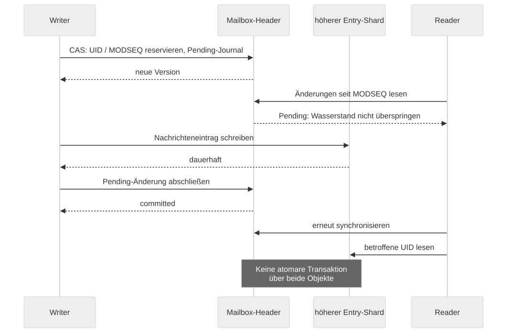

# RADOS data model and consistency

[Architecture](../../ARCHITECTURE.md) · [Developer guide](../development/README.md)

New here? Start with the [Storage guide](storage-guide.md), which
builds up the same model step by step with pictures; this document
is the reference.

## Physical model

The canonical account name selects a RADOS namespace inside shared
pools. Namespaces organize data; they are not per-user Ceph credentials
in their own right. Access control has to be correct earlier, in the
protocol/auth/ACL path. The server's Ceph account can reach several
user namespaces.

| Object/structure | Meaning | Primary source |
|---|---|---|
| `mailboxes` | Registry of names and stable mailbox IDs; quota, delivery intents and the intents of the scrub (`bi:`, `bimp:`, `up:`, `sub:`, `ci:`, `dm:`, `ps:`) | [user.go](../../internal/cephstore/user.go), [intents.go](../../internal/cephstore/intents.go) |
| `account` | Account-wide change counter and change log (JMAP state); watched by JMAP push | [account.go](../../internal/cephstore/account.go), [watch.go](../../internal/cephstore/watch.go) |
| `ix/<space>/<nn>` | Front-end indexes derived from the rest (JMAP locator), 32 shards | [index.go](../../internal/cephstore/index.go) |
| `mbox/<id>` | Header, UID counter, MODSEQ, change/vanished log and the first UID shard | [user.go](../../internal/cephstore/user.go) |
| `mbox/<id>/<n>` | Further message entries | [user.go](../../internal/cephstore/user.go) |
| `msg/<guid>/<n>` | Immutable payload chunks; chunk 0 carries `refs` | [blob.go](../../internal/cephstore/blob.go) |
| `fts/<shard>`, `ftst/<shard>`, `ftsmap` | Posting lists, trigram dictionary, GUID/doc ID mapping and layout record (layout 2); `ftsd/<shard>` is the dictionary layout before 0.35.0 | [fts.go](../../internal/cephstore/fts.go) |
| `ftx/<gen>/p<i>`, `d<j>`, `h<k>` | Posting lists, dictionary and header texts of a layout 3 index generation ([layout 3](#full-text-index-layout-3)) | [ftslayout.go](../../internal/cephstore/ftslayout.go) |
| Script/metadata objects | Sieve texts, the active script, private/shared metadata | [scripts.go](../../internal/cephstore/scripts.go), [metadata.go](../../internal/cephstore/metadata.go) |
| `scrub` | Candidates and repair state | [scrub.go](../../internal/cephstore/scrub.go) |
| `pubseen/<id>` | Private `\Seen` marks of the public folder `<id>` (registry key `ps:<id>`) | [acl.go](../../internal/cephstore/acl.go) |
| `~accounts` / `ix.uploads/…` in the index or [system](#system-pool-and-placement) pool | Due queue of the JMAP uploads, by expiry | [uploads.go](../../internal/cephstore/uploads.go) |
| `~accounts` / `ix.purged/…` in the index or [system](#system-pool-and-placement) pool | Accounts a purge deleted, for the sweep to clean after (removed by a repairing sweep) | [purged.go](../../internal/cephstore/purged.go) |
| `~accounts` / `sweep/state`, `sweep/lock`, `sweep/<run>/<pool>/<nnnn>` in the index pool | Checkpoint, lock and spill objects of a sweep in progress (`shardpost scrub --sweep`); always in the index pool, also with a system pool | [sweep.go](../../internal/cephstore/sweep.go) |
| `~learning` / `learning/<job-id>` in the data pool | The independent message plus the job xattr | [learning.go](../../internal/cephstore/learning.go) |
| `~learning` / `ix.learning/…`, `ix.learning/owner/…` in the index or [system](#system-pool-and-placement) pool | Due queue and owner index of the learning queue | [learnindex](../../internal/learnindex/learnindex.go) |
| `~accounts` / `ix.accounts/head`, `ix.accounts/<nn>` in the index or [system](#system-pool-and-placement) pool | The account directory: one entry per account with a registry, 256 shards | [directory.go](../../internal/cephstore/directory.go), [sortedindex](../../internal/sortedindex/sortedindex.go) |
| `~accounts` / `ix.fts_layout/…`, `ix.fts_due/…` in the index or [system](#system-pool-and-placement) pool | Presence index of the accounts with a layout 3 full-text index; reshard queue of the `fts_due` worker | [ftslayout.go](../../internal/cephstore/ftslayout.go), [ftsdue.go](../../internal/jobs/ftsdue.go) |
| `~admin` / `kv.<key>`, `ix.…`, `auth-flush` in the index or [system](#system-pool-and-placement) pool | The admin store (jobs, plans, push subscriptions, registrations, …) with its hint indexes and due queues, the auth flush log | [adminkv.go](../../internal/cephstore/adminkv.go) |
| `~server` / `metadata` in the index or [system](#system-pool-and-placement) pool | The shared server METADATA entries | [metadata.go](../../internal/cephstore/metadata.go) |
| `~admin` / `system.moved` in the index pool, `system.pool` in the system pool | The placement fence and mark | [placement.go](../../internal/cephstore/placement.go) |

The index pool is replicated because its omap structures require it.
The data pool is EC 2+1 in the existing manifest. That is one concrete
operational configuration, not a general recommendation for every cluster size.
By default, messages consist of 4 MiB chunks; the count is part of
the metadata. `readBlob` uses the configured chunk size to
compute the offsets. It must not be changed casually while data exists.
The FTS shard count likewise affects the object mapping of layout 2;
a layout 3 index records its own counts.

The mailbox shard size, by contrast, is stored in the mailbox header and is
fixed at creation time. For a UID, `shard = (uid - 1) / shardSize`.
Stable mailbox IDs decouple RENAME from the payload objects; names are
registry keys, not reliable physical object paths.

## System pool and placement

The store's own namespaces hold the state of the whole cluster: the
admin store (`~admin`: jobs, plans, push subscriptions, server
registrations, the auth flush log, the queues of the job system), the
account directory with its indexes and queues (`~accounts`), the indexes
of the learning queue (`~learning`) and the server METADATA (`~server`).
Their index part is small (well under 5 GB at a million accounts) and
hot: a few hundred objects that every server polls, watches or locks.
With `ceph.system_pool` it lives in a replicated pool of its own, on
fast OSDs, apart from the index pool of the accounts
([placement.go](../../internal/cephstore/placement.go)):

| Namespace | Index pool | System pool |
|---|---|---|
| `~admin` | the fence `system.moved` | everything else |
| `~accounts` | the sweep's `sweep/*` (its spill holds a name per object of both pools) | the directory, `ix.purged`, `ix.fts_layout`, the queues |
| `~learning` | — | due queue, owner index, the worker lock `mbox/learning-worker` |
| `~server` | — | `metadata` |
| `~public` and the accounts | everything | — |

The data part of `~learning` (the learning copies `learning/<id>`)
stays in the data pool. Without `ceph.system_pool` everything stays in
the index pool, as before 0.47.0. One function decides
(`Store.indexPoolOf`): the store's view of a namespace, its sorted
indexes and its locks follow it, and the long-lived views (the admin
store, the queues) follow it across key rotations. The sweep, the bench
and the placement tools reach the pools themselves.

**One placement per cluster.** Which pool holds the state is decided by
data, not by configuration discipline. Two omap objects in `~admin`,
outside `kv.` and `ix.` (no server reads them as records or indexes):

| Object | Pool | Values |
|---|---|---|
| fence `system.moved` | index | `state` (`leased` for a fence a tool created only to hold its lease, `initializing`, `migrating`, `done`, `native`, `reverted`), the system pool (`to_id`, `to_name`), `index_id`, `fsid`, `run`, `at`, `by`, the tool lease (`tool_instance`, `tool_epoch`, `tool_seen`); after a migration `direction` (`migrate`, `revert`), `fenced_digest`, `heads`, `cleaned_at` |
| mark `system.pool` | system | `format` 1, `state` (`active`, `retired`), `origin` (`native`, `migrated`), the ids and names of the index, data and system pool, `fsid`, `run`, `at`, `objects`, `digest` |
| run state `system.migrate` | system | `run`, `phase` (`M1` to `M7`, `abort`, `revert`), `abort_from`, `digest_shards`, `m4_digest`, `fenced_digest`, `heads`, the original values of every poisoned head (`head:<ns>/<object>`), the report |
| digests `system.migrate/<ns>/<nnn>` | system | the digest of every object a migration copied, by object name; `nnn` is the name's hash modulo `digest_shards` (about 40 000 names per object, at most 256 objects per namespace) |

Pools are compared by id and cluster fsid; the names are for messages
(a pool can be renamed). The fence is the only arbiter: a tool creates
it before anything else, writes the mark as its commit and only then
the final state.

**The check.** Opening the store (every `shardpost` command but the
system tools and the bench, which check it themselves) reads the fence
and, with a system pool, the mark, and decides:

| `ceph.system_pool` | Fence | Mark | Result |
|---|---|---|---|
| empty | none, `reverted` or `leased` | – | start (`none`) |
| empty | any other | – | refused: set `ceph.system_pool` |
| X | none, `reverted` or `leased` | active | refused: a mark without a fence |
| X | none, `reverted` or `leased` | none | refused: run `shardpost system init --pool X` (no system state in the index pool) or `shardpost system migrate --to X` (an existing cluster; a few stats tell which) |
| X | `initializing` for X | any | refused: run the init again |
| X | `migrating` for X | any | refused: a migration runs |
| X | `done`/`native` for X | active, of this index pool and cluster | start (`migrated`/`native`) |
| X | `done`/`native` for X | none | refused: a fence without a mark |
| X | for another pool | any | refused |
| X | any | `retired`, or of another index pool or cluster | refused |

The check never lists and never writes. A server and the push worker
repeat it every minute: a placement read positively that contradicts
the configuration (a migration began, the mark was retired, a fence
appeared) logs `event=system_placement_lost` and ends the process after
draining; a read that fails is a warning and
`imapceph_system_placement{state="unknown"}`, never an exit, so that a
Ceph outage does not become a crash loop. The same holds at startup for
these two: a check that cannot read lets them start in the state
`unknown`, and the periodic check decides. A short-lived command
without the periodic check refuses to start when it cannot read. The
check stops in `Store.Drain` and `Store.Close`.

**Init.** A new cluster gets its system pool from `shardpost system
init`; the routine ([system.go](../../internal/cephstore/system.go)) is
the one the bench uses for its own pools:

1. Nothing to do when the fence is `native`/`done` for the pool and the
   mark is active for this index pool and cluster (it only reads then).
2. The tool lease is taken (below). An existing fence keeps its state;
   where there is none, one is created exclusively in the state
   `leased`, which the servers treat as no fence.
3. The index pool must hold nothing of the four namespaces but the fence
   and the sweep's objects (else the cluster exists: migrate it), the
   system pool nothing but the index heads of this same run, or the
   content of an earlier run (a retired mark with its copies, the run
   state of a migration that was aborted, the heads of an aborted init),
   which is deleted when that run is confirmed and the objects belong to
   it (the run state `system.migrate` of its migration names it, or
   every object is an index head of that run), after the fence is set,
   together with that run's quarantine in the index pool (its run state
   and mark last, so that a deletion that stopped is taken up by
   confirming the run again).
4. A probe object with omap is written and removed (an erasure coded pool
   fails here).
5. The fence becomes `initializing` with a new run, by compare-and-swap.
6. The completion markers of the backfills are written into the heads of
   the empty indexes (`backfill.kv` in `~admin/ix.job`,
   `backfill.accounts` in `~accounts/ix.accounts`, `backfill.learning`
   in `~learning/ix.learning`), as the JSON report the gates read, so
   that `admin.kv_index` and `imapsieve.learning.index` in `read` mode
   read from the first start without a listing.
7. The mark is created exclusively: the commit.
8. The fence becomes `native` and the lease is given up.

Every failure but a lost lease gives the lease up and leaves the fence
as it was (a `leased` fence the init created is removed). A failure or
crash between 5 and 8 leaves `initializing`: servers refuse until the
init has run again and completed it; the lease of an init that died is
taken over by one that is asked to wait (below).

**The tool lease.** Every write of the fence is a compare-and-swap on
its version, renewals and state changes alike, through one writer per
process. Taking it changes only the lease fields of an existing fence,
and giving it up removes them (or the fence the lease created). A free
lease is taken at once. One held by another instance refuses the tool
at once, naming the holder, unless the tool was asked to wait; then it
is taken once its `tool_instance` and `tool_epoch` were seen unchanged
for three minutes of the taker's own monotonic clock (a `tool_seen` more
than 30 s ahead of that clock is refused either way). The holder renews every 30 s and
trusts the lease only for 90 s after it sent its last successful write;
then it stops writing and ends (running the tool again continues). A
tool needs an OSD operation timeout of at most 60 s and throttles that
let its operations start; it refuses `ceph.client_options` that do not
allow that.

**Heads of a newer format.** `Index.Head()` refuses a head whose format
is newer than the server knows, as reads and writes always did. A gate
(the backfill markers) therefore never takes the markers of a head that
moved away; it reports the error once and behaves as in `write` mode.

**Shard counts.** New heads get 16 shards for `ix.job` and `ix.plan`
(1 before 0.47.0) and 256 for `ix.fts_layout` (16 before); an existing
head keeps its count.

**Migration.** An existing cluster moves its state with `shardpost
system migrate` ([migrate.go](../../internal/cephstore/migrate.go),
[shardpost-system(1)](../man/man1/shardpost-system.1)), in a maintenance
window with every process stopped; the run state records the phase
reached, and every run continues where the last one stopped:

| Phase | What happens |
|---|---|
| M0 | Under the tool lease: the target is a replicated pool of its own and holds nothing but this run's work (or, confirmed, an earlier run's copies); no registration of a running process, no valid lease of the push worker or a job, no held lock, no watcher on `auth-flush`, `ix.jobs/claimable/00`, `ix.learning/00`, `ix.submission/00` (a notify with a 2 s timeout) |
| M1 | The fence becomes `migrating`: servers refuse to start, running ones end within a minute |
| M2 | One listing of the index pool: the source (from M5 on, the old place and the quarantine together) |
| M3 | The copy, records first, then index shards, then index heads; with a digest per object |
| M4 | The target holds exactly the source, and both match the digests; `m4_digest` per namespace and in total |
| M5 | The quarantine: every old object is copied to `<ns>.moved/<run>` in the index pool (for example `~admin.moved/<run>`), the copy checked, then the original deleted; every old index head is copied there, its values saved in the run state, and then poisoned: `format` 1000 and `phase` `moved:<pool id>`. `fenced_digest` is the digest of the poisoned heads |
| M6 | The mark: the commit |
| M7 | The fence becomes `done` with `fenced_digest` and the list of the heads |

The copy reads an object whole: a stat, the data in chunks of 4 MiB, a
second stat (the size did not change), the xattrs without the cls_lock
state `lock.*`, the omap in pages of 1000 keys. It writes the first
chunk, the xattrs and the first omap page in one exclusive create, the
rest with the object asserted to exist. The digest is a SHA-256 over
the name, the size, the data, the sorted xattrs and the sorted omap,
each field with its length. Not copied: the object version (no stored
value of the store names a version of these objects; compare-and-swap
reads it anew in every round), the mtime (only account objects use it),
the omap header (the store writes none) and the lock state (a held lock
refuses the migration; an empty lock object is copied as an empty
object). Processes cache index heads under the pool's name, so the
copies need every process restarted, which the window does anyway.

**Why a quarantine.** After M5 nothing is left at the old place that a
process could read: a server before 0.47.0 finds no records, no flush
log, no directory, and fails on the poisoned heads (directory hook,
queues, hint indexes) instead of reading an empty index. A gate of the
backfill markers falls back to `write` mode and would write plain
records at the old place; `shardpost system verify --source-only` finds
every such object. Poisoning the records themselves instead is no
option: the push worker of such a version takes an unreadable lease as
free.

**The old place after the migration** holds the fence, the poisoned
heads (for good), the sweep's objects under `~accounts/sweep/` and,
until `shardpost system cleanup` deletes it after seven days, the
quarantine. `abort` takes a migration back before the servers use the
system pool (from the quarantine and the saved heads, checked against
`m4_digest`; the quarantine stays), `revert` after (from the system
pool, which is the truth then; the quarantine goes). Both, and `cleanup`,
continue when run again after a stop; the operations guide has the
runbook ([Moving the store-wide state](../operations/README.md#moving-the-store-wide-state)).

## Do not confuse identities

| Term | Scope | Meaning |
|---|---|---|
| Account | Auth/store contract | Canonical namespace owner |
| Mailbox ID | Registry of one account | Stable identity independent of the display name |
| UIDVALIDITY + UID | One mailbox | Identity of a message as seen by the IMAP client |
| GUID | A blob and its index references | Reference to shared message data |
| MODSEQ | Change history of a mailbox | Ordering value for synchronization and conditional changes |
| Account sequence | Change history of a whole account | Ordering value across mailboxes; what a JMAP state token names |
| FTS doc ID | Search index of one account | Compact posting list identity, not an IMAP UID |
| session_id | One network/backend session | Log correlation, not a persistent mail identity |

## The atomicity boundary

RADOS makes operations atomic **within a single object**. The writer reads the
state together with its version and writes with `AssertVersion`; on a conflict
it re-reads and decides again. The CAS helpers and the
[version context pool](../../internal/cephstore/verpool.go) prevent a
concurrent operation from using a version read by someone else.

There is no shared transaction across registry, mailbox header, higher shard,
blob, FTS and external program. Every change therefore has to define
which state remains visible after an abort and which
repair path can resolve it again.

## Writing a message

`DeliverGUID` checks the GUID and the size, resolves the mailbox and reserves
quota. It then writes the blob chunks, FTS and finally the mailbox entry.
A successful index entry must never point at payload data that has not been
written yet. Errors before linking trigger the designated cleanup and
quota refund paths; a process abort can leave residual state behind.

Shard 0 can change the header and the entry in a single CAS. For higher shards,
the header first announces the change as pending. The entry is then written
and the journal is completed. Readers must not move their
MODSEQ watermark past incomplete changes.
`PendingFloor` and the synchronization in the protocol layer honor this.

If the entry is already durable but the concluding pending
commit fails, the caller must not delete the blob the way it would after an
early error: that would leave a visible entry without data.
Exactly this distinction is documented in the `link` path.

## COPY, MOVE and EXPUNGE

COPY creates an additional index reference and increments the blob reference
count. The payload does not have to be written again within this store
path. MOVE is not merely an atomic pointer switch: the code creates
a move intent, temporarily increments references, links the target,
removes the source and releases its reference. An abort leaves the
intent in place for repair. After a successful MOVE, the net
reference count is unchanged.

EXPUNGE removes mailbox entries and releases blob references. The last
reference leads to the deletion of the chunks. This is not a backup or
retention feature. `\Deleted`, a trash mailbox and physical deletion
are different states.

When several local delivery actions are involved, a delivery intent protects
their coherence. Its entries name the stable mailbox ID and the GUID
before the message is written. Orphaned intents are repaired or rolled back
after the designated age threshold. Intents do not guarantee
exactly-once delivery to an external client whose
success response can be lost on the network.

## Intents: debris that a scrub finds without listing

A crash between two writes can leave an object that nothing points at: a
blob written before its entry, a mailbox object created before its name
was registered, the shards of a mailbox whose deletion stopped half way.
Until 0.41 the scrub found such objects by listing the account's
namespace in both pools, which costs a walk over every placement group of
the pool per account. Since 0.42.0 every write that can leave such an
object first records an **intent** in an object the scrub reads anyway,
and removes it once the write is complete
([intents.go](../../internal/cephstore/intents.go)):

| Intent | Where | Set | Removed |
|---|---|---|---|
| `bi:<guid>` | registry | in the reservation CAS of `DeliverGUID` (delivery, APPEND, CATENATE, REPLACE, Sieve `fileinto`, COPY into another account), before the blob is written; since 0.52.0 with the mailbox id (`m`) | once the entry is linked or the blob deleted again; batched, see below |
| `qi:<id>` | registry | in the reservation CAS of a COPY or a MOVE out of an ignored mailbox, and in the rename CAS of a rename across the quota rules (since 0.52.0, see [below](#online-quota-recount-and-the-mailbox-lock-0520)) | with the reservation (at once when something is given back), or in the booking of the rename |
| `bimp:<batch>` | registry | in the reservation CAS of an import step: each message's GUID and a salt from which its two fallback GUIDs follow (about 35 bytes per message, 350 KiB for the largest step of 10 000 messages) | after the header write of the step |
| `up:<guid>` | registry | before a JMAP upload's blob is written, after its entry in the uploads due queue | when the upload expires (`jmap.upload_ttl_seconds`) |
| `sub:<guid>` | registry | before the message copy of a delayed JMAP submission is written, with the submission id and an expiry seven days after the release time | when the submission ends (sent, canceled, failed), by the submission worker or the cancel; see [Delayed submissions](#delayed-submissions) |
| `ci:<id>` | registry | in a CAS of its own before `mbox/<id>` is created | in the CAS that registers the name (or an import replacement's swap) |
| `dm:<id>` | registry | in the CAS that unregisters a mailbox, with its UIDNEXT and shard size; since 0.52.0 with `q` (0 until the usage is released, 1 after) | after the blobs are released and the shards deleted (highest first, shard 0 last) |
| `ps:<id>` | registry | before the first private `\Seen` mark of the public folder `<id>` is written | when the scrub removes the marks of a folder that is gone |
| `r:<uid>` | shard 0 of the mailbox | in the header CAS that removes the entry (EXPUNGE, MOVE, the scrub's own removals; for entries above UIDNEXT on a higher shard in a write before the removal), with the blob's GUID, size and chunk count; since 0.52.0 also whether the writer removed the entry itself (`d`, with its nonce `n`) and whether its usage is released (`f`, written right after the release CAS: one extra write per release) | after the blob reference is released, by the session that removed the entry |

A DELETE also **retires** the header of shard 0 after unregistering the
mailbox (`h:uidnext` 0, the old value kept as `h:retired`), so that a
delivery that looked the mailbox up before can no longer allocate a UID
in it; entries such a delivery added between the read of the messages
and the retirement are released as well. A delivery whose entry for a
higher shard was still on its way when the header was retired keeps the
tombstone for the scrub, rewritten with the range the header had then;
a release that failed keeps the tombstone and the shards.

An account that only stores Sieve scripts (ManageSieve, the admin API)
gets a registry with its first script (the key `created`), and with it
a directory entry; before 0.42.0 such accounts had none.

DELETE releases what the shards hold once the header is retired, not
the list it read before unregistering: an EXPUNGE or MOVE of another
session in between released its entries itself. An entry whose removal
intent is on shard 0 belongs to that session; its release may still
come, so the shards and the tombstone then stay for the scrub.

**What the scrub does with an intent.** An intent older than
`scrub.intent_grace_seconds` (3600) belongs to a write that will not
finish ([scrubintents.go](../../internal/cephstore/scrubintents.go)).
The scrub settles what it names against its index scan of the account
(the omap reads of every registered mailbox it does anyway, no listing):

- a blob that an entry references is fine and the intent goes; a blob
  nothing references and whose chunk 0 is older than
  `scrub.grace_seconds` is an orphan: its reference count is set to 0
  under the object version read (a COPY in between makes this fail, and
  the blob stays), then it is unindexed and its chunks are deleted.
- a blob that a **young** intent names (a removal whose release may
  still come, a deletion between its unregistration and its releases, a
  running MOVE or delivery) keeps its reference count: `fixRefs` leaves
  it alone, since a release that follows would otherwise be applied on
  top of the corrected count and could take the blob from a copy. So do
  the blobs of entries an import left above UIDNEXT that the run did not
  remove. Without a listing the scrub never collects anything younger
  than ten minutes, whatever `scrub.grace_seconds` says; the repairing
  sweep keeps the same minimum.
- `r:` and `dm:` are **never** settled by releasing again: the scan
  counts every reference anew (`fixRefs`, with the same mtime guard and
  `AssertVersion`), so a release that did happen before the crash is not
  repeated, and a second decrement can never take the blob away from a
  copy in another mailbox. The mailbox of a `dm:` is not registered, so
  its entries do not count; its range is the larger of its retired
  header (a shard 0 without header keys says nothing) and the tombstone,
  and shards above that range that exist are probed one by one.
- a `dm:` whose blobs are settled loses its shards (highest first,
  shard 0 last), then the tombstone; a `ci:` whose id is not registered
  loses its object; a `ps:` whose folder is gone loses its marks.
- the METADATA entries of mailboxes that are no longer registered go as
  well (the registry is read after the entries; ids are never used
  again).

The age of an intent is the writer's clock (the time in its value)
against the scrubber's: the servers' clocks must agree (NTP) to well
within `scrub.intent_grace_seconds`; a writer whose clock runs ahead
only delays the scrub, one that runs behind by more than the grace
period lets a scrub take an intent of a write in flight for a crash.
Object mtimes, which the scrub and the sweep compare with their own
clock, have whole seconds and come from the writer's clock as well; the
sweep's line for a namespace it read lies `scrub.sweep_clock_margin_seconds`
(60) before the read, on a whole second, so a write in the same second
or from a clock a little behind is never taken for older.

**Where the scrub looks** is `scrub.orphan_source`:

| Value | Listing | Acts on | Intents |
|---|---|---|---|
| `listing` | both pools, per account | the listing (two-run rule for blobs) | dropped once what they name is gone or referenced |
| `shadow` (default) | as `listing` | the listing | judged first, then compared with the listing; differences go to the report (`Shadow`), the log and `imapceph_scrub_shadow_differences_total{kind}` |
| `intents` | none | the intents | settled as above |

In shadow mode `orphan_missed`, `unknown_missed` and `marks_missed`
count what the listing found and no intent names: debris from before
0.42.0, or of a server of an older version during a rolling update, or a
write path without an intent (which would be a bug). `orphan_extra`
counts blobs the intents take for orphans and the listing does not; it
must stay 0. The switch to `intents` is safe only once every server runs
0.42.0 or later (servers do not report their versions to each other, so
nothing enforces this: older servers write no removal intents, and a
blob they move or expunge can then look like an orphan), `orphan_extra` stayed 0, and what `*_missed` still
reports is debris from before (the sweep removes it, see
[operations](../operations/README.md#scrub-without-listings)).

**What it costs on the hot paths** (round trips to the OSDs added per
operation, against 0.41):

| Operation | Set | Remove |
|---|---|---|
| LMTP delivery (one view per delivery) | 0 (in the reservation CAS) | 1 key removal when the view closes |
| LMTP delivery to several mailboxes (Sieve), MULTIAPPEND | 0 | 0 (with the CAS that ends the delivery intent) |
| IMAP APPEND in a session | 0 | 0 (with the next reservation of the session), at the latest one write after 30 s or at logout |
| Delivery into a mailbox the quota rules ignore | 1 CAS | as above |
| EXPUNGE, MOVE (per command, not per message) | 0 (in the header CAS) | 1 key removal on shard 0 |
| CREATE | 1 CAS | 0 (in the CAS that registers the name) |
| DELETE | 0 (in the unregister CAS) | 1 CAS that retires the header, 1 key removal |
| JMAP upload | 1 due queue write + 1 CAS | the expiry |
| First private `\Seen` mark of a public folder | 1 read per session and folder, 1 CAS per account and folder | — |
| Import step | 0 (in the reservation CAS) | 1 key removal |

A key removal is one write op without a read; it bumps the object
version, so a concurrent CAS on the same object retries once. The
skip-if-idle check of the batch scrub reads the registry intents in one
read op (one bounded step per prefix) and each mailbox's `i:` and `r:`
in one more.

Measured on the test cluster (`TestHotPathOps` in
[opcount_test.go](../../internal/cephstore/opcount_test.go), run with
`SHARDPOST_TEST_OPCOUNT=1` through `hack/ceph-test-cluster.sh`; the OSD's
`op_r` and `op_w`; four full-text shards, a 500-byte message), against
the same test on 0.41.0 and 0.43.0:

| Operation | Reads 0.41 → 0.43 → 0.44 | Writes 0.41 → 0.43 → 0.44 |
|---|---|---|
| LMTP delivery, a view per message | 16.4 → 17.1 → 12.8 | 14.0 → 15.0 → 15.0 |
| APPEND, ten in one session | 15.6 → 15.6 → 11.5 | 12.2 → 12.2 → 12.2 |
| EXPUNGE of one message | 15.0 → 15.0 → 15.0 | 12.4 → 13.4 → 13.4 |
| CREATE and DELETE of an empty mailbox | 16.0 → 20.0 → 20.0 | 9.0 → 12.0 → 12.0 |
| JMAP upload | 0.0 → 1.2 → 1.2 | 1.0 → 3.2 → 3.2 |

The extra reads of the LMTP delivery in 0.42 and 0.43 are CAS retries:
the removal a closed view sends in the background meets the next
delivery's reservation on the same registry object. In 0.44 a posting
shard costs one read instead of two and the id map no read of its own
(see [full-text write path](#full-text-write-path)): one read less per
full-text shard and one per LMTP delivery, 16 + 1 with the default
sixteen shards. Measured in the R4 bench setup: 245.6 → 226.4
operations per delivery (`fts` 48 → 32, `ftsmap` 3 → 2; the trigram
dictionary still writes about 174 objects). The full-text index
dominates a delivery either way.

**The uploads.** A JMAP upload is a blob that nothing points at, so it
costs an entry in the due queue `ix.uploads` (namespace `~accounts`), the
intent `up:` and the blob, in that order. The upload expiry worker (one
server of the cluster holds its lease) deletes what is due every
minute; the scrub does the same for an expired upload the worker did not
get to, and a purge finds the uploads through their intents. Upload blobs
are never the blob of a message: `Email/import` and `Email/set` read
them and store a new message (`model.Blobs` has no way to link one;
`TestBlobsCannotLink`, `TestUploadBlobsAreNeverLinked`).

**Batched removal.** A view collects the keys of finished intents and
removes them with its next registry write that can carry them (a
reservation, the end of a delivery), after 30 seconds at the latest,
and when it is closed; LMTP, which opens a view per delivery, pays one
write per delivery, an IMAP session that appends many messages none.

## Purge without listing

With the intents, everything an account holds is named by its data
model, so a purge deletes it object by object instead of listing the
account's namespace in both pools
([purge.go](../../internal/cephstore/purge.go)):

- the mailboxes of the registry, of creation intents (`ci:`) and of
  deletion tombstones (`dm:`), each with its shards from the header of
  shard 0 (retired or not) or the tombstone, and the shards above that
  range that exist (entries of an import step that stopped);
- the blobs of their entries, of the removal and MOVE intents on shard
  0, of `bi:`, `bimp:`, `up:`, `sub:` and `d:` in the registry and of the orphan
  candidates in the `scrub` object; a blob whose chunk count is not
  recorded is sized from its length attribute;
- the fixed objects: the full-text index (`fts/`, `ftst/`, `ftsh/`,
  `ftsd/`, `ftsmap`; the configured shard count, at least 16), the
  front-end indexes (`ix/<space>/<nn>` of every known space), `account`,
  `metadata`, `sieve` (with the vacation records), `scrub`;
- `pubseen/<id>` for every `ps:<id>`;
- the registry, last (it holds the maintenance lock).

Blobs go first, while the entries still name them, then the index
objects (the shards of a mailbox highest first), the registry last; a
purge that starts again finds what is left. The admin store records of
the account (`jmap/push/acct/`, `jmap/push/seen/`, `jmap/submission/`)
are removed in a phase of their own after the directory entry, through
the admin store, which keeps their hint indexes in step. The phase is
the last one on purpose: the phases are checkpointed by number, and an
older server that takes a purge over knows only the earlier ones. Such a
takeover (or a crash between the two phases that no server resumes)
leaves the records; they belong to no account any more and a later
purge of the same name removes them. Accepted for the rolling update.

`purge.listing` (default `true` in 0.42.0) keeps the purge of earlier
versions: it lists both namespaces and deletes what it finds, and it
also reads the data model first and counts the listed objects the model
does not name (`imapceph_scrub_purge_unnamed_objects_total`, with a
warning naming a few). What the model cannot name: debris that servers
before 0.42.0 left without an intent, objects of an account that was
never scrubbed since, full-text shards above a lowered `fts_shards`.
A purge without listing leaves those behind in a namespace that then has
neither a registry nor a directory entry. So that the sweep can tell such
a namespace from an account that only kept Sieve scripts before 0.42.0,
every purge first records the account in the hint index `ix.purged`
(`~accounts`); the sweep deletes what is left in a recorded namespace
without registry and without an active directory entry (an active entry
always wins: a lost registry is no debris). Before it deletes anything
in such a namespace it checks again that there is still no registry and
that the namespace may still be cleaned, and it takes no object written
after it read the namespace for a remnant: an account created again
while the sweep looks at it keeps everything. When a repairing sweep
ends, it removes every record of a purge older than its start less its
grace period, except those of namespaces in which it left something
(an object younger than the grace period, a failed delete, a namespace
it skipped); a purged namespace with no object left at all loses its
record as well. An account registered again under the name, set active
again by a directory repair, or whose stale entry a repair removed,
loses its record at once.

## The sweep

`shardpost scrub --sweep` ([sweep.go](../../internal/cephstore/sweep.go))
is the tool for what no intent names: it lists both pools in all
namespaces, so it costs a walk over every placement group of each, and
runs as a one-off, not as a routine.

- **Pass 1** lists a pool and spills the object names into spill objects
  in `~accounts` (`sweep/<run>/<pool>/<nnnn>`, one omap key
  `<namespace>␟<object>` per object, the spill object chosen by the
  namespace, `scrub.sweep_spill_shards` of them). The iterator's position
  (the PG hash position of go-ceph's `Iter.Token`) is checkpointed in
  `sweep/state` every 10 000 objects; a sweep that stopped seeks there.
  When the pool's `pg_num` changed meanwhile, the position means nothing
  any more and that pool's listing starts over (a name spilled twice
  changes nothing).
- **Pass 2** reads each spill object in key order, so the names of one
  namespace come together, and compares them with what the account's data
  model (the purge's enumeration). What it does not name is a
  remnant; with `--repair`, a remnant older than `scrub.grace_seconds`
  (at least ten minutes) is deleted (a blob through its reference count,
  under the version of its chunk 0). A namespace without registry is
  deleted only when the account directory says the account is being
  purged, or the purge recorded it in `ix.purged` and the directory holds
  no entry for it; any other one (a lost registry, an account that only kept
  Sieve scripts before 0.42.0, the leftovers of a purge whose directory
  entry is gone) is reported (`registry_missing`, `unregistered`, class
  `namespace`) and left alone. An account whose data model cannot be
  read in full (a registry record that does not parse, an unreadable
  header, a registered mailbox without shard 0) and accounts under an
  import lock are left alone. A full-text shard above the configured
  count in an account is reported and never deleted (it may belong to
  servers configured with more shards); any other remnant is deleted
  only at the object version that was judged. Private `\Seen` marks of a live public folder
  that predate the intents are adopted: their `ps:` key is written.

One sweep runs at a time (a cls_lock on `sweep/lock`); the report is
printed as JSON and logged. Lock, checkpoint and spill stay in the index
pool when the rest of `~accounts` lives in the
[system pool](#system-pool-and-placement); the account directory and
`ix.purged` are read where they are. The store's own namespaces and any
other reserved one (a `~` name, such as the quarantine of a migration)
are never swept.

## The account change log

A MODSEQ counts inside one mailbox and says nothing about the mailbox
next to it. That is what RFC 7162 specifies and it is all IMAP needs.
JMAP (RFC 8620) asks a different question — what changed anywhere in
this account since state token N — and answers it with a single number
per account and data type. The `account` object holds that number and
the log behind it:

| omap key | Meaning |
|---|---|
| `h:seq` | The account counter; the highest sequence ever allocated |
| `h:logstart` | The oldest sequence the log still holds |
| `p:<seq>` | A change that has been announced and not yet recorded |
| `a:<seq>` | The record of a change: kind, operation, mailbox, messages |

The log is a second record beside the mailbox change log, never a second
number space. An entry says which object changed and carries the account
sequence; the mailbox MODSEQ stays exactly what it is, and the mailbox
log remains authoritative for what happened inside a mailbox.

A mailbox object and the `account` object are two objects, so the
atomicity boundary applies: they cannot be written together. Every
change is therefore three steps, the same two-phase shape a higher-shard
write already uses:

1. the writer announces the change (`p:<seq>`, one CAS on `account`),
2. the mailbox change happens as before,
3. the writer records what it did and drops the announcement.

A reader never reads past the lowest announcement that has no record
yet, so a state token cannot advance over a change that is still being
written. An announcement whose writer died is turned into a *partial*
entry after 60 seconds: the mailbox is named, its messages are not, and
a client resynchronises that one mailbox. The paths that repair or
import (the scrubber, the account import) write partial entries directly,
because they run again if they die and no client is waiting on their
state token.

The direction of the guarantee is the point: the log may report a change
that did not happen, or report one without its details, but it must
never stay silent about a change that did. A client acts on a spurious
report by fetching something unchanged; it acts on a missing report by
never learning about a message.

The log is bounded like the mailbox change log
(`server.account_log_retention`, 10000 entries by default). A client
whose token is older than the oldest entry is told to resynchronise
instead of being handed a delta with a hole in it.

Two limits are deliberate at this stage. The private `\Seen` marks of a
public folder are recorded in the log of the public account, not in the
log of the account the mark belongs to; JMAP sharing (RFC 9670) is where
that is resolved. And METADATA annotations have no entry at all, because
RFC 8621 has no object for them.

## Front-end indexes

A front-end may keep an index of its own in the store: data it derives
from the rest and can always rebuild from it. The JMAP locator (GUID →
mailbox and UID) is the one that exists. Such an index carries no
consistency obligation towards the rest of the store — a lost write costs
a rebuild, never a message — and nothing on the IMAP write path writes to
it. It lives in `ix/<space>/<nn>`, spread over 32 shards by a hash of the
key, so that an account with a million messages keeps each object at
about thirty thousand keys, below the size at which Ceph warns about
large omap objects. The shard count is fixed for good: changing it would
move every key.

The scrubber leaves these objects alone, and an account purge removes
them with the rest of the namespace.

## Store-wide sorted indexes and the account directory

Listing a RADOS namespace visits every placement group of the pool, so
its cost grows with everything in the pool, not with what the namespace
holds. Enumerations that run routinely therefore read sorted indexes
instead; a listing is acceptable only in a repeatable backfill or a
manual tool. The metric `imapceph_rados_listings_total{site}` counts the
listings that remain (see [Observability](../observability.md)).

**Sorted index.** A store-wide map from ids to small values
([sortedindex](../../internal/sortedindex/sortedindex.go)), stored in a
system namespace of the index pool:

| Object | Content |
|---|---|
| `ix.<name>/head` | omap `shards`, `format`, `phase` (`stable`, or `copying:<n>` while a later reshard copies), `mark:<name>` markers |
| `ix.<name>/<nn>` | one omap key per id whose `FNV-1a(id) mod shards` is `nn` |

The names never start with `kv.` (older servers read those as admin
records) and are distinct from the per-account `ix/<space>/<nn>` above.
The first writer creates the head; readers without a head use the
defaults. Each process caches the head for ten seconds. A write refuses
while the phase is not `stable` (resharding is a later stage and this
version does not write the new layout); a newer format is refused
altogether. One entry is read, set or removed with one operation on its
shard object; an update is a compare-and-swap on the shard object's
version, because go-ceph offers no omap comparison; a short random
backoff separates the attempts, and each lost round counts as
`imapceph_rados_cas_retries_total{kind="index"}`. A listing returns the
entries in (shard, id) order, page by page, with the cursor
`<shard>:<id>`; a page reads the shard of the cursor and continues with
the following shards until it is full.

**Account directory.** The sorted index `accounts` in the namespace
`~accounts`, 256 shards. An account is in it exactly when its registry
object (`mailboxes`) exists; this includes `~public` and accounts that
only received a shared-folder pointer, and never the store's own
namespaces (`~admin`, `~learning`, `~server`, `~accounts`). The value is
JSON:

| Field | Meaning |
|---|---|
| `created` | When the registry was last created (the hook writes it on every creation); the registry's last change for accounts a backfill entered. Concurrent creators race, the last one wins: it is only a time. |
| `state` | `active` or `purging` |
| `session` | The purge job's maintenance lock session while `purging` |
| `cluster` | fsid of the Ceph cluster that holds the account |
| `shard` | Reserved for a later stage (placement), empty |
| `scrub` | The record of the last batch scrub of the account: `at`, `state` (`seq` and `reg`, see below), `complete`, `findings`; absent before the first. A new registration of the account drops it. |

The store registers an account in the compare-and-swap that creates its
registry (`casOmapOpAs`, version 0, the account's own index context),
right before the exclusive create: one read and one write (an `active`
entry is written again with the new `created`). That happens once per
account lifetime, so an existing account pays nothing. `shardpost index backfill accounts` enters the
accounts that existed before the directory (see
[Operations](../operations/README.md#account-directory-backfill)).

`Store.User` refuses the empty name and reserved names other than
`~public`, `~server`, `~admin`, `~learning` and `~accounts`: the empty
name would put a registry into the default namespace, where it belongs
to nobody.

**Purge.** The import lock that keeps protocols out of an account lives
in its registry, so it disappears when the purge deletes the registry.
Without the directory, a late session or delivery could then create the account
again. Now the purge job sets the entry to `purging` with its lock
session (`job-<id>`) while it still holds the lock, before it deletes the
namespace. From then on, while the registry is missing, the registry
hook refuses every creation with `ErrAccountPurging`, a kind of
`ErrImportLocked` (LMTP answers 451, IMAP `NO [UNAVAILABLE]`), except an
`ImportLock` of the job's own session, so that a restarted job can take
its lock again. That
restart leaves an empty registry with only the lock key behind, which is
why the last purge phase stops renewing the lock, fences, deletes the
registry once more (absent is fine) and only then removes the entry.
After that the name is free; a later account of the same name is a new
account. While the registry exists, `purging` does not block anything
beyond the import lock itself.

A grant (SETACL, the admin ACL operations, JMAP sharing) to an account
that is `purging` without registry is refused with `ErrAccountPurging`
(an `ErrImportLocked`; the admin API answers `409 account_purging`)
before the ACL is written: the pointer write into the grantee's registry
would fail, but the ACL entry would stay and pass to whoever gets the
name next. A removal of rights goes through and writes no pointer. The
check narrows the window, it does not close it: a grant whose check ran
just before the purge deleted the grantee's registry still writes its
ACL entry, and its pointer write then fails (`ErrPointerSync`). Closing
it would need the ACL write and the grantee's state in one atomic step,
which two objects in two namespaces cannot give.

**Repair.** `shardpostctl account repair` and the backfill apply these
rules:

| Entry | Condition | Action |
|---|---|---|
| `purging` | a purge job of its session still runs | none (`purge_running`) |
| `purging` | no such job, registry missing | entry removed (`removed`) |
| `purging` | no such job, registry exists | back to `active` (`activated`) |
| `active` | older than 10 minutes, registry missing | entry removed (`stale_removed`) |

A stale `active` entry comes from a purge by an older version during the
rollout, from a crash between the registry hook and the registry
creation, or from a creation whose write failed. The grace keeps a
repair away from an account that is being created right now. The
removal is a compare-and-swap on the entry the repair read, including
its `created`, and the hook writes the entry (with a new `created`)
before it creates the registry. So a creation racing the repair always
keeps its entry: if the hook writes first, the repair finds the entry
changed and leaves it; if the repair removes first, the hook finds no
entry and writes one.

While an account is `purging` without registry, no exclusive job can
take its lock, a second purge included. A job that finds the account
left so by an ended purge fails at once with "run shardpostctl account
repair" instead of waiting for the lock.

**Rollback.** Older servers ignore `~accounts` (the scrub's namespace
listing skips reserved names), and an older purge sets no `purging`, so
for its purges the behaviour before the directory applies; it leaves the
entry `active`, which the repair later removes as stale.

**Reshard (later stage).** Resharding the directory will announce itself
in the head (`phase: copying:<n>`). Servers of this version refuse every
directory write in that phase, so creating an account then fails with a
temporary error (LMTP 451). A reshard therefore requires every server to
run a version that writes during the copy phase first.

## Batches over all accounts and the batch scrub

A **batch** is a maintenance job without account (`Account ""`, kind
`batch`) that runs one kind on every account of the directory
([jobs/batch.go](../../internal/jobs/batch.go)). Only a batch may be
account-less, and `Store.User("")` stays refused: the runner opens no
account for it, the batch opens each account in turn. The kinds a
batch can run are `index_check`, `scrub`, `fts_rebuild` and
`attachment_backfill`; they do not depend on a plan of the account (a
batch has one plan for all of them). The role and the exclusivity of a
batch are those of its kind. A batch is planned only while the
directory carries a completed backfill marker, since otherwise accounts
from before the directory would be missed.

The batch walks the directory in its order (shard, account) a page at a
time; a page holds four accounts per worker (at least 16). The accounts
of a page run with a bounded parallelism (`jobs.batch_parallel`, for a
scrub `scrub.parallel`); after each page the directory cursor
`<shard>:<account>` and the counters go into the job's checkpoint, so a
server that takes the job over redoes at most one page (all batch
kinds may run twice on an account). An entry `purging` whose registry
is gone counts as `gone`; with a registry it counts as active, as the
directory semantics say. Before each account the batch fences on its
lease, so a cancel request or a lost lease stops it between two
accounts. An exclusive kind takes the account's maintenance lock (the
batch's lock session `job-<id>` for every account), keeps it renewed
every third of the lease and waits `jobs.settle_seconds` before it
works; an account that an import or another job holds is put aside and
tried again after the walk, up to three times a lease period apart,
and then counted as failed. The result counts the accounts (`done`,
`skipped`, `gone`, `failed`, `findings`) and names the first 50 that
failed or had findings, the record stays far below the 4 MiB of an
admin record however many accounts there are.

**Skip-if-idle.** The nightly scrub is a batch of `scrub` with
`skip_idle`. After it scrubbed an account with every repair class, the
batch writes the account's scrub record into its directory entry: the
account counter (`h:seq` of the account object) and the object version
of the registry, both read **after** the scrub's own writes (the quota
fix, the orphan candidates, the quota count), whether the run was
complete (no import, no error, the index scan complete) and how many
findings it had. A run that found nothing but saw the state move during
the scrub (a concurrent change) records itself as incomplete. A later
batch with `skip_idle` leaves the account alone only when all of this
holds:

1. the account counter and the registry version are the ones recorded;
2. the `scrub` object is empty: no orphan candidates and no quota count
   wait for the second run of the two-run rule (a run that finds the
   quota counters right removes a count an earlier run left);
3. the recorded run was complete;
4. no intent is open: none of `d:`, `bi:`, `bimp:`, `up:`, `ci:`, `dm:`
   in the registry, no MOVE intent `i:` and no removal intent `r:` on a
   mailbox object; this costs one read op of the registry and one per
   mailbox, no listing;
5. the recorded run had no findings;
6. it is younger than `scrub.interval_days` (7): after that the account
   is scrubbed again in any case.

The cheap conditions (3, 5, 6) are checked from the directory entry
before the account is read at all. Accounts that are not skipped are
scrubbed with the configured orphan source (see
[intents](#intents-debris-that-a-scrub-finds-without-listing)): with
`listing` and `shadow` including the listing of their namespace in the
data pool (orphan blobs) and the index pool (unknown objects), with
`intents` without any listing.

**What skipping still misses.** Since 0.42.0 every write that can leave
debris records an intent in the registry or on a mailbox object, so an
account with debris of a crash is not idle (condition 4) and is
scrubbed. What a skipped account can still hold until its next scrub, at
the latest `scrub.interval_days` later: the private `\Seen` marks
(`pubseen/`) of public folders that were deleted in `~public` meanwhile
(their `ps:` key is no open intent), and debris that writes of servers
before 0.42.0 left without an intent. None of it is visible to a client;
it only takes space until then.

`shardpost scrub` (the run in the process itself) takes its accounts
from `scrub.users`, else from the directory once it carries a completed
backfill marker, else from a listing of the index pool.

## Admin store: hint indexes and due queues

The admin store ([adminkv](../../internal/cephstore/adminkv.go)) keeps
one object per record, `kv.<key>` in the namespace `~admin`: jobs
(`job/<id>`), plans (`plan/<id>`), idempotency keys (`idem/<hash>`), the
JMAP push subscriptions of an account (`jmap/push/acct/<account>`) and
smaller state. Records stay objects in every mode. Next to them live
sorted indexes ([kvindex](../../internal/kvindex/kvindex.go)) that spare
the job runner, the expiry of old records and the push worker the
listing of the namespace (which visits every placement group of the
pool).

| Object | Content |
|---|---|
| `ix.job/…` (16 shards; 1 in a head created before 0.47.0) | hint index of `job/`: `{state, account, kind, finished}` |
| `ix.plan/…` (16 shards; 1 in a head created before 0.47.0) | hint index of `plan/`: `{kind, account, expires}` |
| `ix.idem/…` (16 shards) | hint index of `idem/`: `{job_id}` |
| `ix.jmap/push/acct/…` (64 shards) | hint index of `jmap/push/acct/`: `{verified, expires, sum}` (any subscription verified, the latest expiry, and since 0.52.0 a checksum of the record, so the push worker's scan reads only the records that changed); its shard count is the partition count of the push worker |
| `kv.jmap/push/seen/<account>` | the state the push worker last pushed for the account: `seq`, the digest and the states of the shared accounts, since 0.52.0 an acknowledgement per subscription (`ack`: the position it was delivered up to) and an `epoch` that rises when the account counter jumped back; written with a compare-and-swap that merges by max ([JMAP: Push partitions](../jmap.md#push-partitions)) |
| `ix.jmap/push/p<nn>/lock` | cls_lock of push partition `nn` (0.52.0), held through key rotations by its holder; the front-ends notify it with the account as payload when a subscription changes |
| `ix.jmap/push/members` | the membership of the push pods: one key per pod with its partitions, the accounts it watches, its bounds, its clock and whether it is leaving; a reader deletes a record older than ten minutes |
| `ix.jmap/push/ctl` | the control object every push pod watches; notified after an orderly release of a partition |
| `kv.jmap/push/lease` | the lease record of the single push worker of before 0.52.0; the partitioned pods keep it occupied as a marker (`holder` `partitioned/<instance>`) and wait while an old pod holds it |
| `kv.servers/<instance>` | registration of a server (`{version, caps, seen}`), renewed every minute, deleted 24 hours after its last heartbeat ([layout 3](#full-text-mixed-versions)) |
| `ix.servers/…` (1 shard) | hint index of `servers/`: `{version, caps}`, without `seen`, so a heartbeat does not write it |
| `kv.fts/layout3` | the cluster mark that allows full-text layout 3 |
| `kv.fts_due/<account>` | the job the `fts_due` worker planned for the account's generation (deleted with the account) |
| `ix.jobs/claimable/…` | due queue of the jobs a runner may have to claim |
| `ix.jobs/expiry/…` | due queue of the jobs, plans and idempotency keys that expire |
| `ix.jobs/expiry/lock` | cls_lock of the expiry worker |
| `ix.kv/lock` | cls_lock of `shardpost index backfill kv` |
| `kv.jmap/sendq/<account>/<id>` | the record of a delayed JMAP submission ([below](#delayed-submissions)) |
| `ix.submission/…` | due queue of the delayed JMAP submissions |
| `ix.submission/p<n>/lock` | cls_lock of partition `n` of the submission worker |

The head of `ix.job` carries the backfill markers `backfill.kv` (the
report of the last completed backfill, with its start time) and
`backfill.kv.progress`.

**Hint index.** An entry carries what its readers need of the record,
so a reader that filters (jobs by account and state) reads only the
records that match. The hint rule orders the two writes: on create the
record first, then the entry; on delete the entry first, then the
record. A crash in between leaves a record without entry, which the
backfill adds, or an entry without record, which readers skip and
remove. The entry is written after a write that created the record or
changed its index value (a heartbeat does not), and it is computed from
the record as it is then: the index update reads the record inside its
compare-and-swap on the shard object, so of two writers of one record
the later index write reflects the later record. A failed index write
does not fail the record write; it is logged and counted
(`imapceph_kv_index_errors_total`), and the backfill repairs it.

**Due queue.** A completeness index of what becomes due at a time
([duequeue](../../internal/sortedindex/duequeue.go)): every record that
has to be visited has an entry, so a worker finds what is due by
reading the heads of at most eight shard objects instead of listing.
The omap key is `<due>/<id>/<gen>`: the due time as 20-digit Unix
nanoseconds (keys sort by due time), the id, and the generation of the
record it was written for. The shard is `FNV-1a(id) mod n` of the id
alone, so all entries of one id live in one shard object and moving an
entry is one write op (`RmOmapKeys` of the old key plus `SetOmap` of the
new one). `n` is `admin.kv_queue_shards` (default 4, at most 8) when
the first writer creates the queue; the head keeps it after that. `Due`
reads the first page of every shard, keeps the keys up to now and
merges them, earliest first. Writers create an entry before its record
and remove it after the record. Moves are not compare-and-swap (go-ceph
has no omap comparison); the record stays the fence, and readers
compare an entry with its record: an entry without record or with a
generation newer than the record's is skipped for a grace of ten
minutes (its writer may be between the two writes) and removed after
it; an entry that does not match its record's position is moved there.

**Jobs queue** (`jobs/claimable`). A queued job is due at its creation
time (generation 0), a running one at the end of its lease (generation
`Lease.Gen`). Every write that changes the lease end or the state moves
the entry after the record, from the position computed from the record
as it was read in the compare-and-swap to the one of the record as
written:

| Writer | Record | Queue |
|---|---|---|
| submit | created (`Created` is the entry's time, same nanosecond) | entry at `Created` written before the record; notify |
| claim | `Lease.Gen`+1, `Lease.Until` = now + lease | moved to the new lease end and generation |
| heartbeat | `Lease.Until` extended | moved |
| postpone (account locked) | `Lease.Until` = now + lease | moved |
| release at shutdown | `Lease.Until` = now | moved to now; notify |
| cancel of a queued job | ended at once | removed |
| cancel of a running job | `cancel_requested` | unchanged (`claimable()` does not change) |
| end | final state | removed after the record |

So the entries due now are the jobs `claimable()` selects. A reader
(`admin.kv_index=read`) that finds an entry whose record is not
claimable (a heartbeat's record write succeeded, the process died before
the move) moves it to the record's lease end; an entry of an ended job
is removed; a claim removes the entry it came from together with the
record's own. The compare-and-swap on the record stays the fence.

**Wake instead of poll.** A writer notifies shard 0 of
`jobs/claimable` when an entry becomes due earlier than before: a
submit, and a release at shutdown. In `read` mode every runner watches
that object and then claims from the queue at once; its poll
(`jobs.poll_seconds`) stays as the fallback, and a watch that reports
an error (the OSD dropped it, or the store rotated its connection) is
set up again on the next poll. In `write` mode runners do not watch:
their look for jobs is still a listing of the admin namespace, and a
wake-up per submit on every server would multiply those listings; they
find new jobs by the poll as before. `imapceph_job_wakeups_total{cause}`
counts the looks by cause. Watch errors are coalesced into one pending
error per watch, so the librados thread that reports them never waits
for the runner.

**Expiry** (`jobs/expiry`). The entries carry the retention of
`cleanup()`:

| Record | Entry |
|---|---|
| job | placeholder at `Created + retention` (generation 0) at submit; at the end moved to `Finished + retention` (generation 1) |
| idempotency key | the same positions as its job (the job record names the key, `idem_key`); the placeholder is written before the key itself |
| plan | `Expires + retention` |

One server of the cluster runs the expiry worker: it holds the
cls_lock `ix.jobs/expiry/lock` instead of taking it per step. The lock
lives `jobs.lease_seconds` + 120 s and is renewed with `MAY_RENEW` every
third of that, so a renewal that waits out the OSD op timeout (60 s)
still lands before the lock runs out; releasing it waits for a renewal
in flight before the unlock, so a late renewal cannot take the lock
again. Every
`jobs.expiry_seconds` deletes what is due. For a job it deletes the
idempotency key first (only while the key still names this job; absent
is fine), then the job (a compare-and-swap that checks the job is still
ended and expired), then the entries. A job that has not ended when its
placeholder is due is rescheduled one retention later; an idempotency
key whose job was never stored (a crash between the two creates, which
used to block the key for good) is deleted when its placeholder is due.
A plan is deleted at `Expires + retention`. The lock is advisory: every
deletion is a compare-and-swap on the record. When the store rotates
its cephx key (`Store.Rotate`), the worker's lock is unlocked through
the old connection while its key is still valid and reported lost; the
worker takes it again on the new connection. A lock whose holder died
stays held until its TTL (`jobs.lease_seconds` + 120 s) ran out. A key
that `Due` cannot parse is skipped and counted
(`imapceph_queue_stale_entries_total{action="unparsable"}`).

**Key rotation.** The admin store is opened once and kept for the
process lifetime by the job runner, JMAP and the push worker. It does
not hold one connection for good: it is a view registered with the
store, and `Store.Rotate` (a new cephx key from Rook) reopens it on the
new connection and swaps it in. Requests that already run finish on the
old view, which is closed once they are done (so the old connection
shuts down); the queue watch on the old view gets an error and the
runner watches again on the new one. No restart is needed after a key
rotation. `Store.Rotate` releases each held worker lock only after a
renewal in flight returned, so a rotation can take up to the OSD op
timeout (60 s) per held lock.

In `write` and `off` mode `cleanup()` (a listing of the jobs and plans)
keeps running on every runner poll beside the expiry worker. In `read`
mode it does not run: after the backfill `jobs/expiry` knows every
record, and the expiry worker alone deletes what is due. So in `read`
mode no running path lists the admin namespace: the runner claims from
`jobs/claimable`, job lists (admin API, `shardpostctl job list`) and the
push worker's scans read the hint indexes, and the expiry worker reads
`jobs/expiry`. Only `shardpost index backfill kv` lists
(`imapceph_rados_listings_total{site="admin_kv_backfill"}`); a listing
under `admin_kv` in `read` mode is a prefix that is not an indexed
collection.

**Modes** (`admin.kv_index`):

| Mode | Writes | Reads |
|---|---|---|
| `off` | no index, no queue, no expiry worker | listings (the behaviour before) |
| `write` | hint indexes, both queues, expiry worker, notifies | listings; the runner claims from the listing; `cleanup()` on the poll |
| `read` (default) | as `write` | listings of an indexed collection come from its hint index (key order, merged across shards; entries without record are removed); job lists filter on the index values; the runner claims from `Due`; no `cleanup()` |

`read` is only correct after `shardpost index backfill kv` completed
with a start after the last server without the indexes stopped: records
such a server wrote are missing from the indexes until then. A server
configured for `read` therefore checks the completion marker
`backfill.kv`: while it is missing, the server logs a warning at start
("admin.kv_index=read without a completed …") and behaves as in
`write` mode (it lists, runs `cleanup()` and does not watch the
claimable queue). It looks for the marker again every 30 seconds and
switches to `read` once it exists, without a restart. The server cannot
tell when the last older server stopped; that the backfill started
after it is the operator's part of the rollout (see
[Operations](../operations/README.md#admin-store-backfill)).

**Rollback.** Older servers ignore the `ix.*` objects (they list only
`kv.*`) and keep reading by listing; the records are unchanged, the job
record only gains the field `idem_key`. A job that an older server ends
leaves its queue entries behind; the readers of this version remove
them (claimable: the record has ended; expiry: the record is gone or is
rescheduled to its real expiry).

## Delayed submissions

A JMAP EmailSubmission with `HOLDFOR` or `HOLDUNTIL` (0.43.0, scaling
plan B10, [JMAP](../jmap.md#delayed-sending)) waits in the admin store
until its release time ([sendqueue](../../internal/sendqueue/record.go)):

| Object | Content |
|---|---|
| `kv.jmap/sendq/<account>/<id>` (`~admin`) | the record: state, generation, release and next attempt, envelope, XCLIENT data, the GUID of the copy, attempts, the outcome per recipient |
| `ix.submission/head`, `ix.submission/<nn>` (`~admin`) | completeness queue, keys `<due>/<account>/<id>/<gen>`, shard by the id |
| `ix.submission/p<n>/lock` (`~admin`) | cls_lock of worker partition `n` (accounts by hash) |
| `sub:<guid>` in the account's registry | the intent of the message copy: submission id, size, chunks, expiry |
| `msg/<guid>/<n>` in the account's data pool | the message copy (Bcc removed), one reference, never linked to an entry |

The JMAP view of the submission (`undoStatus`, `deliveryStatus`, the
change log) stays the account's record `jmap/submission/<account>`;
the worker writes the outcome there when the submission ends.

**States.** The record moves by compare-and-swap, each write raising its
generation: `pending → sending → final | failed`, `pending → canceled`,
`sending → pending` (a temporary failure before the message was
transferred, while retries are left — one budget of `retry_attempts`
for relay errors and for an account directory, registry or message copy
that could not be read), and `sending → final` with an
unknown result once `sending_timeout_seconds` has passed since the
attempt began. Only the compare-and-swap `pending → sending` starts a
conversation with the relay, and only the worker that made it returns
the record to `pending`, and only for an error that happened before the
message was transferred: a submission is sent at most once, whatever
the leases, the clocks or the timeout say. A cancel is the
compare-and-swap `pending → canceled`; a cancel and the start of a send
cannot both succeed.

**Order of the writes.** Creating: the JMAP view (`pending`, so that a
worker that sends at once finds the entry to settle), the copy's
intent, the copy, the queue entry, the record (a completeness index: the
entry before the record); a schedule that fails takes the JMAP view
back. The record keeps the JMAP view as created with the sequence of
its creation in the account's change log; settling adds the view to the
account's records when it is missing there, the change log still
reaches back to that sequence and does not show it destroyed (a lost
view write). The records carry a random epoch set when they are first
written, and the queue record the epoch it was created in: a name that
was purged and used again has records of another epoch, which never get
an old submission's view. Past the log's reach, in another epoch, or for
a submission that failed because its account or copy is gone, a missing
view counts as destroyed, and an account without any records (purged)
gets none. Ending (worker, cancel): the
JMAP view, the copy with its intent, the record, the entry (the record
before the entry). The entry's position follows from the record: a pending
submission at its next attempt, one being sent at the end of its
sending timeout, an ended one at once (its clean-up is due). A reader
that finds an entry elsewhere moves it to the record's position; an
entry without record, or with a newer generation, is removed after ten
minutes (`model.DueQueueGrace`), since its writer may still be between
the two writes. A crash anywhere is finished from the entry.

**Worker.** Every server with a relay and
`jmap.submission.delayed.worker` runs it. The accounts are split into
`partitions` by hash, each with a renewed cls_lock; a server holds up to
`max_partitions`. The holder pages through the due entries of the
queue (from the key it read last, so entries of other partitions do not
hide its own) and sends up to `concurrency` at once. It wakes on a
notify on shard 0 of the queue (each new submission sends one), when
the earliest entry it saw becomes due, and every `poll_seconds`; free
partitions it tries to take only on the poll, so a notify costs no lock
operations. The leases spread the work; the compare-and-swap on the
record is the fence. Entries of partitions it does not hold that are
overdue by more than a poll are counted
(`imapceph_jmap_submission_queue_entries{state="unowned"}`) and warned
about: a partition nobody holds is never sent, so servers ×
`max_partitions` must reach `partitions` — (servers − 1) ×
`max_partitions` for one server to fail; `max_partitions` 0 (all, the
default) always does. Before it sends, the worker checks the account
directory: a submission of an account whose entry is `purging`, or that
has neither an entry nor a registry (purged), fails instead of being
sent. An entry alone is no proof: an account older than the directory
has none until the backfill ran, and its registry shows it is live. A
directory that cannot be read is a temporary failure (retried).

**Shutdown.** A stopping worker starts no new conversation (also none
that waited for a slot), waits for the running ones to end — up to the
relay's timeouts, ten minutes for the answer to a message — and gives
its leases back. A dial the shutdown canceled leaves the submission
pending without counting an attempt. A server killed in the middle
(SIGKILL, the pod's grace period ran out) leaves the record in
`sending`: at most once still holds, the submission ends as unknown
after the sending timeout.

**Purge, scrub, sweep.** A purge marks the directory entry `purging`
first — from then on no worker sends for the account — then removes the
records and entries of its submissions, named by the `sub:` intents of
its registry, before the namespace goes (a conversation a worker had
already begun ends as it ends; it is not repeated); the copies go with the namespace, named by
the same intents ([purge](#purge-without-listing)). A scrub leaves a
copy alone until its intent expired (seven days after the release time)
— also a scrub that lists, which otherwise takes a blob without a
reference for an orphan — and then deletes it with its intent. The
sweep names the copies through the data model like every other blob.

**Rollback.** Servers before 0.43.0 do not know the queue: they refuse
new delayed submissions, do not send queued ones, and leave their
records, entries and copies. Going back behind 0.43.0 therefore needs an
empty queue (see [Operations](../operations/README.md#delayed-submissions)).

## Learning queue: due queue and owner index

A learning job ([imapsieve](../imapsieve.md#durable-learning-queue)) is
a record of its own: `learning/<id>` in the namespace `~learning` of
the data pool holds the message, the job is its xattr `job`. The data
pool is erasure coded and has no omap, so the indexes that spare the
worker and the purge the listing of that namespace live in the namespace
`~learning` of the index pool
([learnindex](../../internal/learnindex/learnindex.go)):

| Object (index pool, `~learning`) | Content |
|---|---|
| `ix.learning/head`, `ix.learning/<n>` | due queue `learning`: `<next attempt>/<id>/<gen>` → empty; `imapsieve.learning.queue_shards` shards (default 4) |
| `ix.learning/owner/head`, `ix.learning/owner/<nn>` (16 shards) | hint index of the jobs by owner: `<account>/<id>` → empty |
| `ix.learning/lock` | cls_lock of `shardpost index backfill learning` |
| `mbox/learning-worker` | cls_lock `maildrop` of the worker (the object and name every version locks) |

The head of the due queue carries the backfill markers
`backfill.learning` and `backfill.learning.progress`.

**Due queue.** A completeness index: every job has one entry. A live
job sits at its next attempt, a dead one at the largest due time the
key can hold (`09223372036854775807`, the year 2262), after every live
entry, so it is never due and readers of the due entries never reach
it. (The plan called this the `dead/` prefix; a prefix on the id would
put the entry into another shard, so the move would no longer be one
write.) The generation is the job's `Gen`, which every write through the
queue counts up; servers without the index drop the field when they
rewrite a job.

| Writer | Record | Queue | Owner index |
|---|---|---|---|
| enqueue (event, prepared COPY/MOVE) | created exclusively; an existing job is left alone | entry at its next attempt written before the record (removed again when the record exists already at another position); notify | entry after the record |
| attempt failed (retry, backoff) | `Attempts`, `Next`, `Gen`+1 | moved after the record | unchanged |
| dead (attempts exhausted, permanent error, unconfirmed after a day, oversize) | `Dead`, `Gen`+1 | moved to the dead position | unchanged |
| retry of a dead job (admin API) | `Dead` false, `Next` now, `Retries`+1, `Gen`+1 | moved to now; notify | unchanged |
| delivered, purge | removed | removed after the record | removed before the record |

**Worker.** One server of the cluster holds the cls_lock `maildrop` on
`mbox/learning-worker` in the index pool and keeps it (renewed every
third of its two minutes) instead of taking it per pass. Servers of
older versions take the same lock per pass, so during a rolling update
only one worker sends jobs to the learning programs. When the store
rotates its cephx key the lock is unlocked through the old connection
and reported lost; the worker takes it again on the new connection. A
lock whose holder died stays held until its TTL ran out. In `read` mode
the worker reads at most 100 due entries per pass from the heads of the
queue shards, reads each job's record and compares: an entry without
record is skipped and removed after ten minutes (the entry is written
before the record); an entry the record does not match (an older server
rewrote the job) is moved to the record's position. It watches shard 0
of the queue, which an enqueue and a retry notify, and keeps its poll of
one second as the fallback; a broken watch is set up again at the next
poll. `imap_imapsieve_learning_wakeups_total` counts the passes a
notify started.

**Readers.** In `read` mode the admin API lists jobs from the owner
index (all of them, or the prefix `<account>/`) and reads each record;
an entry whose record is gone is removed. Show and retry read the
record by id in every mode. An account purge deletes the jobs the owner
index names. In `write` mode all three list the namespace as before
(`imapceph_rados_listings_total{site="learning_all"}`,
`{site="learning_purge_owner"}`).

**Modes** (`imapsieve.learning.index`, default `read` since 0.47.0, `write` before):

| Mode | Writes | Reads |
|---|---|---|
| `off` | no index, no queue | listings (the behaviour before) |
| `write` | due queue and owner index | worker, admin list and purge list the namespace |
| `read` (default) | as `write` | worker from `Due`, woken by notify; admin list and purge from the owner index |

`read` needs the marker of a completed `shardpost index backfill
learning` that started after the last server without the index stopped
(jobs such a server enqueued have no entries until then). Without the
marker the server logs a warning at start and behaves as in `write` mode
until the marker exists; it looks for it every 30 seconds. The backfill
lists the namespace once (`{site="learning_backfill"}`) under the
cls_lock `ix.learning/lock`, reads every job again and sets its queue
and owner entry; it can be repeated and resumes after an interruption.
It then removes the queue entries whose job is gone: those at the dead
position, which no reader of due entries reaches, and those due for
longer than ten minutes. A delete that finds the job already gone
removes the id's entries at the dead position as well (one bounded read
of its shard).
See [Operations](../operations/README.md#learning-queue-backfill).

**Rollback.** Older servers ignore the index objects and the field
`Gen`; a job they rewrite or delete leaves its entry behind, which
readers of this version move or remove.

## Notifications and search

Watch/notify is a wake-up signal. The mailbox header, the
change journal and the entries remain authoritative. A full snapshot becomes
necessary when the journal no longer covers the requested time range. Watches
must be stopped before their store view is closed.

The IMAP sessions of a process share their watches through one watch hub
([watchhub](../../internal/watchhub/watchhub.go)): one RADOS watch per
object, on a store view of the hub's own, fanned out to every session
that follows the object. IDLE follows the mailbox object of the selected
mailbox. NOTIFY follows the account object (`account`) and reads what
changed from the account change log: the mailboxes the new entries name
get their STATUS (one header read each), the selected one its poll; when
the log no longer covers the position the session read up to, or an
entry names no mailbox, every notified mailbox is looked at. A selected
mailbox of another account or of the public namespace is followed
through the owner's account object. When an account object cannot be
watched, NOTIFY falls back to the mailbox objects. A watch that reports
an error (the OSD dropped it, or the store rotated its connection) is set
up again by the hub on a fresh view, retried with a growing delay (the
first failure is logged as a warning, the further ones at debug level),
and its followers are woken to look for what they may have missed. NOTIFY
also reads the logs it follows every 60 s without a notify, which bounds
the delay of a change recorded after its notify (an announcement whose
writer died is resolved after 60 s) or missed while a watch is set up
again. A connection holds at most `server.imap_max_watches`
subscriptions, one of them reserved for IDLE; NOTIFY SET is refused with
`NO [LIMIT]` when its fallback watches do not fit.

The full-text index works per GUID. Field terms and DE/EN stemming are stored
in posting lists; a trigram dictionary supports substring searches.

| Object | omap key | Value |
|---|---|---|
| `fts/<nn>`, `server.fts_shards` of them (16), shard = fnv1a(term) | term, `<field>:<token>` (`s:invoice`) | posting list: document IDs, sorted, delta-varint |
| `ftst/<nnn>`, 256 of them, shard = fnv1a(trigram) | `<trigram>:<term>` (`voi:s:invoice`), one key per trigram of the token | empty |
| `ftsmap` | `g:<guid>`, `i:<id>`, `n` | document ID, GUID, next ID |

**Full-text write path.** Indexing a message (or a batch of an import)
first allocates its document id in one compare-and-swap on `ftsmap`
(`ensureDocIDs`), then updates the posting lists of every shard its
terms fall into, all shards at the same time, each in one
compare-and-swap: a read of the terms' lists with the object version
and a write guarded by it (`casPostings`). That read is also where lists
of GUIDs from before document IDs are found: the round then ends
without a write, the GUIDs get document IDs, and the next round
converts the lists to the ID encoding as it adds the message. Whether
the index is fresh — the condition of the version marker `v` below — is
decided inside the id map's compare-and-swap as well: an id map with `n`
is not fresh; only when `n` is missing (and the view has not seen ids
before) are the posting shards looked up, one stat each until the first
one found, and the round is repeated with the answer. A delivery into
an account with document IDs thus costs one read and one write on
`ftsmap` and one read and one write per posting shard it touches.

The previous paragraph describes layout 2; a layout 3 index keeps the
same keys in fewer objects, see [layout 3](#full-text-index-layout-3).

An omap compare-and-swap of the account's objects (`casOmap`: posting
shards, id map, registry, account, mailbox UID shards and the other omap
objects of the account; not the header changes of a mailbox — modseq,
flags — which go through `casHeader`, `kind="header"`, without backoff;
the header object's recent mark, retirement and move intents go through
`casOmap`) that loses
against another writer (the object version changed between its read
and its write) waits at random 1 to 10 ms, times the number of rounds
it lost so far, before it reads again, so that writers of the same
object do not collide again in the next round; it gives up after 16
rounds. Every lost round counts in
`imapceph_rados_cas_retries_total{kind="omap",class}`, `class` being the
object class (`fts`, `ftsmap`, `registry`, `mbox`, `account`, ...).
`shardpost bench measure --contention` measures it.

A term that is new for the account costs one dictionary key per trigram
of its token (at most 38, a token has at most 40 characters). The keys
are set without reading the object and without a version check, because
setting a key twice changes nothing; what a delivery or an import batch
writes to the dictionary therefore depends on its new terms and not on
the size of the vocabulary. The 256 shards are fixed for good, like
those of `ix/`, and keep an object below the key count at which Ceph
warns for a dictionary of tens of millions of keys.

A query token of three or more characters is looked up by scanning the
key range `<trigram>:<field>:` of each of its trigrams, a page of 1024
keys of every range at a time, until the first range ends: every term
that contains the token is listed under each of its trigrams, so one
complete range, filtered for the token, is the whole answer. A shorter
token is looked up as a prefix in the posting shards.

The field `h` (every header name and value) has posting lists but no
dictionary keys. Most of its vocabulary occurs once — message IDs,
timestamps, queue IDs — and a substring index over it would grow with
the number of messages rather than with their words. In a word search
(the JMAP `header` filter, the admin `text` search, IMAP with
`fts.imap_search: word`) a token searched in `h` matches a header word
exactly, by its stem or as a prefix (a prefix lookup reads every
matching term, 64 per round trip and shard), and as a substring where
the word is in the subject or an address (`s`, `f`, `t`), which have
dictionary keys. Subject, addresses and body match by substring.

Up to 0.34.6 the dictionary was `ftsd/<nn>` (as many shards as `fts/`)
with one key per trigram and the newline-separated list of its terms as
the value, capped at 2000 terms. A value was read and rewritten whole
for every term added to it, which made the cost of a new term grow with
the vocabulary ([report](../reports/2026-09-30-shardpost-0.34.5.md)).
Nothing writes this layout any more. It is still read in addition to
the new one, so an account finds its older terms by substring until the
job `fts_dict_convert` has written the dictionary again from the posting
lists and deleted the old objects; `fts_rebuild` does the same from the
messages. A server older than 0.35.0 does not read `ftst/`: after a
downgrade, substring search needs an `fts_rebuild`.

`fts_dict_convert` is a legacy job since 0.46.0: it matters only for a
layout 2 index written before 0.35.0. A layout 3 index (below) always
has its dictionary, and a conversion to layout 3 derives it from the
posting lists itself, so planning `fts_dict_convert` for a layout 3
account is refused (`conflict`). A run that finds layout 3 or a
conversion under way ends as succeeded with `skipped` in its result: at
its start it writes nothing; when the conversion starts during the run,
it writes no further batch and deletes no old object (what it wrote
before is harmless, the conversion derives its own dictionary). It never
changes the layout record.

What is indexed is UTF-8 text, prepared by the `fts` package
([body.go](../../internal/fts/body.go), `HeaderValue`, `HeaderText`)
for the index, for IMAP `SEARCH` keys checked against the message and
for the cached preview, so they agree: header names and values
(unfolded, RFC 2047 words in any charset of the WHATWG list, raw 8-bit
text in `fts.fallback_charset`), every `text/*` part converted from its
charset (`text/html` reduced to its visible text, `fts.html`), the file
names of all parts and the header and text of attached messages, at
most 4 MiB of text per message. Details are in the
[configuration](../configuration.md#full-text-index-fts).

A word of more than 40 characters has no term of its own
([query.go](../../internal/fts/query.go) states and proves the rules,
`TestLongWordWindows` checks them). Its first 40 characters are a term
in every field, so every word start stays findable. In the fields with
the dictionary it also gets the 40-character windows that start at
every multiple of 20 and the window that ends with the word, at most
eight: every inner part of up to 21 characters lies in one of them.
Two marker terms stand for what the windows do not cover: `<field>:~~`
(a word of more than 40 characters, for inner parts of 22–40
characters) and `<field>:~+` (a word longer than its eight windows,
180 characters). Neither can be a query token, and neither has
dictionary keys.

The header store `ftsh/<nn>` keeps `HeaderText` per message — the
decoded header lines that IMAP `SEARCH` checks header keys against —
compressed with DEFLATE, at most 64 KiB of text (a longer header is not
kept). It is written before the posting lists (delivery, `APPEND`, JMAP,
import, `fts_rebuild`; see [layout 3](#full-text-index-layout-3) for why) and removed with them (expunge, purge, mailbox
deletion, the scrubber's orphans, `DeleteFTS`); keyed by GUID, it is not
touched by `COPY` or `MOVE`. Like the rest of the index it does not
count against the quota.

| Object | omap key | Value |
|---|---|---|
| `ftsh/<nn>`, `server.fts_shards` of them, shard = fnv1a(GUID) | GUID | format byte 1, DEFLATE of the header text |
| `ftsmap` | `v`, `r` | index version marker `2`; `r` (empty) while `fts_rebuild` runs |

IMAP `SEARCH` matches substrings (RFC 9051 6.4.4). The index cannot
answer that alone — stems, words in any order and the missing
dictionary of `h` make it find too much or too little — so by default
(`fts.imap_search: substring`) it supplies candidates and every
candidate is checked. `SearchCandidates`
([ftssearch.go](../../internal/cephstore/ftssearch.go)) returns a
superset of the messages that contain the value, or nothing when it
cannot narrow. Each word of the value is looked up by how it can occur:
a word between two separators of the value as that term; the last word
as the start of a term, by a scan of the posting shards for keys with
that prefix (keys only, a page of 1024 per round trip, complete because
every term has its key in exactly one posting shard); the first word,
which may be the end of a longer word, through the dictionary. The last
two add the messages with the marker the word needs. A word does not
narrow when it cannot be looked up completely: an inner part in `h`, of
fewer than three characters, a lookup of more than 4096 terms, an
account still on the dictionary layout before 0.35.0.

The version marker `v` in `ftsmap` says that every message of the
account was indexed by this version. A fresh index gets it with its
first document ID — only when the id map has no `n` yet, no rebuild is
running and no posting shard exists (an index from before document IDs
has posting lists of GUIDs and no `n`). `fts_rebuild` sets `r` to a token of its run right
after deleting the old index and, when every message is indexed again,
sets `v` and removes `r` in one compare-and-swap — only if `r` still
holds its own token, so a rebuild that another one replaced does not
mark the index that one is still writing. A rebuild that stops midway,
or a delivery into the index it is rebuilding, leaves no trusted
marker. Without `v`, or with `r`, `SearchCandidates` does not
narrow at all — an older index (markup, undecoded words, no file
names) cannot be trusted even for whole words — and every message is
checked: correct, but slow, until the rebuild.

The protocol layer ([searchtext.go](../../internal/imapproto/searchtext.go))
asks for candidates separately for the header and the body of every
text key, wherever it is in the tree, and combines them: `AND`
intersects, `OR` unites, `NOT` does not narrow. It checks the
candidates `fts.verify_parallel` at a time: header keys against the
header store (one omap read per shard for 256 messages; a message
without a stored header has the first 16 KiB to 1 MiB of its blob
read), the body by reading the message under the memory budget, only
where the body candidates include it. The cost of a search is
therefore index lookups, header-store reads for the messages a header
key cannot narrow — at worst every message of the mailbox, as for a
`TEXT` value that may begin inside a header word — and message reads
for the messages whose body may match. A key the index cannot narrow at
all (`BODY ab`) reads every message. With `fts.imap_search: word` the
index answers `SUBJECT`, `BODY`, `TEXT` and `HEADER Subject` alone, as
earlier versions did. JMAP and the admin `text` search always use the
index alone.

## Full-text index layout 3

Layout 2 — the objects described in the previous section, the only
layout before 0.45.0 — has a fixed set of objects per account: 16
posting shards, 256 dictionary shards, 16 header shards. A delivery
touches nearly all of them: 245.6 RADOS operations in the R4
measurement, 225 of them for the index
([report](../reports/2026-10-02-r4-measurement.md)). Layout 3 keeps the
same keys and values in an *index generation* whose object counts
follow the size of the account
([ftslayout.go](../../internal/cephstore/ftslayout.go)). Searches give
the same results in both layouts; only object names and counts differ.

| Object | omap key | Value |
|---|---|---|
| `ftx/<gen>/p<i>`, S of them, shard = fnv1a(term) mod S | `<field>:<token>` | posting list (as in layout 2) |
| | `!g`, `!s`, `!n`, `!dn` | generation, state (`live` or `frozen:<tok>`), terms, dictionary keys of the terms |
| `ftx/<gen>/d<j>`, D of them, shard = fnv1a(trigram) mod D | `<trigram>:<field>:<token>` | empty |
| | `#<tri0>:b:<token>` | empty; the start entry of a body identifier in a generation with the identifier filter (0.50.0), in the object of the token's first trigram `<tri0>` ([below](#full-text-identifier-filter)) |
| | `!g` | generation |
| `ftx/<gen>/h<k>`, H of them, shard = fnv1a(GUID) mod H | GUID | header text (format byte 1, DEFLATE) |
| | `!g` | generation |
| `ftsmap` | `L` | the layout record (JSON) |
| | `V`, `c` | version marker of layout 3 (instead of `v`: `2`, since 0.50.0 also `3` and `4`, [below](#full-text-identifier-filter)), number of documents |

`<gen>` is a random token of 16 hex digits. Keys that start with `!` are
markers: every full enumeration skips them (a conversion, the
dictionary conversion), and no prefix scan can reach them. A version
before 0.45.0 reading a layout 3 account finds no `v` and narrows
nothing (IMAP search is slow but right).

The **layout record** `L` names the current generation (`f` 3, `g`,
`s`, `d`, `h`), a conversion in progress (`next`: target generation and
the token of its run, for the import reshard also its heartbeat `at`),
sources a conversion has not removed yet (`old`, each with the token of
its run and, for the import reshard, the heartbeat `at` it carries over
from `next` at the switch) and whether the layout
2 objects are gone (`lg`). Since 0.50.0 a generation (current, `next`,
`old`) may carry the identifier filter of its dictionary (`dx`:
`{"v":1,"n":25}`) and its text preparation (`ah`: `nosig`); both are
fixed for the life of the generation. Without `L` the account has
layout 2.
Writers read `L` in the id map's compare-and-swap of every indexing (no
extra read); removals read it with the document id; readers cache it
per view, with the trust markers, and check the markers of every object
they read in the same operation.

**Creating an index.** A fresh index (no `n`, no `L`, no layout 2
posting object) gets layout 3 when `fts.layout` is 3 (the default since
0.46.0) and the cluster mark `fts/layout3` exists in the admin store,
read at that moment without a cache; otherwise it gets layout 2. The
server logs the layout new indexes get at startup and whenever a read
of the mark differs from the one before, and keeps it in the gauge
`imapceph_fts_layout_effective`. The account is entered in the presence index
`ix.fts_layout` (in `~accounts`; account → `since`) first, then the S +
D + H objects are created exclusively with their markers, then the
compare-and-swap that allocates the first document ids writes `L`, `V`
and `c`. A writer that loses that race to another creator deletes its
objects and follows the record that won; the presence entry belongs to
the account and stays. An account converted to layout 3 while it had no
documents gets `V` with its first document ids (no `n` and no rebuild
under way), so its substring searches narrow from the start. Objects of
a generation come into being only
there, in `fts_rebuild` (which decides the layout the same way when it
starts) and in a conversion. A fresh index has S = D = H =
`fts.shards_min` (1), or, when an import or a rebuild knows how many
messages it brings, the counts the bench corpus estimates for that many
messages.

**Writing.** An indexing writes the header texts first (in both layouts:
a conversion that freezes the posting objects afterwards finds them in
the source it copies), then one compare-and-swap per posting object —
reading the terms of a page (1020 terms and the four markers) and
writing the lists and the counters — then the dictionary keys of the
new terms blindly, asserting that the object exists. The new terms of
every attempt in a generation count, also of one that ended at an
anomaly after some objects were written: a retry finds those terms
existing and would not name them again. A removal's retry that reads a
list an earlier attempt emptied as non-empty again (a delivery during
the frozen wait) drops that term from the keys it removes. An *anomaly* — a frozen object,
a missing object, a foreign `!g`, in layout 2 a missing posting object
while `L` exists — ends the attempt; the writer reads `L` and

- repeats the whole indexing in the generation `L` names when it is
  another one (the same document ids; nothing more goes into the old
  generation);
- waits, once per indexing, for a conversion that froze the objects
  (`fts.frozen_wait_seconds`) and then goes on in the new generation, or
  fails with a temporary error (LMTP 451) — also for a freeze of another
  run while a conversion is named, because lifting it would write into
  a source being copied;
- lifts a freeze that no conversion names any more in its own versioned
  write;
- fails on a missing object of the named generation (the scrub reports
  it, `fts_rebuild` repairs it); a layout 3 object is never created by a
  writer.

A layout 2 index without `L` is written with the operations of 0.44.0:
a missing posting object is created in the writer's compare-and-swap
(the `L` it read with its ids says no conversion runs). That is safe
because a conversion takes the account lock — which refuses new
logins, deliveries and imports, but does not end the IMAP, POP3 or JMAP
sessions already open — and waits `jobs.settle_seconds` before it
records `L`; only a writer that sleeps through a whole conversion could
create an object of the removed layout 2 objects afterwards, which the
scrub reports (`fts_mixed_layout`) and the purge and the sweep remove.
With `L` present a missing layout 2 posting object is an anomaly as
above. A reader of layout 2 that finds a posting object missing reads
`L` once per search, also when its cached view had none: an idle
session keeps that view across a whole conversion, and without the
read its next search would take the removed objects for empty. A
missing dictionary or header object of layout 2 is empty, as before.

One indexing follows at most two generation changes and waits at most
once; the posting goroutines report a freeze and the indexing waits
centrally. A dictionary write that finds its object missing in another
generation is ignored: the terms are in the source the conversion
derives its dictionary from.

**Removing.** The removal reads the document id and `L` in one read,
removes the header text, takes the document out of the posting lists
(the anomaly rule as above; in another generation the removal is
repeated there) and removes the dictionary keys of the terms that became
empty. The document id is freed in any case, also when the blob cannot
be read or an object is frozen: a list that still holds it holds a dead
id, which searches resolve to nothing and conversions and rebuilds leave
out. The undo of a delivery, the upload expiry and the scrubber's
orphans do not wait for a frozen index.

**Reading.** A search reads over the generation the view cached. A
missing object or a foreign `!g` makes it read `L` again: in another
generation it starts over (at most twice), in the same one it fails
(IMAP `NO [UNAVAILABLE]`, JMAP `serverFail`). A frozen object of the generation `L`
still names is read on — its state is complete. The dictionary ranges
of the trigrams that fall into one object are read in one operation per
round, so with D = 1 a substring lookup costs one read per round.

**What it costs.** With S = D = H = 1 a delivery costs about 21
operations (`TestHotPathOps` on the test cluster: 10.3 reads and 10.4
writes per LMTP delivery, a view per message; 13.3 and 13.4 with S = D
= H = 4); the full-text part is 2 S + D + 1. An expunge costs about 7
operations of the index plus the blob read. A small account has 4
full-text objects instead of 284; the keys are the same.

**Growth and reshard.** Posting and header objects have the target
T_p = `fts.shard_target_keys` and the cap `fts.shards_max` (128),
dictionary objects the target T_d = `fts.dict_target_keys` and the cap
`fts.dict_shards_max` (512): the dictionary has about five times as many
keys as the postings (280 against 57 per message on the largest account
measured), so one cap for all three either starves the dictionary or
lets the postings fan out (0.49.0; before, `fts.shards_max` 32 applied
to all three). A posting compare-and-swap that finds more than
1.5 × T_p (100 000) terms in its object while S is below its cap, or
more than 1.5 × T_d dictionary keys per dictionary object (`!dn` · S /
D) while D is below its cap, and an id map compare-and-swap with more
than 1.5 T_p documents per header object while H is below its cap,
queue the account in `ix.fts_due` (in `~accounts`; id the account,
generation the FNV-64 of the index generation, due now); a server
queues a generation at most once per ten minutes. At a cap the trigger
is silent: no queue entry, no job and no account lock; instead the
writer counts `imapceph_fts_shards_capped_total{kind}` and logs a
warning, once per generation, kind and server (a memory of 65 536
generations without expiry, oldest out first). The worker
`fts_due` runs with the job system on the server that holds its lease
(`fts.auto_reshard`) and owns the entries: an entry of a purged account
or of a generation that was replaced goes; a locked account and a job
that has not ended postpone it (5 minutes, doubling up to 6 hours);
otherwise it plans and applies `fts_layout {"due_only": true}` and
remembers the job in the admin record `fts_due/<account>` (deleted with
the account). A job that switched removes entry and record; one that
found nothing to do (the per-object trigger and the target from the sums
can disagree) leaves the entry six hours alone, and when it fires after
them, the entry goes and the record (exactly that job's, changed first)
turns idle, keeping the number of no-ops of the generation. A writer
whose trigger still asks for a reshard then queues the account afresh,
and the worker plans a new job; after every further no-op of the same
generation the wait doubles, up to seven days (a skewed account below
its cap, whose busiest object outgrew its target while the sums ask for
the shape it has, takes the account lock less and less often). Before 0.49.0 the entry
was moved to the same past time on every look of the worker, once a
minute and for good, and the account was never planned again — a cap
raised later (or real growth) needed a job by hand. The targets are
S′ = 2^⌈log2(Σ`!n` / T_p)⌉ and H′ from `c`, each at most
`fts.shards_max`, and D′ = 2^⌈log2(Σ`!dn` / T_d)⌉, at most
`fts.dict_shards_max`; all at least `fts.shards_min`. `FTSLayoutDue`
(the plan of `fts_layout`, `plan -due-only`, the import reshard) uses
the same caps and names the kinds a cap cut (`capped` in the plan's
target); it counts nothing. Beyond 128 × T_p, 12.8 million terms, and
512 × T_d, 51.2 million dictionary keys per account with the defaults,
the objects grow past their targets; Ceph reports large omap objects
from 200 000 keys per object
(`osd_deep_scrub_large_omap_object_key_threshold`). A fresh index is
sized from the import hint (or, for a rebuild, the documents) with
`estimateKeys`: linear between calibration points of the bench corpus
up to 5000 messages (about 85 dictionary keys per message, a corpus
without identifiers) and the largest account measured (36 246 messages,
2 069 828 terms, 10 138 532 dictionary keys), beyond it with the slope
of that last section (about 63.5 terms and 311 dictionary keys per
message); between 5000 and 36 246 messages it is a bridge, not a
measurement.

A posting compare-and-swap sees the counters of one object only, so
the trigger decides per object (`!n` > 1.5·T_p, `!dn` · S / D >
1.5·T_d), while the plan of `fts_layout` (`plan -due-only`, the worker's
job, the import reshard) decides by the sums (D′ = 2^⌈log2(Σ`!dn` /
T_d)⌉). For an evenly spread index the sums ask for more objects about
1.5 times earlier than the trigger fires (Σ`!dn` above D·T_d against
1.5·D·T_d); a skewed one can make the trigger fire while the sums still
ask for the shape it has (a no-op job, see above). A manual `plan
-due-only` may therefore reshard an account before its writers would
have queued it. The trigger stays per object on purpose: computing it
against the target of the sums would need S reads per write.

**What the caps do not change.** More dictionary objects keep each of
them below Ceph's threshold, but not the sum. At about 280 dictionary
keys per message and an estimated 50 to 60 bytes of omap each (the
index pool holds about 65 bytes per key on average, postings and
header texts included), a dictionary costs 14 to 17 KB of NVMe per
message; 10¹⁰ messages, an upper estimate for a provider with a million
accounts, would be about 2.8·10¹² keys and 140 to 170 TB before
replication. The identifiers — new in every message — are most of it;
the bench corpus `ids` and `shardpostctl fts stats -classes` on test
accounts measure how much, and a later stage may give them one key each
instead of one per trigram — the identifier filter of 0.50.0 does
([below](#full-text-identifier-filter)). The next limit of large
accounts is the fan-out of a delivery: with about 650 terms it touches
nearly every posting object, 2·S operations.

**Conversion.** The job `fts_layout` (role `repair`, exclusive, also as
a batch) converts between the layouts and reshards a layout 3 index. A
run identifies itself by a token, `job-<id>/<lease generation>`, and
holds the account lock (deliveries fail temporarily for the whole job):

| Phase | |
|---|---|
| P2 | fence; `L.next` = target generation and token. A `next` of exactly this token is continued; any other is foreign — also one of the same job with another lease generation, which may still be writing — its targets are deleted and it is replaced. Sources a crashed run left in `old` are deleted. 2→3 enters the presence index first. |
| P3 | `!s` = `frozen:<tok>` on every source posting object (a missing layout 2 one is created frozen). |
| P5 | the targets are created afresh; the sources are read page by page, markers and dead ids left out, lists of GUIDs from before document ids converted; the dictionary is derived from the terms by the target's identifier filter, the header texts of live documents copied; written blindly in pieces of at most 2048 keys asserting the objects exist, fenced before each; then the counters. Since 0.49.0 the copy hands every full piece to `fts.convert_writers` (8) writers and goes on reading; its buffer holds at most max(`fts.convert_buffer_keys`, 1024 × target objects) keys, and above it the largest pending piece is written early (`imapceph_fts_convert_buffer_keys`). The result counts the writes (`writes`) and the largest buffer (`buffer_keys`). |
| P6 | fence; `L` names the target (only while `next` carries exactly this token), the source goes to `old`; the target gets the version marker of its filter and text preparation in `V` when the source's (`v` for 2→3, `V` for 3→3) was one this version trusts, else none, and 2→3 removes `v`; 3→2 removes `L`, writes `v` = `2` (`4` for the text preparation `nosig`) for a trusted source, removes `V` and takes the account out of the presence index. Before 0.50.0, 2→3 moved `v` to `V` and 3→2 moved `V` back to `v` as they were. |
| P7 | fence; the sources are deleted (only while `old` names this run), then the `old` entry; 2→3 sets `lg`. |

Between P6 and P7 the sources are frozen while `L` already names the
target: writers with an older `L` meet the freeze, read `L` and write
into the target. A run that fails or is cancelled clears its
conversion itself (`ClearFTSLayoutNext`: the record's `next` first, then
the freezes of exactly its token — never another run's — then its
targets); after a lost lease it leaves it, and the server that takes
over replaces it. The runner clears it as well after it stored the
final state of a single-account job, the cancel of a job that ended
does, anyone who takes the account lock (an exclusive job, a batch per
account, `OpenImport`) clears any foreign one, and the scrub job clears
one whose job is not running any more or whose import heartbeat is
older than 90 seconds (also `shardpostctl fts layout clear`); the same
rule applies to the `old` entries a run left after its switch.

**During an import.** The account lock of an import keeps `fts_layout`
jobs out until the import ends, so a large import would run on the
objects of a fresh index. `shardpostctl migrate` tells the target how
many messages it brings (the hint sizes a fresh index) and after every
batch calls `POST /admin/v1/accounts/{account}/import/fts-reshard`
under its session: the endpoint reads the counters (S + D + H + 1
reads) and, when they ask for more objects, reshards under the import
session with the token `<session>/<nonce>`. The run waits
`jobs.settle_seconds`, renews the import lock and its heartbeat `at` in
`L.next` (after the switch in its `L.old` entry, until P7) every 30
seconds, and counts as fenced while the last renewal
worked and its context lives. The request waits up to
`fts.import_reshard_sync_seconds` and then answers 202; the session's
batches answer 409 while the reshard runs. The runs of a server are
kept in a map per account (one run per session, started under one
mutex); a GET on another server falls back to `L.next`. The background
run has a view of its own and stops, clearing its conversion, before the
store closes at shutdown.

**Purge, sweep, scrub.** The data model names every generation of `L`
(current, `next`, `old`) before the id map, and the layout 2 objects in
any case, also with `lg`: a layout 2 writer that slept through the
conversion may have left one, and deleting absent objects is cheap (one
more read per account for `L`). A purge
removes the account from the presence index before its registry; an
unnamed generation (a creation that lost its race and crashed) is a
remnant for the sweep. The scrub reports a missing object of the current
generation and layout 2 objects in an account with `lg` (a stat of
`fts/00`, `ftsh/00` and `ftst/000`: `fts_mixed_layout`), both repaired
by `fts_rebuild`, and keeps the
presence index in step. The full-text objects do not count against the
quota, in neither layout.

**Mixed versions and the way back.** Every server since 0.45.0
registers itself (`servers/<instance>` in the admin store, at startup
and every minute, with its version and the capability `fts_layout3`;
the hint index `ix.servers` carries version and capabilities only, so a
heartbeat does not write it; a registration not renewed for 24 hours is
deleted). While a server before 0.45.0 holds the lease of the expiry
worker, it removes the `jobs/expiry` entries of the registrations it
does not know; those records then expire only through `status` and
`enable`, which delete registrations older than 24 hours. Older servers
do not register and cannot read layout 3, so
the cluster mark is set by `shardpostctl fts layout3 enable --pods n`
only when exactly `n` fresh registrations report the capability
(`--force` skips that, audited). Without the mark no layout 3 index is
created whatever `fts.layout` says; this is what makes the default `3`
safe for a cluster that has not switched. The way back:

1. `fts.layout: 2` on every server (explicitly: the default is `3`);
2. `shardpostctl plan -all -layout 2 fts_layout` and apply it;
3. `shardpostctl fts layout3 disable` — it removes the mark, waits five
   seconds and succeeds only when the presence index is empty;
4. roll the image back.

In an emergency (an older server already runs): export
`shardpostctl fts layout3 list`, run `fts_rebuild` for those accounts
under the older version, and the sweep later under 0.45.0 or newer.

**The separate caps (0.49.0) and older versions.** The shape of a
generation is in `L`, so a version before 0.49.0 reads and writes a
generation of any D. But it computes the target D with
`fts.shards_max` and its trigger has no cap: a generation whose D is
above that version's `fts.shards_max` counts as due for its `due_only`
jobs (`sameShape` compares the counts only) and would be shrunk. While
such a version holds the `fts_due` worker (a rolling update) and on the
way back, either `fts.auto_reshard: false` on every pod or
`fts.shards_max` at least the largest D in the store (`shardpostctl fts
layout3 list -verify` prints it per page) prevents it; see
[operations](../operations/README.md#separate-dictionary-caps-0490-rollout-and-way-back).

### Identifier filter and text preparation (0.50.0)

Identifiers — tracking tokens, hashes, base64 runs, the DKIM and ARC
signatures of attached headers — are long runs of letters and digits
that are new in every message. Each costs the substring dictionary one
key per distinct trigram (a 64-character hash 114 keys over its three
windows), so the dictionary of a large account grows with them
linearly: about 280 keys per message on the largest account measured,
85 on the bench corpus without identifiers
([plan](../reports/2026-10-03-fts-dictionary-v0.md)). Two settings make
it smaller. Both are off by default; with the defaults every key,
marker and search result is the one of 0.49.0.

**The identifier filter** (`fts.dict_filter: ids`,
[ftswrite.go](../../internal/cephstore/ftswrite.go) `dictEntriesAt`). A
body term (field `b`) whose token has at least one letter, at least one
digit and at least N runes (`fts.dict_id_min_runes`, 13 to 40, default
25; letters and digits as the tokenizer sees them, `fts.IsIdentifier`)
gets one *start entry* `#<tri0>:b:<token>` in the object of its first
trigram `<tri0>` (its first three runes) instead of a key per
trigram. The window terms of long words are terms like any other: a
window with a digit is an identifier. Postings, windows and the markers
`~~` and `~+` do not change, nor do the fields `s`, `f`, `t` (their IMAP
keys keep the substring rule) and `h` (no dictionary). `#` sorts before
every trigram (letters and digits, from 0x30 on), starts no trigram and
is no marker, so no trigram range reaches a start entry. The rule
depends on the term and N alone: writers, removals, the conversion, the
counter `!dn` (one key for an identifier) and its trigger all derive the
same keys, and `dictEntriesAt` is the only place of the write path the
filter changes.

A substring search reads, for a body word q of at least three runes,
besides the trigram ranges the start entries that begin with q — the
range `#<tri0(q)>:b:<q>`, an exact prefix — in the same object and the
same read as the range of q's first trigram, so it costs no operation
of its own. The answer is there when a trigram range and the start range
are both read to their end; it is their union, and `maxCandidates`
(4096) counts both together: more and the word does not narrow. The
reader does not need to know whether the generation has the filter:
without it the start range is empty. An identifier is thus found as a
whole word and by its start (and a long one by the start of each
window), an inner piece of it is not; see
[protocols](../protocols.md#full-text-search) for what this means for
`BODY`, `TEXT`, JMAP and the word mode.

**The text preparation** (`fts.attached_headers: nosig`,
[attached.go](../../internal/fts/attached.go)). The body text has the
header of every attached message (`message/rfc822`, `message/global`)
as "Name: value" lines and the text of a `text/rfc822-headers` part (a
bounce) as it is. With `nosig` the signature and trace fields of both —
`DKIM-Signature`, `ARC-Seal`, `ARC-Message-Signature`,
`ARC-Authentication-Results`, `Authentication-Results`, `Received`,
`Received-SPF`, `X-Google-DKIM-Signature` and every `X-*-Signature` (a
denylist, the fields the bench corpus `ids,nosig` leaves out) — are
left out, with their continuation lines; every other field and the
header of the message itself stay. Unlike the filter this changes the
indexed text and so the postings: the same function prepares the text
of the index and the text IMAP checks each candidate against, so the
server's `BODY`/`TEXT` semantics follow the setting at once, but an
index has the words of the preparation it was built with.

**A property of the generation.** Both settings take effect only
through a new generation: a fresh index, `fts_rebuild`, and — for the
filter — `fts_layout`; never by the configuration alone. The generation
records them in `L` (`dx`, `ah`, also in `next` and `old`), and
writers, removals and conversions take them from there. A writer
tokenizes a message in the text preparation of the generation it
writes to, again when it follows a conversion into another; a removal
tokenizes the blob the same way. New generations get the settings only
while the cluster mark `fts/dictfilter` is set (`shardpostctl fts
dictfilter enable --pods n`, the servers since 0.50.0 register the
capability `fts_dict_filter`); it is read without a cache wherever a
generation is created, and without either setting it is not read. The
account's entry in the presence index `ix.fts_layout` carries `props`
while a generation of the account, current or under way, has either
property: set before such a generation is created (a fresh index, a
rebuild, P2 of a conversion), cleared after the account switched to a
generation without (the first ids of a fresh index, P6, the clear of
a conversion that did not happen; 3→2 removes the entry). The scrub
keeps it in step with `L` (a `props` it clears must be older than its
grace: it may belong to a generation being created).
`shardpostctl fts dictfilter disable` therefore reads the presence
index only.

**Changing an existing index.**

- *Filter*: `fts_layout` with `dict_filter` `ids` or `none` (or, by the
  configuration and the mark, `plan -all -due-only fts_layout`:
  `due_only` is due when the filter differs). P5 copies the postings
  and derives the dictionary from them by the target's filter, so both
  directions are exact: after the way back a generation is the one that
  was never filtered, also for the messages delivered meanwhile. The
  dictionary keys of the target are estimated before P5 from a sample:
  the posting keys of max(1, S/8) objects (the plan and the import
  reshard's check: one object) give the factor by which the keys
  change, applied to Σ`!dn` (logged, no term); P5 writes the exact
  counters. The client library reads no keys without their values, so
  a sampled object costs its whole omap. `dict_filter: ids` on a layout
  2 index without a layout 3 target is refused. The worker `fts_due` does not plan because of the filter;
  a job it plans for the size takes the configured filter along.
- *Text preparation*: `fts_rebuild`, which reads every message again
  (`fts_layout` keeps the source's preparation: it copies the
  postings). The way back from `nosig` is a rebuild with `all`, exact
  as well. During a rebuild IMAP reads the messages instead of the
  index (slow, right).

**Version markers.** `V` (layout 2: `v`) says which version may trust
the index:

| Marker | Generation | Trusted by |
|---|---|---|
| `2` | no filter, every attached header field | every version since 0.45.0 (0.35.0 for `v`) |
| `3` | identifier filter, every field | 0.50.0 and later |
| `4` | text preparation `nosig` (with or without the filter) | 0.50.0 and later, and only by a server with `fts.attached_headers: nosig` |

A version before 0.50.0 trusts only `2`: in a generation with `3` or
`4` IMAP narrows nothing there (it reads every message — slow, but
right), and JMAP and the word mode find identifiers only as whole
words. A server of 0.50.0 trusts `3` without condition — the filter is
part of the index's search semantics, whatever its own
`fts.dict_filter` says — but an index of `nosig` only with `nosig`
itself: otherwise it lacks words the IMAP check looks for, and IMAP
reads the messages. A fresh index and a rebuild set the marker of their
generation, a conversion the one of its target (when the source's was
trusted), 3→2 writes `2` (`4` for `nosig`), and a rebuild into layout
2 always `2`: layout 2 has neither filter nor text preparation of its
own and indexes with the default. The text preparation counts as
`nosig` when `L` or the marker says so: a version before 0.50.0 that
rewrites `L` drops `dx` and `ah`, but leaves the marker.

**Mixed versions.** Without the mark nothing changes. With it every
server is 0.50.0 or later (the registrations say so when it is set). A
writer of an older version in a filtered generation writes trigram keys
(a superset); an older removal leaves a start entry behind (a lookup
that finds no postings); the next `fts_layout` derives the dictionary
anew. An older version that reshards a filtered generation derives the
whole dictionary but keeps `V` = `3` and drops `dx` from `L`; one that
converts it back to layout 2 copies `3` into `v`. Both are exact
dictionaries: this version trusts them, and the scrub reports the
marker (`fts_version_drift`) and sets it to `2`. A marker `4` whose `L`
lost `ah` the same way is only reported: readers take `nosig` from the
marker, and the next `fts_layout` writes `L` anew. The other way round,
an older writer that gives a filtered or `nosig` generation its first
document ids while it is empty (a conversion of an empty account)
writes `V` = `2`, which an older reader would trust although
identifiers lack their trigram keys; the scrub reports it as
`fts_version_drift` and sets the marker of the generation (`3` or `4`;
the older writers wrote a superset since). The way back is in
[operations](../operations/README.md#dictionary-filter-and-attached-headers-0500).

### Online runs (0.51.0)

An offline `fts_layout` or `fts_rebuild` holds the account lock for the
whole job: deliveries get a temporary failure, logins are refused and
running IMAP and POP3 sessions end within five seconds. With the cluster
mark `fts/online` both run *online*, without the lock
([ftsonline.go](../../internal/cephstore/ftsonline.go)): users notice at
most a search that starts over once at the switch.

**Recording through the id map.** Writers keep writing into the current
generation only. While `L.next` carries `on`, the compare-and-swap of the
id map that every indexing does anyway (it allocates the document ids
and reads `L`) also records the indexed GUIDs for the run, in the same
write:

| Key in `ftsmap` | Value |
|---|---|
| `w:<guid>` | `<tok>:<id>`: the run and the id the GUID had (a GUID indexed again with a new id is recorded again) |
| `w#` | `<tok>:<n>`: the writes of `w:` keys for the run (starts again for another token) |

`L.next` gets three fields besides the target: `on`, `m` (`copy` from
the postings, a reshard or a change of the identifier filter;
`reindex` from the messages, a rebuild or a change of the text
preparation) and `hold` (Unix milliseconds, see below). `L` itself does
not change in the id allocation.

**The soft freeze.** The run freezes the source posting objects as an
offline run does (`!s` = `frozen:<tok>`), but for writers of 0.51.0 the
freeze is *soft*: an operation that meets it reads `L` once; if the
generation is still current and `next` is an online run it is recorded
for, it writes through every freeze of that run (and the one it met)
for the rest of the operation — one anomaly round per operation, never
the frozen wait. An indexing that allocated its ids before the run
began (it read `L` before `next` existed) records itself first
(`registerBuild`, one compare-and-swap). The state is bound to the
run's token: a freeze of any other run is an anomaly again, so an
operation that wrote through run A's freeze never writes through the
hard freeze of an offline run B that replaced A. A removal records
nothing: it removes from the current generation, and the target keeps
at most a dead id, which every search filters. Readers read on through
a frozen object of the current generation after one look at `L` per
search.

**The run.**

| Phase | |
|---|---|
| O1 | without a lock: the mark (refused without it); the account locked by an import or another job, or another run alive (its job runs, or an import heartbeat is fresh) → *busy*, no change; the `next` and `old` of runs that ended are cleared (with their `w:` keys); the target and the mode; the window (a run the worker or a batch planned starts only when its estimate fits); an account without a layout 3 index → *unsupported* |
| O2 | fence; the targets are created, then `L.next` = {target, tok, on, m} while `next` is still empty. From here on writers record. The import lock is read again: an import that locked meanwhile wins (the run's `next` goes, busy) |
| O3 | the soft freeze of every source posting object, each after a look at `L` (a run that was taken over stops before it overwrites the freeze of its successor) |
| O4 | the snapshot of the id map (after O3: a writer of an older version whose postings came before the freeze is in it); for `reindex` also the mailboxes, listed a page at a time and kept only as GUID → size and chunks |
| O5 | `copy`: the copy of P5 into the targets, which no one else writes; `reindex`: every live message of the snapshot from its blob, with the target's text preparation and the snapshot's ids, then the messages of the mailboxes that have no id (through the writers, so they are recorded). The run writes with a *fixed* write: every anomaly in the target (a missing object, another generation) means that another run took over, and the run stops (`errConversionLost`) — it never follows `L` into the current generation, waits for a freeze or queues a reshard |
| O6 | catch-up rounds: read `w#`, then every `w:` key of the run, and index the pairs not done yet from their blobs into the target. Once, before the first switch, the whole `i:` range of the id map is compared with the snapshot: live documents that are neither in it nor recorded (a writer of an older version, a message without terms) are indexed too |
| O7 | fence; the switch, one compare-and-swap of the id map: only while `next` carries the token and `on`, and `w#` is what the last round read before its listing. `L` names the target, the source goes to `old`; `c` stays. `copy` sets the target's version marker when the source's was trusted (as P6); `reindex` sets it in any case and removes the rebuild key `r` — an online rebuild heals an index an offline rebuild left midway — unless it skipped an unreadable message (`skip_unreadable`): then it removes the marker and `r` stays, so that no index is trusted that misses a mail (IMAP reads the messages until a complete rebuild). Every read of a blob is tried five times with a growing pause; a message of a mailbox without an id whose blob is gone was expunged meanwhile |
| O8 | fence; the sources go, then the run's `w:` keys and `w#` (each page in a compare-and-swap with `L` that keeps the keys of the run `next` names), then the `old` entry |

Crash hooks follow every phase. The run of a job never continues
across lease generations: the job that takes over finds a `next` of
the same job with another token, clears it and starts again.

**Why the target is complete.** Every live document's id allocation
lies before O2, between O2 and O7, or after O7 (the id map serialises
it with both). After O7 the document goes into the target directly.
Between O2 and O7 the allocation recorded it and counted `w#`; O7
succeeds only when `w#` equals what the last catch-up round read before
its listing, so the round indexed it from its blob (the blob is written
before the ids). Before O2 the document is in the snapshot: `reindex`
indexes it from its blob; `copy` copies each posting it wrote before
the freeze of that object, and a posting it writes after the freeze
meets the soft freeze, whose writer records itself (and is caught up
from the blob) — or, when `L` names the target already, writes there.
A GUID recorded with id 1 and then again with id 2 (removed and
indexed again) leaves only `<tok>:2`: id 1 is dead then, and the count
still matches. Search results after the switch are those of an offline
run over the same live messages, plus dead ids that are filtered.

**Convergence and the hold.** Each round indexes the deliveries of the
previous one. When the switch still finds new records after
`fts.build_catchup_rounds` (5), the run sets `next.hold` = now +
`fts.build_hold_ms` (2 s, at most 5 s). An id allocation that would
write sees the hold, ends its round without a write, sleeps once until
the hold ends (outside the compare-and-swap) and tries again; a
delivery is that much slower, never refused. The run catches up once
more and switches. A switch that fails under the hold lifts it; after
three holds the run fails without a change (metric, log) and the
worker plans it again.

**Costs.** A delivery during a run costs no operation more (two keys
more in the compare-and-swap it does anyway); an operation that meets
the freeze one more read of `L`, one that began before O2 one
compare-and-swap more. The run reads the messages delivered during it
once more. Until O8 the account has two generations (the space of the
target). A search during the run reads `L` once more.

**What it leaves when it stops.** A run that fails or is cancelled
clears its `next` as an offline run does; `ClearFTSLayoutNext` also
removes the run's `w:` keys and `w#`. The runner clears it after the
final state of an online job as well — also after a panic, also for
`fts_rebuild` (R2.5); a batch clears it for an account whose run
failed. Anyone who takes the account lock clears a foreign online
`next` as any other; the online run then fails at its next look at `L`
or at its switch. Keys a crash leaves are harmless (a later run counts
only its own token) and the scrub removes them (`fts_build_leftover`,
repair class `uncovered`: only keys whose token is not the one of
`L.next` in the state it read, each page in a compare-and-swap with
`L`).

**Mixed versions.** The capability `fts_online_build` is in every
registration of 0.51.0, and `shardpostctl fts online enable --pods n`
sets the mark only when exactly n fresh servers report it. A server of
an older version does not know `on`: for it the freeze is hard (it waits
`fts.frozen_wait_seconds`, then a temporary failure, or after O7 it
follows `L` into the target), so it loses no posting; and its id
allocation records nothing — its postings before the freeze are in the
snapshot, a message of it without postings is caught by the one
comparison of the `i:` range in O6 (one after that comparison would be
missing from the target, but it has no term to be found by in the
source either). An older version that rewrites `L` drops `on`; the run
notices it at its switch and stops. An older runner that claims an
online plan ignores `online` and runs the job offline under the lock.
Without the mark everything is as in 0.50.0.

**What stays offline.** Conversions between layout 2 and 3, the import
reshard (under the import session), and the repairs that need a new id
map: `fts_rebuild` offline for a missing object of the current
generation, an unreadable id map or `L`, or a cluster without the mark.

## Online quota recount and the mailbox lock (0.52.0)

Two more jobs run without the account lock since 0.52.0 (design:
temp/16; code: [quotacapture.go](../../internal/cephstore/quotacapture.go),
[quotaonline.go](../../internal/cephstore/quotaonline.go),
[mailboxlock.go](../../internal/cephstore/mailboxlock.go)). Both rest on
`casOmapPrefix` ([casprefix.go](../../internal/cephstore/casprefix.go)):
a compare-and-swap whose read covers keys *and* the first page of prefix
ranges in one op under one version, so that the run key, the mailbox
locks and the scrub marks are read at no extra cost by the CASes that
already run.

### Registry keys and record fields

| Key or field | Value | Writer |
|---|---|---|
| `qr` | `{tok, h, t0, exp, hold}`: the online recount; `h` is the first 16 hex digits of sha256(tok) | the run (start, heartbeat, hold); removed by the switch or a clean-up |
| `qd#` | `{tok, n, ne, pb, pm}`: the number of `qd:` keys and the entries in them, the net arrivals (bytes, messages) | every usage CAS while `qr` stands |
| `qd:<n>` | `{h, m, e: [[uid, size, tagged], …]}`: the entries one release took out of mailbox `m` (at most `quota.recount_release_chunk` per key) | EXPUNGE, MOVE out of a counted mailbox, the MOVE gate |
| `qm:<id>` | `{h, t: [[uid, size], …]}`: the tagged entries a mailbox deletion released | the release CAS of a deletion |
| `qi:<id>` | `{t, k, m, n, b}`: the intent of a COPY, a MOVE out of an ignored mailbox or a rename across the quota rules (`k`) | the reservation CAS; the rename CAS |
| `sr:<holder>` | `{holder, exp}`: a scrub that repairs entries or counters | the scrub before its first such repair, renewed with its lease, removed at the end |
| `mblock:<session>` | `{ids, names, exp, phase}`: the mailboxes a `mailbox_delete` locks; `phase` `locked`, `unregistering`, `destroying` | the job (M1, M5, M6, M7) |
| `m:<name>` → `lock` | `{s, exp}`: the lock of one mailbox | the job; every rewrite of the record carries it over |
| `bi:<guid>` → `m` | the mailbox id of the delivery | the reservation CAS |
| `dm:<id>` → `q` | 0 while the usage is still in the counters, 1 once released | the unregistration (0), the release CAS (1); `keepTombstone` and the renewal of M7 carry it over |
| `m:<uid>` → `qt` | the `h` of the run whose reservation the entry comes from; stays with the entry | `link` after a captured reservation, the MOVE gate; cleared by `relink` |
| `r:<uid>` → `d`, `n`, `f` | removed by the writer of the key (the header CAS for shard 0, the commit of the pending change for higher shards), the nonce of that removal, the usage released (or nothing to release) | `unlink`; the flag write after the release CAS |

Every value and field is optional on the read side: a server of 0.51
reads none of them and writes values without them, which the run and
the scrub take as "no capture", "not removed", "not released".

### The recount

Arrivals count as a sum only: the entries that come out of a captured
reservation carry the run's tag, and the listing skips them. Departures
are captured with (mailbox, UID) and deduplicated. A MOVE between two
counted mailboxes, which changes no counter, passes a *gate* after its
intent (one read; a CAS while a run is live) that captures the batch as
arrivals and its source entries as departures. The run

1. starts with one CAS (`qr`, an empty `qd#`, the rests of an earlier
   run removed) that is `busy` while an import lock, a mailbox lock
   before `destroying`, a scrub mark, an import step or another live run
   stands, and takes a snapshot of the `bi:`/`qi:` intents;
2. waits until those intents are gone (or dead) and, per mailbox, until
   the MOVE intents found at the first read of the mailbox are gone (or
   dead) — later ones belong to MOVEs whose gate saw the run;
3. lists each counted mailbox: the header (UIDNEXT, HIGHESTMODSEQ), the
   higher shards from the top (entries at or above UIDNEXT dropped), and
   shard 0 last with its entries, its `r:` keys and the live pending
   change records from `pendingScanStart`. An entry not seen on its
   shard counts when its `r:` has `d` and not `f`; one with an `r:`
   without `d` that a live pending record names is read again until it
   has `d`, the record is committed or expired;
4. folds the captures and switches in one CAS: `q:bytes`/`q:msgs` :=
   counted + `pb` − tagged departures (a listed mailbox that got a `qm:`
   contributes nothing), `qr`, `qd#`, `qd:*`, `qm:*` removed; captures
   of another `h` are foreign leftovers and go with them. The check that
   every listed mailbox is still counted as it was (a rename across the
   rules) ends the run `lost` otherwise.

The order of the release moved for all paths, with and without a run:
`unlink` → the usage release CAS → one write that sets `f` on the
removal's own `r:` keys → the blob references → the `r:` keys, as before.
The write order and the life of `r:` stay exactly what the scrub's blob
safety rests on (`scanIndex` reads `r:` after the entries, a young `r:`
keeps `fixRefs` off the blob); the extra information is in the value.
`entriesToRelease` still leaves out every entry with an `r:`, so a
deletion never releases what another session is releasing.

### The mailbox lock

`mailbox_delete` with the mark locks its targets in their registry
records, atomically with the binding name → id: the lookup, the
reservation CAS, the rename and the create CAS read the record anyway.
Exact (in a registry CAS that carries the write) are the reservation of
a counted target, the MOVE gate, CREATE under a target, RENAME and the
unregistration; `Copy`/`Move` into an ignored target, `Move` out of a
target, `Expunge` and `SetFlags` read the record from the lookup cache
(at most `registryTTL` = 2 s behind). That is enough because the job
waits `jobs.settle_seconds` and then, live, until no reservation names a
target and no MOVE intent points at or sits on one, and checks the plan
afterwards: a write that slipped through is drift, and the mail stays.

The job unregisters the targets by id under its lock (a record rewritten
by a server before 0.52.0 lost the lock field: the unregistration stops,
fail safe), retires the headers, sets the phase `destroying` — from then
on account locks are taken again and a `fileinto` of the name creates a
fresh mailbox — and destroys from the tombstones (idempotent; the
tombstone's time is renewed with its `q` as it is). An import may not
reuse a mailbox id whose tombstone lives (`createIntended`). The session
that has a target selected is woken through the RADOS notify of the
mailbox object and closed with `BYE`; `poll` closes a session only on an
authoritative answer (the lock in the record, or `ErrNoMailbox` confirmed
by a registry read, also after another session's `DELETE`), never on a
transport error. A delivery whose target got locked between the
resolution and the store goes to INBOX under a new GUID that the
delivery intent names for INBOX, so a rollback finds the copy where it
lies; the rollback itself uses `ExpungeOwn`, which ignores the lock.

## Repair and its limits

The scrubber checks references, quota, orphaned blobs,
missing blobs and aborted intents, among other things. Age thresholds, object
versions and multi-stage candidate handling protect operations in flight. A dry
run is the diagnostic option to use before intended repairs.

Scrub is not a complete backup and no substitute for restore
tests. A missing blob cannot be reconstructed from its index entry.
Backup/restore across both pools as well as a coordinated data migration
have to be qualified as operational procedures of their own.

For store changes, always describe the success, conflict and abort paths:
what is durable? What does a reader see? Who cleans up? A successful
in-memory protocol test does not answer these questions for RADOS.
