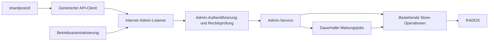

# Stufe 8: Betriebsverwaltung mit shardpostctl und OpenAPI

Status: **geplant; Kern vorgezogen** (18.09.2026): Vertrag mit Generierung,
Unix-Socket- und mTLS-Listener, Rollen, Audit-Logzeile, `version` und die
lokale Zustellung (LDA) mit `shardpostctl`, siehe
[Admin-API und LDA](../admin-api.md). Entwurf vom 16.09.2026 auf Basis
von ShardPost 0.12.0. Die Nummer setzt die bisherigen Stufen 6/7 für JMAP
fort; sie schreibt keine zeitliche Abhängigkeit von JMAP vor. Die ersten
Teilpakete dieser Stufe sollten vor einer größeren Backend-Migration kommen.

## Ziel und Architekturentscheidung

Administratoren sollen Postfächer untersuchen, Berechtigungen erklären,
gezielt reparieren und nachvollziehbar verwalten können, ohne RADOS-Objekte
von Hand zu ändern oder IMAP als privilegierte Administrationsschnittstelle
zu missbrauchen. Vorbild ist der betriebliche Nutzen von doveadm, nicht dessen
vollständiger Befehlsumfang oder Wire-Protokoll.

**Vorgesehen sind `shardpostctl` und eine interne, versionierte HTTP-API mit
OpenAPI als führendem Vertrag.** Daraus werden Go-Transporttypen,
Server-Schnittstellen und der von der CLI verwendete Client generiert.
Die fachlichen Operationen liegen in einem gemeinsamen Admin-Service hinter
schmalen Store-Interfaces. Die CLI enthält weder Ceph-Zugangsdaten noch einen
zweiten Reparaturalgorithmus. Kein universeller Endpunkt zum Ausführen von
Shellbefehlen oder beliebigen RADOS-Schreiboperationen.

Der Admin-Listener läuft zunächst im Serverprozess, getrennt von Mailports
und Metriken. Langläufer werden als dauerhafte Jobs ausgeführt. Eine eigene
Deployment-Komponente ist erst bei belegtem Bedarf erforderlich.

OpenAPI beschreibt Ein- und Ausgaben, Fehler und Authentifizierung. Es ersetzt
weder Autorisierungslogik noch Jobkoordination oder Konsistenzprüfungen.
Der konkrete Vertrag wird in Teilpaket 8a unter `api/admin/openapi.yaml`
angelegt; diese Planung behauptet noch keine verfügbaren Endpunkte.

## Zuständigkeiten

- **ShardPost:** Mailboxen, Nachrichten, Mailbox-ACLs, Quota, Sieve-Daten,
  FTS, Store-Integrität und eigene Wartungsjobs.
- **Nauthilus beziehungsweise Provisionierung:** Identitäten, Passwörter,
  Authentifizierungsrichtlinien, Account-Lebenszyklus und kanonische Konten.
  Ein Speichernamespace ist kein Nachweis eines gültigen Benutzerkontos.
- **nauthilus-director:** Platzierung, Routing, aktive Sessions, Hold, Kick,
  Drain und Move. Diese Funktionen werden nicht nochmals in ShardPost gebaut.
- **Betriebsorchestrierung:** Verknüpft Director-Hold, Datenübertragung und
  Umschaltung. Ein Director-Hold allein sperrt keine direkten Store-Schreiber.

„Benutzer-ACLs“ bezeichnet hier Rechte eines Principals auf einer Mailbox.
Admin-Rollen für die HTTP-API sind davon getrennt; ein Mailbox-ACL-Adminrecht
verleiht keine systemweite Betriebsberechtigung.

## Kandidaten und Priorität

Priorität P0: vor größerem Pilot/Migration; P1: im Anschluss für regulären
Betrieb; P2: eigener Ausbau nach Bedarf. Die CLI-Namen sind Entwurfsnamen.

| Funktion / doveadm-Vorbild | Nutzen und geplante Oberfläche | Bestand und erforderlicher Ausbau | Priorität |
|---|---|---|---|
| `mailbox list/status` | `mailbox list/show`: stabile ID, Name, UIDVALIDITY, UIDNEXT, MODSEQ, Anzahl, Special-Use, Subscriptions, Shards | `ListMailboxes`, `Info` vorhanden; paginierte, kostenbewusste Admin-Sicht fehlt | P0 |
| `mailbox create/rename/delete/subscribe` | Ordner provisionieren, umbenennen, abonnieren und kontrolliert entfernen | Store-Operationen vorhanden; geschützte Admin-Fassade, Vorbedingungen und Löschplan fehlen | P0; Löschen 8c |
| `acl get/rights/debug` | `acl list/explain`: Warum sieht ein Benutzer ein freigegebenes Postfach nicht? Explizite und effektive Rechte, Besitzer und SharedRef erklären | ACLs und SharedRefs vorhanden; Erklärung muss dieselbe Rechteberechnung wie IMAP nutzen | P0 |
| `acl set/add/remove/delete/recalc` | Rechte ändern und beschädigte Freigabeverweise abgleichen | `SetACL` und Generationen vorhanden; selektiver Abgleich und atomare relative Rechteänderungen ergänzen | P0 |
| `quota get/recalc` | `quota show/check/recalculate`: Grenzwert, Belegung, Abweichung; lokale Limits gezielt ändern | Quota-API und Scrub-Abgleich vorhanden; eigenständiger Job ohne weitere Scrub-Reparaturen fehlt | P0 |
| `force-resync`, `dump`, `rebuild` | `index inspect/check/repair`: Registry, Header, Shards, UIDs, MODSEQ, Pending, Intents und Referenzen prüfen | Scrubber vorhanden; fein abgegrenzte Prüfer/Reparaturen und strukturierte Berichte fehlen | P0 |
| `index`, `fts rescan/check` | `fts status/check/rebuild`: fehlende/veraltete Einträge erkennen, Suchindex kontrolliert neu aufbauen | Indexierung/Suche/`DeleteFTS` vorhanden; kein sicherer administrativer Neuaufbau als Job | P0 |
| `fts optimize` | Postinglisten/Trigramme untersuchen, eventuell verdichten | Kein pauschaler Nutzen bewiesen; nur bei gemessener Fragmentierung oder Kosten ergänzen | P2 |
| `search`, `fetch`, `flags`, `copy`, `move`, `expunge` | Nachrichten gezielt finden, Metadaten lesen, Flags korrigieren, verschieben und löschen | Store-Bausteine vorhanden; begrenzte Abfrage, Rechte und stabile Zielmenge fehlen; Inhaltslesen gesondert autorisieren | P1 |
| `sieve` | Skripte auflisten, validieren, versioniert sichern und aktivieren; Diagnose ohne Mailversand/Lernen | Skriptverwaltung vorhanden; Admin-Fassade und garantiert nebenwirkungsfreie Prüfung fehlen | P1 |
| Lernqueue (ShardPost-spezifisch) | `learning list/show/retry`: Rückstände, Fehler und Dead-Jobs untersuchen; einzelne Jobs erneut versuchen | Worker vorhanden; paginierte Diagnose und sichere Wiederholung fehlen | P1 |
| `backup`, `sync`, `import` | Inventar, Export/Import, Vergleich, Fortschritt und wiederaufnehmbare Migration | Eigener Datenübertragungsvertrag nötig; keine Behauptung von dsync-Kompatibilität | P1, separates Teilpaket 8e |
| `user`, `who`, `kick`, `proxy`, `auth`, `pw` | Kanonisches Speicherkonto anzeigen; Routing-/Sessiondiagnose mit Director korrelieren | Identitätsverwaltung und Routing bleiben bei deren Ownern; keine Passwortverwaltung in ShardPost | Diagnose P0; Rest extern |
| `stats`, `log`, `config` | Version, Konfigurationsfingerprint ohne Secrets, Store-Status und Jobzustand; Verweise auf Metriken/Logs | Config-Prüfung, slog und Prometheus vorhanden; keine zweite Monitoring-Datenbank | P0 |
| `purge`, Benutzerlöschung | Vollständiges Offboarding mit Referenzen, Freigaben, Skripten, Lernjobs und dokumentiertem Retentionsumfang | Nicht aus `DeleteMailbox` ableitbar; eigenes Verfahren mit Provisionierung und Backup-Policy | P2 |
| `fs`, `dict`, `exec`, `deduplicate` | Keine allgemeine Rohdaten- oder Shellverwaltung; Deduplikation nur mit eigenem fachlichem Vertrag | Direkte Änderungen würden Store-Invarianten umgehen; Message-ID allein beweist keine Duplikate | Nicht in erster Umsetzung |

Doveadm kann unter anderem Mailboxen, ACLs, Quota, Nachrichten und Sieve
verwalten; die Auswahl oben priorisiert unsere Betriebsfälle anhand der
[Befehlsübersicht](https://doc.dovecot.org/2.4.1/core/summaries/doveadm.html).
ACL-Erklärung und Freigabeabgleich orientieren sich am Zweck von
[`acl debug/rights/recalc`](https://doc.dovecot.org/2.4.0/core/man/doveadm-acl.1.html),
Quota-Abgleich an
[`quota recalc`](https://doc.dovecot.org/2.4.0/core/man/doveadm-quota.1.html).

## Fachliche Grenzen der Reparaturen

**Mailboxindex ist nicht gleich Volltextindex.** FTS ist aus verfügbaren
Nachrichten rekonstruierbar. Verlorene UID-Zuordnungen, Flags oder MODSEQ-
Historien sind nicht zuverlässig aus dem MIME-Inhalt rekonstruierbar.
`index repair` darf deshalb weder UIDVALIDITY stillschweigend ersetzen noch
Nachrichten umnummerieren. Nicht reparierbarer Zustand wird als solcher
gemeldet und verlangt Restore oder einen gesonderten Wiederherstellungsplan.

Der vorhandene Scrubber darf nicht unverändert als generischer
„alles reparieren“-Endpunkt veröffentlicht werden: Er kann unter anderem
verwaiste Daten löschen und Einträge für fehlende Blobs entfernen. Befunde
werden in Prüfklassen und einzeln wählbare Reparaturaktionen zerlegt.
Altersgrenzen, Objektversionen und Intent-Behandlung bleiben erhalten.
Ein fehlender Blob wird nicht als reparierter Mailinhalt ausgegeben.

**FTS-Neuaufbau:** Kein `DeleteFTS` gefolgt von ungeschütztem Live-Scan.
Ein implementierter Vertrag muss Zustellung, COPY/MOVE und EXPUNGE während
des Aufbaus berücksichtigen. Vorzugsweise neue Indexgeneration erstellen,
Änderungen nachführen, Vollständigkeit prüfen und atomar umschalten; die alte
Generation erst danach freigeben. Falls dies zunächst nicht umgesetzt wird,
ist ein expliziter, im Backend durchgesetzter Wartungsmodus mit begrenzter
Unterbrechung erforderlich. Teilindizes dürfen keine scheinbar vollständigen
Suchergebnisse liefern. Da FTS heute pro Konto/GUID organisiert ist, bleibt
der erste Rebuild kontoweit; Mailboxfilter versprechen keine isolierte
Löschung gemeinsam verwendeter FTS-Einträge.

Dovecots [`fts rescan`](https://doc.dovecot.org/2.4.0/core/man/doveadm-fts.1.html)
vergleicht konzeptionell Index und Nachrichtenbestand; manche Treiber löschen
stattdessen den Index. Diese treiberabhängige Semantik übernehmen wir nicht
als undifferenziertes „rescan“.

**Quota und ACL:** Laufende Reservierungen dürfen nicht durch einen einfachen
Neuzählwert überschrieben werden. ACL-Reparaturen beachten Owner, Generationen
und beide Seiten der Freigabeverweise. Add/Remove von Rechten ist eine
serverseitige, versionsgeprüfte Operation, kein Read-Modify-Write in der CLI.

**Nachrichtenoperationen:** Ziel ist Konto + stabile Mailbox-ID + UIDVALIDITY
+ UID, ergänzend GUID; keine flüchtigen IMAP-Sequenznummern. Bei selektiertem
MOVE/EXPUNGE wird die tatsächlich betroffene Menge fixiert und erneut geprüft.
Kontoübergreifendes Verschieben ist zunächst ausgeschlossen. Löschung,
Papierkorb und Backup-Aufbewahrung werden getrennt ausgewiesen.

## API-, Sicherheits- und Jobvertrag

- Versionierter Pfad `/admin/v1`; typisierte Ressourcen statt beliebiger
  Befehlsstrings. Beispiele: Accounts/Mailboxes/ACL/Quota, Wartungspläne,
  Jobs und Diagnose. Undurchsichtige IDs statt Mailboxnamen als URL-Pfadteile.
- Standardmäßig deaktivierter Listener; intern exponiert, TLS und
  authentifizierte Admin-Identität. Für den ersten Transport mTLS mit
  expliziter Zuordnung von Zertifikatsidentität zu Rollen/Kontenumfang.
  Endnutzer-Login oder bloße Netzzugehörigkeit genügt nicht. Zusätzlich
  (Entscheidung 18.09.2026) ein Unix-Socket im Pod für lokale Aufrufer
  wie `shardpostctl` und die Quota-Programme: Identität ist die Peer-UID
  (nur die des Servers), die Rollen sind konfiguriert.
- Getrennte Rechte für Diagnose, ACL/Provisionierung, Reparatur,
  Nachrichteninhalt, Export und endgültiges Löschen; Konto-/Tenant-Scope wird
  bei jedem Zugriff geprüft. Keine Mandantentrennung allein durch RADOS-Namespace.
- Lesende Requests verändern keinen Store-Zustand. Teure Prüfungen sind
  explizite Jobs mit I/O-, Zeit-, Speicher- und Parallelitätsbudget.
- Pagination und maximale Ergebnismengen; keine implizite Auswahl aller
  Benutzer. Inventar unterscheidet Store-Konten von provisionierten Konten
  und schließt interne Namespaces aus. Bulk-Jobs arbeiten auf fixierten Listen.
- Gefährliche Aktionen nutzen Plan → Apply: Plan enthält Zielmenge,
  Auswirkungen, Ablaufzeit und Versionen; Apply referenziert den Plan und
  prüft Drift erneut. Das ermöglicht unbeaufsichtigte autorisierte Automation,
  ohne eine interaktive Bestätigung für jeden normalen Schreibzugriff.
- Kurze Änderungen nutzen Versionsvorbedingungen (`ETag`/`If-Match`);
  nicht erfüllte Vorbedingungen liefern `412`, fachliche Konflikte `409`.
  Maschinenlesbare Fehlercodes unterscheiden fehlend, verboten, nicht
  reparierbar, Wartung erforderlich, temporär gestört und teilweise erledigt.
- Langläufer liefern `202` mit Job-ID. Zustände: queued, running, succeeded,
  partially_failed, failed, cancel_requested, cancelled. Fortschritt,
  Checkpoints, Teilfehler, Wiederaufnahme und Ergebnis bleiben nach Pod-Neustart
  erhalten. Abbruch erfolgt an sicheren Grenzen und ist kein Rollbackversprechen.
- Idempotency-Key bindet Identität, Scope und Request-Hash an das Ergebnis;
  Wiederholung erzeugt keinen zweiten Auftrag. Kein Exactly-once-Versprechen
  für externe Lernprogramme oder SMTP-Seiteneffekte.
- Jobübernahme braucht Lease, Generation und Prüfung dieser Generation an
  Mutationsgrenzen. Abgelaufene Worker dürfen nach Übernahme nicht weiter
  schreiben. Konfliktmatrix für Scrub, Rebuild, Import und Quota-Reparatur;
  gemeinsame Registrierung gilt auch für Cron-/CLI-Wartung. CAS bleibt bestehen.
- Audit: Admin-Identität, Operation, Scope, Plan/Job, Zeitpunkt, Ergebnis,
  nachvollziehbare Änderungen; keine Tokens, Passwörter, Nachrichtentexte
  oder Skriptinhalte. Geschützte externe Aufbewahrung und definierte Retention.
  Konten/Job-IDs dürfen nicht zu hochkardinalen Prometheus-Labels werden.
- CLI: menschenlesbare Tabellen und `--json`, stabile Exitcodes (Erfolg,
  Teilfehler, fehlgeschlagen); `job wait` wertet den Endzustand aus.
  SDK/Server-Generierung, Spezifikationsprüfung und Prüfung auf veraltete
  generierte Dateien sind reproduzierbare Build-Ziele.

## Umsetzungspakete und Abnahme

### 8a — Vertrag, CLI und lesende Diagnose (P0)

OpenAPI, generierter Client/Server, `shardpostctl`, Admin-Identität/Rollen,
Mailbox-/ACL-/Quota-/Versionsansichten und Jobstatus implementieren.
Bestehende Fachoperationen wiederverwenden; paginierte Store-Zugriffe ergänzen,
statt vollständige Kontenlisten nur nachträglich in der API abzuschneiden.

Abnahme: echte HTTPS-Requests und CLI gegen den Server; unberechtigt,
falscher Scope, abgelaufenes Zertifikat, Pagination und leere Ergebnisse.
Nachweis, dass Diagnose keine Maildaten verändert und keine Secrets ausgibt.

### 8b — Provisionierung und Berechtigungen (P0)

Mailbox create/rename/subscription, ACL set/add/remove/explain, Quota-Limits.
Für Limits vorab genau eine maßgebliche Quelle festlegen; keine konkurrierenden
Werte zwischen Provisionierung und Store. Keine externe Identität anlegen.

Abnahme: zwei Konten und Shared Mailbox, gleichzeitige ACL-Änderungen,
Unicode-Namen, geschützte INBOX-Regeln, Benachrichtigung aktiver IMAP-Sessions,
Versionskonflikte und Idempotenz bei verlorener HTTP-Antwort.

### 8c — Wartungsjobs und gezielte Reparaturen (P0)

Dauerhafte Jobausführung, Diagnose/Plan/Apply, Quota-Abgleich,
ACL-Verweisabgleich, Index-/Intent-Prüfung, selektiver Scrub, FTS-Rebuild und
kontrolliertes Mailbox-Löschen. Bestehendes `shardpost scrub` und CronJob an
denselben Service/Koordinationsvertrag anbinden; keine unkoordinierte Zweitspur.

Abnahme gegen echtes Ceph: Pod-Abbruch und Lease-Verlust an Schreibgrenzen,
Wiederaufnahme ohne doppelte Wirkung, parallele Zustellung/STORE/MOVE/EXPUNGE,
abgelaufene Pläne, volle Ressourcenbudgets und Teilfehler. Bekannte Suchmengen
vor/nach Rebuild gleich; UIDVALIDITY/UIDs bleiben bei Reparaturen erhalten.
Bei fehlenden Daten muss der Bericht offen bleiben statt Erfolg zu behaupten.

### 8d — Supportwerkzeuge (P1)

Begrenzte Nachrichtensuche, gesondert autorisiertes Fetch/Export, Flags,
Copy/Move innerhalb eines Kontos, geplantes Expunge; Sieve-Prüfung und
Aktivierung sowie Lernqueue-Diagnose/Retry. Nebenwirkungsfreie Sieve-Prüfung
muss Redirect, Vacation, Notify und externe Programme unterdrücken.

Abnahme: stabile Zielidentitäten bei paralleler Änderung, sichere Vorschau,
Datenschutz in Logs/Audit und klare Behandlung nicht idempotenter Lernziele.

### 8e — Migrations- und Wiederherstellungswerkzeuge (P1)

Export-/Importformat und Prüfsummen festlegen; Rohmail, Datum, Flags,
Mailboxidentitäten, UIDVALIDITY/UIDs, MODSEQ-Vertrag, ACLs, Subscriptions,
Special-Use, Metadaten und Sieve berücksichtigen. POP3-UIDLs ausdrücklich
prüfen. Reproduzierbare FTS-Daten müssen nicht Teil des Transfers sein.
Import bestehender UID-Identitäten erfordert neue Store-Funktionen; APPEND
allein verspricht diese Erhaltung nicht.

Inventar → Erstkopie → Delta → Director-Hold und Nachweis ruhender
Schreibpfade → finaler Abgleich → Routing-Umschaltung → Protokollprüfung.
Rückweg berücksichtigt nach Umschaltung hinzugekommene Änderungen.
Abnahme: repräsentative Dovecot-Konten, wiederholbarer Import, Client-Identitäten,
Sieve ohne unbeabsichtigten Versand, Ausfälle während Transfer und Rückmigration.
Zusätzlich isolierten Restore aus einer echten Sicherung prüfen; ein
erfolgreicher Export ist kein Backup-/Restore-Nachweis.

**Vorgezogener Kern: identitätserhaltender Kontoimport** (Planung vom
18.09.2026, umgesetzt und ausgerollt mit 0.17.0; Bedienung und Semantik in
[Admin-API: Kontoimport](../admin-api.md#kontoimport-mit-erhaltenen-imap-identitäten)). Anlass: Die erste Produktivmigration per imapsync erzeugte neue
UIDVALIDITY/UIDs, alle Clients luden ihre Ordner vollständig neu. Geplant ist
ein Import über die Admin-API (Rolle `import`, Import-Sitzung mit
kontoweiter Sperre), der UIDVALIDITY, UIDs samt Lücken, UIDNEXT, Flags,
Keywords, INTERNALDATE/SAVEDATE und MODSEQ übernimmt; `h:modseq` und
`h:logstart` werden auf den Quellstand gesetzt, damit CONDSTORE/QRESYNC-
Caches der Clients gültig bleiben. Der Quellleser `shardpostctl migrate imap`
liest Dovecot per IMAP mit Master-User (UID FETCH mit MODSEQ), kopiert
initial und in wiederholbaren Deltas; nur der letzte Delta liegt im
Director-Hold. Umgesetzt über einen Sidecar im Server-Pod am Admin-Socket (kein mTLS nötig).
Abnahmekriterium: vorher synchronisierte Clients (Thunderbird, Apple Mail,
iOS) laden nach der Umschaltung nichts vollständig neu.

## Vor Implementierungsbeginn zu entscheiden

1. Betreiberidentitäten, Zertifikatsausstellung, Rollen und Audit-Aufbewahrung.
2. Jobdatenlayout und Übernahme-/Fencing-Vertrag; Schema und Upgrade/Rollback.
3. FTS-Generationen oder zunächst expliziter Wartungsmodus.
4. Maßgebliche Quota-Quelle und kanonische Kontenauflösung.
5. Importformat, unterstützte Dovecot-Quellversionen und Identitätserhaltung
   (Vorschlag für den IMAP-Quellleser siehe Kontoimport unter 8e).

Kein Teilpaket setzt einen CAS-Umbau voraus. Zusätzliche Schreibserialisierung
oder FTS-Optimierung wird erst durch Messungen begründet. Diese Stufe baut
administrative Fähigkeiten und überprüfbare Betriebsabläufe aus.

## Geprüfte Codebasis

- [Store-Vertrag](../../internal/model/model.go): Mailboxen, ACL, Quota,
  Nachrichten, Metadaten und Sieve.
- [Bestehender Scrub-Einstieg](../../cmd/shardpost/main.go) und
  [Scrubber](../../internal/cephstore/scrub.go).
- [FTS](../../internal/cephstore/fts.go): interne Indizierung, Suche und
  kontoweites Löschen; noch kein administrativer Rebuild-Vertrag.
- [Speichermodell](../architecture/storage.md) und
  [Qualitätsstand](quality.md): Atomarität, Reparaturgrenzen und Nachweise.
