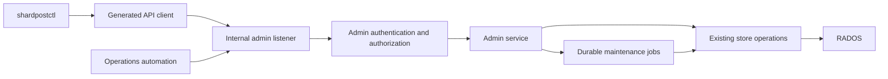

# Stage 8: Operational administration with shardpostctl and OpenAPI

Status: **complete** (2026-09-19): every package 8a to 8e is implemented
and live; 0.23.0 carries the last of them. The sections below keep the
plan and the decisions behind it. What was built, in order: the contract
with code generation, the Unix socket and mTLS listeners, roles, the audit
log line, `version` and local delivery (LDA) via `shardpostctl`, see
[Admin API and LDA](../admin-api.md). Also implemented: the
identity-preserving account import from 8e (0.17.0), a time-limited
protocol trace per account (0.18.0, role `trace`) as the first support tool,
and **8a** (0.19.0): read-only diagnosis for the server, an account, mailboxes
(paginated), ACLs with an explanation, quota and shares, plus an account scope
per mTLS client, see [Admin API: diagnosis](../admin-api.md#read-only-diagnosis-stage-8a).
The job status from 8a follows with the jobs in 8c. **8b** (0.20.0):
create, rename and subscribe mailboxes and change ACLs with version checks
(role `provision`), see [Admin API: provisioning](../admin-api.md#provisioning-and-permissions-stage-8b).
**8c** (0.21.0): durable jobs with lease, fencing, checkpoints and takeover,
plan → apply with a drift check, idempotency key, job status (the rest
of 8a); kinds `index_check`, `scrub` (classes), `quota_recalc`,
`acl_reconcile`, `fts_rebuild` (maintenance mode), `mailbox_delete`, `purge`
(roles `repair`, `delete`), see [Admin API: maintenance jobs](../admin-api.md#maintenance-jobs-stage-8c).
The periodic scrub CronJob remains separate; the shared coordination point is
the account lock, which it respects. **8d** (0.22.0):
list messages, search within limits, show headers, export
(role `content`), flags, copy/move (role `support`),
scheduled expunge (job `expunge`, role `delete`), Sieve
list/show/put/delete/activate and a check without side effects,
learning queue list/show/retry, see [Admin API: support tools](../admin-api.md#support-tools-stage-8d).
**8e** (0.23.0): account export as a versioned archive with checksums
(role `export`), `archive verify` and `restore` via the account import,
isolated restore without ACLs and without an active Sieve script, see
[Admin API: export and restore](../admin-api.md#export-and-restore-stage-8e).
Stage 8 is therefore complete. Drafted on 2026-09-16 on the basis
of ShardPost 0.12.0. The number continues the previous stages 6/7 for JMAP;
it does not impose any temporal dependency on JMAP. The first work packages
of this stage should come before a larger backend migration.

## Goal and architecture decision

Administrators should be able to inspect mailboxes, explain permissions, repair
specific problems and administer the system in an auditable way, without
editing RADOS objects by hand or abusing IMAP as a privileged administration
interface. The model is the operational value of doveadm, not its complete
command set or its wire protocol.

**The plan is `shardpostctl` plus an internal, versioned HTTP API with
OpenAPI as the leading contract.** Go transport types, server interfaces and
the client used by the CLI are generated from it.
The domain operations live in a shared admin service behind narrow store
interfaces. The CLI contains neither Ceph credentials nor a second repair
algorithm. There is no universal endpoint for running shell commands or
arbitrary RADOS writes.

The admin listener initially runs inside the server process, separate from the
mail ports and the metrics endpoint. Long-running work is executed as durable
jobs. A deployment component of its own is only required once the need is
demonstrated.

OpenAPI describes inputs and outputs, errors and authentication. It replaces
neither authorization logic nor job coordination or consistency checks.
The concrete contract is created in work package 8a under
`api/admin/openapi.yaml`; this plan does not yet claim any available endpoints.

## Responsibilities

- **ShardPost:** mailboxes, messages, mailbox ACLs, quota, Sieve data,
  FTS, store integrity and its own maintenance jobs.
- **Nauthilus, respectively provisioning:** identities, passwords,
  authentication policies, account lifecycle and canonical accounts.
  A storage namespace is not evidence of a valid user account.
- **nauthilus-director:** placement, routing, active sessions, hold, kick,
  drain and move. These functions are not rebuilt in ShardPost.
- **Operational orchestration:** ties together director hold, data transfer
  and cutover. A director hold alone does not lock out direct store writers.

"User ACLs" here means the rights of a principal on a mailbox.
Admin roles for the HTTP API are separate from that; a mailbox ACL admin right
does not grant any system-wide operational authority.

## Candidates and priority

Priority P0: before a larger pilot/migration; P1: afterwards for regular
operation; P2: a separate extension as needed. The CLI names are draft names.

| Function / doveadm model | Benefit and planned surface | Existing code and required extension | Priority |
|---|---|---|---|
| `mailbox list/status` | `mailbox list/show`: stable ID, name, UIDVALIDITY, UIDNEXT, MODSEQ, count, special-use, subscriptions, shards | `ListMailboxes`, `Info` exist; a paginated, cost-aware admin view is missing | P0 |
| `mailbox create/rename/delete/subscribe` | Provision, rename, subscribe and remove mailboxes in a controlled way | Store operations exist; a protected admin facade, preconditions and a deletion plan are missing | P0; deletion 8c |
| `acl get/rights/debug` | `acl list/explain`: why does a user not see a shared mailbox? Explain explicit and effective rights, owner and SharedRef | ACLs and SharedRefs exist; the explanation must use the same rights computation as IMAP | P0 |
| `acl set/add/remove/delete/recalc` | Change rights and reconcile damaged share references | `SetACL` and generations exist; add selective reconciliation and atomic relative rights changes | P0 |
| `quota get/recalc` | `quota show/check/recalculate`: limit, usage, deviation; change local limits selectively | The quota API and the scrub reconciliation exist; a standalone job without further scrub repairs is missing | P0 |
| `force-resync`, `dump`, `rebuild` | `index inspect/check/repair`: check registry, header, shards, UIDs, MODSEQ, pending state, intents and references | The scrubber exists; narrowly scoped checks/repairs and structured reports are missing | P0 |
| `index`, `fts rescan/check` | `fts status/check/rebuild`: detect missing/stale entries, rebuild the search index in a controlled way | Indexing/search/`DeleteFTS` exist; there is no safe administrative rebuild as a job | P0 |
| `fts optimize` | Inspect posting lists/trigrams, possibly compact them | No general benefit demonstrated; add only on measured fragmentation or cost | P2 |
| `search`, `fetch`, `flags`, `copy`, `move`, `expunge` | Find specific messages, read metadata, correct flags, move and delete | Store building blocks exist; a bounded query, permissions and a stable target set are missing; reading content requires separate authorization | P1 |
| `sieve` | List, validate, version and activate scripts; diagnosis without mail sending or learning | Script management exists; an admin facade and a guaranteed side-effect-free check are missing | P1 |
| Learning queue (ShardPost-specific) | `learning list/show/retry`: inspect backlogs, errors and dead jobs; retry individual jobs | The worker exists; paginated diagnosis and safe retries are missing | P1 |
| `backup`, `sync`, `import` | Inventory, export/import, comparison, progress and resumable migration | A data transfer contract of our own is needed; no claim of dsync compatibility | P1, separate work package 8e |
| `user`, `who`, `kick`, `proxy`, `auth`, `pw` | Show the canonical storage account; correlate routing/session diagnosis with the director | Identity management and routing stay with their owners; no password management in ShardPost | Diagnosis P0; the rest external |
| `stats`, `log`, `config` | Version, configuration fingerprint without secrets, store status and job state; pointers to metrics/logs | Config checking, slog and Prometheus exist; no second monitoring database | P0 |
| `purge`, user deletion | Complete offboarding covering references, shares, scripts, learning jobs and a documented retention scope | Cannot be derived from `DeleteMailbox`; needs its own procedure together with provisioning and the backup policy | P2 |
| `fs`, `dict`, `exec`, `deduplicate` | No general raw-data or shell administration; deduplication only with a domain contract of its own | Direct changes would bypass store invariants; a Message-ID alone does not prove a duplicate | Not in the first implementation |

Doveadm can administer mailboxes, ACLs, quota, messages and Sieve among other
things; the selection above prioritizes our operational cases based on the
[command overview](https://doc.dovecot.org/2.4.1/core/summaries/doveadm.html).
ACL explanation and share reconciliation follow the purpose of
[`acl debug/rights/recalc`](https://doc.dovecot.org/2.4.0/core/man/doveadm-acl.1.html),
quota reconciliation that of
[`quota recalc`](https://doc.dovecot.org/2.4.0/core/man/doveadm-quota.1.html).

## Domain limits of the repairs

**A mailbox index is not a full-text index.** FTS can be reconstructed from the
available messages. Lost UID assignments, flags or MODSEQ histories cannot be
reliably reconstructed from the MIME content.
`index repair` must therefore neither silently replace UIDVALIDITY nor
renumber messages. State that cannot be repaired is reported as such and
requires a restore or a separate recovery plan.

The existing scrubber must not be exposed unchanged as a generic
"repair everything" endpoint: among other things it can delete orphaned data
and remove entries for missing blobs. Findings are broken down into check
classes and individually selectable repair actions.
Age thresholds, object versions and intent handling are preserved.
A missing blob is not reported as repaired mail content.

**FTS rebuild:** no `DeleteFTS` followed by an unprotected live scan.
An implemented contract must account for delivery, COPY/MOVE and EXPUNGE
during the rebuild. Preferably create a new index generation, track changes,
verify completeness and switch over atomically; release the old generation
only afterwards. If this is not implemented right away, an explicit
maintenance mode enforced in the backend with a bounded interruption is
required. Partial indexes must not return search results that appear
complete. Since FTS is organized per account/GUID today, the first rebuild
remains account-wide; mailbox filters promise no isolated deletion of shared
FTS entries.

Dovecot's [`fts rescan`](https://doc.dovecot.org/2.4.0/core/man/doveadm-fts.1.html)
conceptually compares the index against the message set; some drivers delete
the index instead. We do not adopt that driver-dependent semantics as an
undifferentiated "rescan".

**Quota and ACL:** in-flight reservations must not be overwritten by a simple
recount value. ACL repairs respect the owner, the generations and both sides
of the share references. Adding/removing rights is a server-side,
version-checked operation, not a read-modify-write in the CLI.

**Message operations:** the target is account + stable mailbox ID +
UIDVALIDITY + UID, plus the GUID; never volatile IMAP sequence numbers. For a
MOVE/EXPUNGE in the selected state, the actually affected set is pinned and
re-checked. Moving across accounts is excluded for now. Deletion,
trash and backup retention are reported separately.

## API, security and job contract

- Versioned path `/admin/v1`; typed resources instead of arbitrary command
  strings. Examples: accounts/mailboxes/ACL/quota, maintenance plans,
  jobs and diagnosis. Opaque IDs instead of mailbox names as URL path segments.
- A listener that is disabled by default; exposed internally, with TLS and an
  authenticated admin identity. For the first transport, mTLS with an
  explicit mapping from certificate identity to roles/account scope.
  An end-user login or mere network membership is not enough. In addition
  (decision of 2026-09-18) a Unix socket in the pod for local callers
  such as `shardpostctl` and the quota programs: the identity is the peer UID
  (only the server's own), and the roles are configured.
- Separate rights for diagnosis, ACL/provisioning, repair,
  message content, export and permanent deletion; the account/tenant scope is
  checked on every access. No tenant separation by RADOS namespace alone.
- Read requests do not change store state. Expensive checks are
  explicit jobs with an I/O, time, memory and concurrency budget.
- Pagination and maximum result sizes; no implicit selection of all
  users. The inventory distinguishes store accounts from provisioned accounts
  and excludes internal namespaces. Bulk jobs work on pinned lists.
- Dangerous actions use plan → apply: the plan contains the target set,
  the effects, an expiry time and versions; apply references the plan and
  re-checks for drift. This enables unattended authorized automation
  without requiring an interactive confirmation for every ordinary write.
- Short changes use version preconditions (`ETag`/`If-Match`);
  unmet preconditions return `412`, domain conflicts `409`.
  Machine-readable error codes distinguish missing, forbidden, not
  repairable, maintenance required, temporarily disrupted and partially done.
- Long-running work returns `202` with a job ID. States: queued, running,
  succeeded, partially_failed, failed, cancel_requested, cancelled. Progress,
  checkpoints, partial failures, resumption and the result survive a pod
  restart. Cancellation happens at safe boundaries and is not a rollback promise.
- The idempotency key binds identity, scope and request hash to the result;
  a retry does not create a second job. There is no exactly-once promise
  for external learning programs or SMTP side effects.
- Job takeover requires a lease, a generation and a check of that generation at
  mutation boundaries. Expired workers must not keep writing after a takeover.
  There is a conflict matrix for scrub, rebuild, import and quota repair;
  shared registration also applies to cron/CLI maintenance. CAS remains in place.
- Audit: admin identity, operation, scope, plan/job, timestamp, result,
  traceable changes; no tokens, passwords, message bodies
  or script contents. Protected external retention and a defined retention period.
  Account and job IDs must not become high-cardinality Prometheus labels.
- CLI: human-readable tables and `--json`, stable exit codes (success,
  partial failure, failed); `job wait` evaluates the final state.
  SDK/server generation, specification checking and a check for stale
  generated files are reproducible build targets.

## Implementation packages and acceptance criteria

### 8a — Contract, CLI and read-only diagnosis (P0)

Implement OpenAPI, the generated client/server, `shardpostctl`, the admin
identity/roles, the mailbox/ACL/quota/version views and the job status.
Reuse the existing domain operations; add paginated store access
instead of truncating complete account lists after the fact in the API.

Acceptance criteria: real HTTPS requests and the CLI against the server;
unauthorized access, wrong scope, expired certificate, pagination and empty
results. Evidence that diagnosis does not change mail data and emits no secrets.

### 8b — Provisioning and permissions (P0)

Mailbox create/rename/subscription, ACL set/add/remove/explain, quota limits.
For limits, define exactly one authoritative source up front; no competing
values between provisioning and the store. Do not create external identities.

Acceptance criteria: two accounts and a shared mailbox, concurrent ACL changes,
Unicode names, protected INBOX rules, notification of active IMAP sessions,
version conflicts and idempotency when the HTTP response is lost.

### 8c — Maintenance jobs and targeted repairs (P0)

Durable job execution, diagnosis/plan/apply, quota reconciliation,
ACL reference reconciliation, index/intent checking, selective scrub, FTS
rebuild and controlled mailbox deletion. Connect the existing
`shardpost scrub` and the CronJob to the same service and coordination
contract; no uncoordinated second track.

Acceptance criteria against a real Ceph: pod termination and lease loss at write
boundaries, resumption without duplicate effects, concurrent
delivery/STORE/MOVE/EXPUNGE, expired plans, exhausted resource budgets and
partial failures. Known search result sets identical before and after a rebuild;
UIDVALIDITY/UIDs preserved across repairs.
When data is missing, the report has to stay open instead of claiming success.

### 8d — Support tools (P1)

Bounded message search, separately authorized fetch/export, flags,
copy/move within one account, scheduled expunge; Sieve checking and
activation as well as learning queue diagnosis/retry. A side-effect-free Sieve
check must suppress redirect, vacation, notify and external programs.

Acceptance criteria: stable target identities under concurrent changes, a safe
preview, data protection in logs/audit and clear handling of learning targets
that are not idempotent.

### 8e — Migration and restore tools (P1)

Define the export/import format and its checksums; cover raw mail, date, flags,
mailbox identities, UIDVALIDITY/UIDs, the MODSEQ contract, ACLs, subscriptions,
special-use, metadata and Sieve. Check POP3 UIDLs explicitly.
Reproducible FTS data need not be part of the transfer.
Importing existing UID identities requires new store functions; APPEND
alone does not promise that preservation.

Inventory → initial copy → delta → director hold with evidence of quiesced
write paths → final reconciliation → routing cutover → protocol check.
The way back accounts for changes made after the cutover.
Acceptance criteria: representative Dovecot accounts, a repeatable import,
client identities, Sieve without unintended sending, failures during the
transfer and migration back.
In addition, verify a restore from a real backup; a successful export is
not evidence of backup/restore.

Evidence (2026-09-20): the live account `de10042@srvint.net` was exported,
then purged (1031 objects removed, `store false, 0 mailboxes`) and
restored from that archive alone. Everything came back: 10 mailboxes with
their UIDVALIDITY and ids, 941 messages with the same UIDs, flags, dates
and MODSEQ, every mailbox verified against the inventory, a clean index
check and an IMAP session reporting the state it had before. Because the
data was really gone in between, this is the backup/restore evidence the
criterion asks for. Only the restore into a *different* account
(`-account`: other target, ACLs skipped, no Sieve activation) is covered
by tests rather than by a live run; it can be added the next time an
account is rebuilt.

**Core pulled forward: identity-preserving account import** (planned on
2026-09-18, implemented and rolled out with 0.17.0; usage and semantics in
[Admin API: account import](../admin-api.md#account-import-with-preserved-imap-identities)). Reason: the first production migration via imapsync created new
UIDVALIDITY/UIDs, and all clients reloaded their folders completely. The plan is
an import through the Admin API (role `import`, an import session with an
account-wide lock) that carries over UIDVALIDITY, UIDs including gaps, UIDNEXT,
flags, keywords, INTERNALDATE/SAVEDATE and MODSEQ; `h:modseq` and
`h:logstart` are set to the source state so that the clients' CONDSTORE/QRESYNC
caches stay valid. The source reader `shardpostctl migrate imap`
reads Dovecot over IMAP with a master user (UID FETCH with MODSEQ), copies
initially and then in repeatable deltas; only the last delta happens inside the
director hold. Implemented through a sidecar in the server pod on the admin socket (no mTLS needed).
Acceptance criterion: previously synchronized clients (Thunderbird, Apple Mail,
iOS) reload nothing completely after the cutover.

## Decisions (2026-09-19)

1. Operator identities and roles as before: Unix socket (peer UID) and
   mTLS client certificates with roles and an account scope; the audit trail is
   the log line `admin_request`, retained in the central logging system.
2. Job data in the index pool (in a namespace of its own), takeover by lease with
   a generation, account-exclusive jobs additionally under the account lock.
3. FTS rebuild initially in **maintenance mode** (account lock), no
   index generations.
4. **LDAP (`rnsMSQuota`) remains authoritative** for quota limits; the Admin API
   sets no limits and only reconciles the usage. Accounts are resolved
   canonically through Nauthilus.
5. Import as implemented (Dovecot 2.4 over an IMAP master user); export and
   backup as a **versioned archive of our own**, restore through the import.
6. Account deletion (purge) belongs to this stage; migrating back to Dovecot
   does not.

No work package requires a CAS redesign. Additional write serialization
or FTS optimization will only be justified by measurements. This stage builds
out administrative capabilities and verifiable operational procedures.

## Reviewed code base

- [Store contract](../../internal/model/model.go): mailboxes, ACL, quota,
  messages, metadata and Sieve.
- [Existing scrub entry point](../../cmd/shardpost/main.go) and the
  [scrubber](../../internal/cephstore/scrub.go).
- [FTS](../../internal/cephstore/fts.go): internal indexing, search and
  account-wide deletion; no administrative rebuild contract yet.
- [Storage model](../architecture/storage.md) and
  [quality status](quality.md): atomicity, repair limits and evidence.
