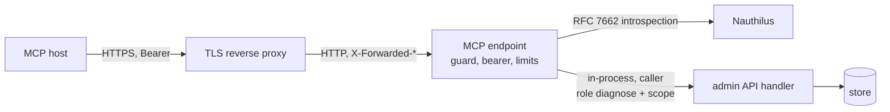

# MCP endpoint (read-only diagnostics)

Unreleased (after 0.53.0, written 2026-11-18): a server can offer the read-only operations of
the [admin API](admin-api.md) as an MCP endpoint (Model Context
Protocol), so that an MCP host — Claude Code, Claude Desktop, an own
agent — can look at ShardPost without `shardpostctl`, a client
certificate or a shell on a node. It is off unless `mcp.enabled` is
true.

The endpoint is built like the MCP endpoint of Nauthilus, and its
configuration uses the same keys: a listener of its own behind a
TLS-terminating reverse proxy, the stateless Streamable HTTP transport
of the official Go SDK, OAuth 2.1 bearer tokens with RFC 6750 and
RFC 9728 challenges, a bound on failed tokens per client address, a
bound on calls in flight per person, a check of every JSON-RPC body
before the SDK sees it, and an audit line per refused request and per
tool call. What differs is
the runtime behind it:

- **ShardPost is not an authorization server.** Nauthilus issues the
  tokens; the endpoint checks each one by RFC 7662 introspection at
  Nauthilus, as the client that owns the resource there. Nauthilus'
  `hosted_resource` becomes the `mcp.oauth` block.
- **The tools are the admin API.** Each tool is one GET operation of
  `api/admin/openapi.yaml` that needs the role `diagnose`; its title,
  description and input schema are read from that contract. A call is
  served in-process by the admin API's own handler as a caller with the
  role and account scope `mcp.principals` grant, so the admin API checks
  the role and the account scope, counts the request in
  `shardpost_admin_requests_total` and writes its audit line with
  `transport=mcp` — exactly as for `shardpostctl`. The answer is the
  admin API's JSON; an error answer is a tool error with the admin
  API's `code` and `message`.
- **Nothing changes state.** Only the role `diagnose` can be granted,
  and only GET operations without message contents are tools. Plans,
  jobs, provisioning, support views of messages, export and delete stay
  with `shardpostctl`.



## Tools

| Tool | Admin API operation |
| --- | --- |
| `server_version` | `GET /admin/v1/version` |
| `server_status` | `GET /admin/v1/server` |
| `servers_list` | `GET /admin/v1/servers` |
| `accounts_list` | `GET /admin/v1/accounts` (scope of all accounts) |
| `account_get` | `GET /admin/v1/accounts/{account}` |
| `account_directory` | `GET /admin/v1/accounts/{account}/directory` |
| `account_quota` | `GET /admin/v1/accounts/{account}/quota` |
| `account_shared_mailboxes` | `GET /admin/v1/accounts/{account}/shared` |
| `mailboxes_list` | `GET /admin/v1/accounts/{account}/mailboxes` |
| `mailbox_get` | `GET /admin/v1/accounts/{account}/mailboxes/{id}` |
| `mailbox_acl_get` | `GET /admin/v1/accounts/{account}/mailboxes/{id}/acl` |
| `mailbox_acl_explain` | `GET /admin/v1/accounts/{account}/mailboxes/{id}/acl/explain` |
| `sieve_scripts_list` | `GET /admin/v1/accounts/{account}/sieve` (names, not scripts) |
| `account_submissions_list` | `GET /admin/v1/accounts/{account}/submissions` |
| `submissions_list` | `GET /admin/v1/submissions` (scope of all accounts) |
| `account_fts_layout` | `GET /admin/v1/accounts/{account}/fts/layout` |
| `account_fts_stats` | `GET /admin/v1/accounts/{account}/fts/stats`, counters only |
| `fts_layout3_status` | `GET /admin/v1/fts/layout3` |
| `fts_layout3_accounts` | `GET /admin/v1/fts/layout3/accounts` (scope of all accounts) |
| `fts_dictfilter_status` | `GET /admin/v1/fts/dictfilter` |
| `fts_online_status` | `GET /admin/v1/fts/online` |
| `quota_online_status` | `GET /admin/v1/quota/online` |
| `mailbox_lock_status` | `GET /admin/v1/mailbox/lock` |
| `jobs_list` | `GET /admin/v1/jobs` |
| `job_get` | `GET /admin/v1/jobs/{job}` |
| `plan_get` | `GET /admin/v1/plans/{plan}` |
| `learning_jobs_list` | `GET /admin/v1/learning` |
| `learning_job_get` | `GET /admin/v1/learning/{job}` |

The arguments are the operation's path and query parameters; the path
parameters are required. `account_fts_stats` does not offer `exact`,
`parallel` and `classes`: they read the account's whole index and belong
to an operator who knows the cost (`shardpostctl fts stats`). Every
string in a result is data of the system — account, mailbox and script
names, ACL identifiers — which a mailbox owner can set; the descriptions
and the server instructions tell the model to treat it as untrusted
data, never as instructions. A result above half of
`mcp.limits.max_response_bytes` is replaced by the error
`response_too_large`; a list answer is wrapped as `{"result": [...]}`
because structured tool output is an object. Besides the admin API's
codes a tool error can carry the endpoint's own: `bad_request`
(arguments outside the input schema, or a path value `.` or `..`),
`response_too_large`, `timeout` and `internal`.

A tool answers with the view of the server that serves the call. The
store is shared, so the answer is the same on every server, except for
`server_status` and `server_version`, which describe that server.

## Tokens

A request reaches a tool only with a bearer token that

- the introspection endpoint reports `active`;
- names `mcp.oauth.issuer` as `iss`, carries `sub` and an `exp` in the
  future, and is a user access token (no `client_id` claim, which
  Nauthilus gives service tokens only);
- was issued to a client of `mcp.oauth.static_clients` (`azp`) and has
  exactly that client and `mcp.oauth.resource` as its audience;
- carries one of `mcp.oauth.scopes` (default `shardpost:diagnose`);
- names a person `mcp.principals` grant something.

| Answer | When |
| --- | --- |
| 401 with `WWW-Authenticate: Bearer resource_metadata=…` | no token, or a token that fails one of the checks above; failed tokens count against `mcp.limits.failed_auth_per_minute` per client address (IPv4 address, IPv6 /64) |
| 403 `error="insufficient_scope"` | a valid token without one of the scopes (the client may ask for it) |
| 403 `not_granted` | a valid token of a person no principal names |
| 429 | the client address used up its failed tokens (`Retry-After: 60`); or the person has `max_concurrent_per_principal` requests in flight, or the endpoint `max_concurrent` and none frees within a second (`too_many_requests`, `Retry-After: 1`) |
| 503 | the issuer cannot say whether the token is active (`Retry-After: 5`); the cause is logged as `MCP token introspection failed`, never the token |

The protected resource metadata (RFC 9728) is served at
`/.well-known/oauth-protected-resource` plus the resource path and
names the issuer as the authorization server.

## Configuration

The keys are those of Nauthilus' `runtime.servers.mcp`; `mcp.oauth` and
`mcp.principals` replace `hosted_resource`. Every key is read at
startup. Durations are written as in Nauthilus (`15s`, `1m`).

| Key | Default | Meaning |
| --- | --- | --- |
| `mcp.enabled` (`MCP_ENABLED`) | `false` | serve the endpoint |
| `mcp.address` (`MCP_ADDRESS`) | `127.0.0.1:9097` | listener, plain HTTP |
| `mcp.tls_termination` | `trusted_reverse_proxy` | the only mode: TLS ends at a proxy of `trusted_proxies` |
| `mcp.trusted_proxies` | — | proxy addresses or CIDRs whose `X-Forwarded-For`, `-Proto` and `-Host` are believed; required unless the resource is plain `http` on a loopback host. The proxy must set all three headers itself, replacing what a client sent: the right-most value of `-Proto` and `-Host` decides the scheme and host checks |
| `mcp.allowed_hosts` | the resource's host | `Host` values accepted |
| `mcp.allowed_browser_origins` | — | `Origin` values accepted; a request with another `Origin` is refused, CORS headers are never sent |
| `mcp.limits.timeout` | `15s` (at most `1m`) | budget of one tool call: at its end the call is answered with the tool error `timeout`; the admin API call it started may still finish and keeps its slot until then |
| `mcp.limits.max_concurrent` | 8 (at most 64) | requests in flight |
| `mcp.limits.max_concurrent_per_principal` | 2 (at most `max_concurrent`) | requests in flight per client and person |
| `mcp.limits.max_request_bytes` | 65536 (at most 1 MiB) | JSON-RPC body |
| `mcp.limits.max_response_bytes` | 1 MiB (4 KiB to 16 MiB) | structured result and its text copy together |
| `mcp.limits.failed_auth_per_minute` | 30 | failed tokens per client address and minute |
| `mcp.audit.enabled` | `true` | write the transport audit line `mcp access` |
| `mcp.oauth.resource` | — | the RFC 8707 resource indicator: the public URL of the endpoint; its path is the endpoint path |
| `mcp.oauth.issuer` | — | the issuer (`iss`) of the tokens and the authorization server of the metadata |
| `mcp.oauth.scopes` | `[shardpost:diagnose]` | a token needs one of them |
| `mcp.oauth.static_clients` | — | the OAuth clients (`azp`) whose tokens are accepted |
| `mcp.oauth.introspect_url` | `nauthilus.introspect_url` | RFC 7662 endpoint |
| `mcp.oauth.introspect_client_id` | the nauthilus section's introspection client | the client that owns the resource at the issuer |
| `mcp.oauth.introspect_client_secret` (`MCP_INTROSPECT_CLIENT_SECRET`), `_file` (`MCP_INTROSPECT_CLIENT_SECRET_FILE`) | that client's secret | its secret |
| `mcp.oauth.principal_claim` | `sub` | the claim `principals[].identity` is compared with |
| `mcp.oauth.groups_claim` | `groups` | the claim `principals[].group` is compared with |
| `mcp.principals[].identity` or `.group` | — | exactly one: the person or the group granted |
| `mcp.principals[].roles` | — | only `diagnose` |
| `mcp.principals[].accounts`, `.all_accounts` | all accounts | the account scope, as in `admin.clients` |

A person several principals name gets the union: one principal without
`accounts` grants every account, one with `all_accounts` the scope of
all accounts. The loader refuses an enabled endpoint without resource,
issuer, clients, principals or an introspection client with its
secret; a resource with user information, query, fragment or a path
character other than letters, digits and `-._~/`; an issuer or
introspection URL that is not `https` (plain `http` only on a loopback
host); `introspect_client_secret` without `introspect_client_id`; a
resource that is `https` or not on a loopback host without trusted
proxies; and limits outside their bounds. A disabled section is not
checked. The runner
(`shardpost runner`) serves no endpoint, so its secret file may be
missing there.

```yaml
mcp:
  enabled: true
  address: 0.0.0.0:9097
  trusted_proxies: [10.0.0.0/8]
  oauth:
    resource: https://mcp.example.org/mcp
    issuer: https://login.example.org
    static_clients: [claude-code]
    introspect_client_id: shardpost-mcp
    introspect_client_secret_file: /etc/shardpost/mcp-introspect-secret
  principals:
    - group: mail-operators
      roles: [diagnose]
      all_accounts: true
    - identity: support-anna
      roles: [diagnose]
      accounts: ["*@example.org"]
```

On the Nauthilus side the introspection client owns the resource and
admits the MCP host's static client:

```yaml
identity:
  oidc:
    clients:
      - name: "ShardPost MCP"
        client_id: "shardpost-mcp"
        client_secret: "${SHARDPOST_MCP_SECRET}"
        token_endpoint_auth_method: "client_secret_basic"
        grant_types: ["authorization_code"]
        redirect_uris: []
        scopes: ["openid"]
        token_introspection:
          resources: ["https://mcp.example.org/mcp"]
          clients: ["claude-code"]
```

The MCP host's client needs the scope `shardpost:diagnose` and requests
the token with `resource=https://mcp.example.org/mcp`. Dynamically
registered clients are not admitted, as for a hosted resource of
Nauthilus: their client IDs are not known in advance.

## Observability

- `shardpost_mcp_requests_total{result}`: refused requests and tool
  calls by
  `ok`, `tool_error`, `unauthorized`, `forbidden`, `rejected`,
  `rate_limited`, `busy`, `error`; a successful `initialize` or
  `tools/list` is not counted. Every series exists from the start when
  the endpoint is enabled.
- The transport audit line `mcp access` (`event=mcp_access`), written
  for every refused request and every tool call, names the result,
  status, client address, reason, tool, principal (`client#subject`,
  also on `insufficient_scope` and `not_granted`) and the admin API
  code; never a token, an argument or a result.
- Every tool call also writes the admin API's `admin request` line with
  `transport=mcp` and `principal=mcp:<client>#<identity>`, and counts in
  `shardpost_admin_requests_total`.
