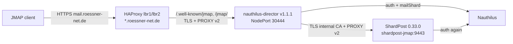

# JMAP through nauthilus-director on mail.roessner-net.de (stage 7)

Date: 2026-09-28. Status: live, healthy. JMAP clients use
`https://mail.roessner-net.de`, the name every mail client already uses
through automx; the test name `jmap.roessner-net.de` is gone.

## Path

1. **HAProxy (lbr1, lbr2):**
   - The 443 binds load the `*.roessner-net.de` wildcard next to `login.authserv.me`. SNI picks the wildcard for `mail.roessner-net.de`.
   - Host `mail.roessner-net.de` with `/.well-known/jmap` or `/jmap/` goes to `be_director_jmap`: kn1–kn3:30444, TLS verified, `send-proxy-v2 check-send-proxy`, `/director/healthz`, 30 min for the event source, and the same fail-over settings as before.
   - Other paths on that host keep their previous backend.
2. **nauthilus-director v1.1.1:**
   - Listener `jmap` on 18443 (Service NodePort 30444).
   - Every request is authenticated: Basic through Nauthilus with protocol `jmap`; Bearer through introspection with resource `https://mail.roessner-net.de/` and scope `mail:account:read`, followed by an identity lookup for `mailShard`.
   - Routing by `mailShard`; a missing shard is refused.
   - One backend connection per client connection, PROXY v2 with the client address.
   - `accept_local` admits HAProxy's PROXY LOCAL health checks.
3. **ShardPost:**
   - `jmap.public_base_url: https://mail.roessner-net.de`, so every session URL names the Director.
   - The JMAP listener uses the internal `shardpost-tls` certificate, like IMAP. Service `shardpost-jmap` is ClusterIP.
   - The network policy admits only the Director and the operator's test pods on 9443. PROXY is trusted from the pod network only.
   - The shard gate (`mailShard` = `shardpost`) stays as a second check.
4. **Nauthilus:**
   - `shardpost-introspection` owns the resource `https://mail.roessner-net.de/`.
   - The Director's JMAP listener introspects with the same client, because both form one resource server and an RFC 8707 resource has exactly one owner.
   - The secret reaches the Director through its `make sync-secrets`.

## Director release

**v1.1.0**, the JMAP proxy:
- Commits `bbd56bc`, `e28fb64`, `5d56189`, `c1e0a98`.
- Two independent reviews. No blocker; the Upgrade passthrough, the listener leak, request-hold heartbeats and docs were fixed before tagging.
- `make release-guardrails` green; GitHub release and production images built.

**v1.1.1**:
- `1d3e1c7`: a deterministic round-robin test, whose flakiness had failed CI.
- `2c9e0b1`: JMAP in the architecture, a new M9 spec, OpenAPI and FAQ.
- `ee758e2`: opt-in `proxy_protocol.accept_local`. HAProxy health checks send PROXY v2 LOCAL, which the listener had refused, so every server was down.

All workflows green, including unit tests on `main`.

## Cutover, in order

1. Director v1.1.0 rolled out with the JMAP listener (Basic only). Tested through a port-forward with a hand-written PROXY v2 header:
   - 401 without credentials and with a wrong password;
   - 404 outside the path list;
   - session and `Mailbox/get` worked;
   - Nauthilus logged the address from the header.
2. HAProxy route (`rns-server/services/haproxy/mail-jmap-route.py`, maintenance 395). Health checks failed ("Connection closed during SSL handshake", the refused PROXY LOCAL). `check-send-proxy` was added with `mail-jmap-check-proxy.py`, then the Director fix above.
3. Nauthilus configuration: resource `https://mail.roessner-net.de/` (nauthilus-tests `5ee61cc`).
   - Applied shadow first, then production, from a separate worktree of that commit, under maintenance 396.
   - That repository holds another session's prepared, not yet applied beta.18 upgrade. It stayed untouched, and production stayed on beta.17.
4. Director v1.1.1 with `accept_local` and Bearer: all three HAProxy servers UP (L7OK). Over `mail.roessner-net.de`, no credentials, a wrong password and a bogus Bearer token each answer 401.
5. ShardPost `public_base_url` switched; the complete acceptance ran through the Director (below).
6. Teardown of the test name:
   - ShardPost JMAP to the internal certificate and a ClusterIP Service. The Director backend verifies `shardpost.shardpost.svc.cluster.local` against `shardpost-ca`.
   - Let's Encrypt certificate `shardpost-jmap-tls` deleted.
   - HAProxy route and `be_shardpost_jmap` removed (`jmap-teardown.py`, maintenance 397).
   - DNS A/AAAA `jmap.roessner-net.de` deleted (ns1 and ns2 answer nothing).
   - Nauthilus resource `https://jmap.roessner-net.de/` removed (nauthilus-tests `bd716db`, shadow then production).
   - The owner removed the SAN `jmap.roessner-net.de` from the LBR certificate script. The certificate in service still carries it until its next issue; with no DNS and no route that is harmless.

## Acceptance through the Director

All against `JMAP_HOST=mail.roessner-net.de` (now the default of the scripts):

| Script | Result |
|---|---|
| `hack/jmap-acceptance.py` | sending delivered in ~10 s, Sent copy, `forbiddenFrom`/`forbiddenMailFrom` refused |
| `-stage6a.py` | Quota; exactly one vacation reply in ~10 s |
| `-stage6b.py` | Blob upload/get/lookup, SieveScript |
| `-stage6c.py` | IMAP-ACL sharing, rights, `Email/copy`, revocation |
| `-stage6c2.py` | principals, `shareWith`, notifications |
| `-stage6c3.py` | event source through the Director: new shared account pushed, hidden change not pushed, visible change in ~1 s, revocation pushed |

After the switch to the internal certificate, the session and `Mailbox/get` were checked again. A recorded send and receive is in
[JMAP by example](../jmap-examples.md). The aerc test configuration (`rbdpoc2`) points at `mail.roessner-net.de`.

After every step: pods ready, no restarts, no ERROR/WARN in ShardPost, the Director or Nauthilus. IMAP logins through `mail.roessner-net.de` kept working.

## Follow-up the same day: Director v1.1.2 and automx

**Bearer routing.** IMAP, POP3 and Sieve Bearer logins used to route only on the introspection claims. The token names the canonical account but carries no `mailShard`, so the Director fell back to the rendezvous hash across mailstack and shardpost.

In the 24 hours before the fix no Bearer login went through the Director; all 264 IMAP logins used passwords and routed by `mailShard`.

v1.1.2:
- looks up the token's account after introspection (`recipient_lookup`) and routes on the lookup's `mailShard`;
- a failed lookup is a tempfail;
- an account that differs from the token's is refused, on JMAP as well.

In Nauthilus, the Dovecot-group search now also matches `rnsMSDovecotUser`, the value of the `dovecot_account` claim (nauthilus-tests `caf7cca`).

**Token binding.** The IMAP listener accepted only tokens whose audience was Roundcube. Native clients register through DCR and have their own client id as the audience, and automx cannot make them request an RFC 8707 resource. So OAuth, which automx advertises, was unusable for them.

The owner decided to switch `imaps`, `sieve` and `jmap` to `token_binding: introspection_allowlist`:
- the IdP binds the token through the allowlist of `shardpost-introspection` (`roundcube-app`, DCR profile `mail-client-v1`);
- resources are recognised in `aud`, which is where Nauthilus puts them;
- the scope `mail:account:read` stays mandatory.

Two review rounds, no blocker. Before the tag, these were fixed:
- validation against the authority's own client;
- resource matching in `aud`;
- routing attributes taken only from the lookup;
- generic IMAP refusal text;
- the documented requirement that the introspection client has no interactive grants.

Postchecks after the rollout:
- IMAP and Sieve password logins OK;
- a bogus XOAUTH2 token got `NO [AUTHENTICATIONFAILED]`;
- a bogus JMAP Bearer got 401;
- JMAP sending and push through the Director green;
- HAProxy servers UP;
- `make test` and `make mail-flow` PASS.

**automx** offers JMAP for all 26 domains:
- `incomingServer type="jmap"` in Autoconfig and `protocols.jmap` in PACC, with the session URL and `OAuth2`/`password-cleartext`;
- the UAAC1 TXT records `_ua-auto-config.<domain>` were already stale for all 26 domains before the change, and were set to the new digest through the PowerDNS API;
- `automx dns check` passes 130 of 130 checks on ns1 and ns2.

Report: node1-maint `reports/2026-09-28-automx-jmap.md`.

## Open

- A real OAuth login with MFA (Thunderbird via DCR) over IMAP and JMAP, and Web Push to a real device, still need the owner.
